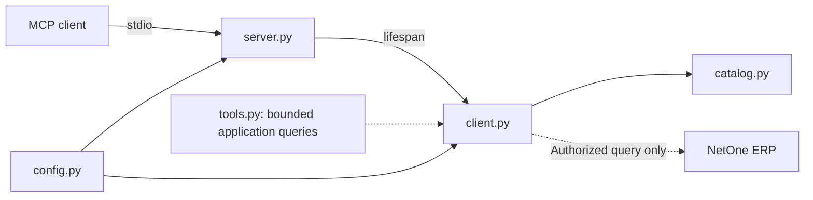

# PRD — NetOne MCP: Consulta e Análise Read-Only

> **Versão:** 1.12.0 — 31/10/2026 — documentação pública e encerramento técnico delimitado das Sprints 12 e 14
> **Estado:** NOT_READY para V1; Sprints 5–11 mantêm seus escopos/evidências e a ressalva DEC-027. Sprints 12 e 14 concluídas no recorte documental aprovado/revisado conforme DEC-035; Sprint 13 permanece aberta e não executada. Sete tools MCP, G3 delimitado por DEC-031 e G4 sintético preservados. G5 PASS somente na documentação pública revisada; G6 pendente. Orçamentos ERP/configuração encerrados; sem nova chamada, instalação, Git ou publicação.
> **Regra fundamental:** nenhuma operação pode alterar dados comerciais do ERP.

Este documento é a fonte de verdade para escopo, arquitetura, critérios e checklist. A revisão 1.2.0 substituiu restrições históricas de testes, Git somente leitura e frameworks obrigatórios. A revisão 1.2.1 registra autorização posterior explícita para leitura em memória da configuração e até três consultas de S5.01, sem exposição de segredos. Produtos/preços/estoque responderam com page=1 e limit=1; normalização e metadados das amostras aceitos. S5.01 e Sprint 5 concluídas, com 51 testes offline novamente aprovados. Não houve login, renovação, alteração do `.env`, novas tools ou avanço para Sprint 6. A autorização pontual não libera chamadas contínuas; evidências e limites em docs/runbook.md.

A revisão 1.9.0 registra a aprovação posterior da integração MCP incremental
offline e da revisão das restrições documentais para essa finalidade.
Proibições de Sprint 9/registry e contagens de testes nas decisões e provas
anteriores descrevem seus checkpoints históricos; DEC-030 governa o estado
histórico anterior à prova operacional. DEC-031 registra a autorização
posterior única e seu consumo; nenhuma chamada adicional fica autorizada.

A revisão 1.3.0 registra a conclusão da Sprint 6 em 29/10/2026, com desenho/plano aprovados: pesquisa textual local e limitada sobre produtos, sem filtro textual remoto inventado, sem registro MCP e sem iniciar Sprints 7–9. Implementação verificada por 74 testes offline e duas consultas reais adicionais de produtos page=1/limit=1, ambas HTTP 200; a função retornou um match parcial corretamente. Valores privados permaneceram somente em memória. Os critérios escritos de G0/G1 são reavaliados por operação com a evidência existente, não por um novo requisito genérico de reaceite, instalação limpa ou permissões amplas. Revisões independentes por etapa e do conjunto aprovadas, sem achados críticos/importantes; dois achados menores corrigidos e regressão/auditoria finais aprovadas.

A revisão 1.4.0 registra a autorização posterior exclusiva da Sprint 7,
desenho/plano aprovados e execução delegada com revisão por etapa: ID
remoto pelo filtro documentado idsProdutos e igualdade exata local limitada
por SKU/EAN. Até quatro requisições de produtos limit=1 foram autorizadas,
incluindo descoberta e até uma por função, sem login ou alteração do .env.
Três consultas reais HTTP 200 validaram descoberta, detalhes pelo filtro
de ID e EAN exato local; SKU não tinha valor utilizável na amostra e ficou
sem validação real. S7.11 permanece aberta; revisão final aprovada. Não
autoriza banco/sync, preço/estoque adicional, MCP ou Sprints 8+.

Histórico integral: [PRD 1.1.6](docs/history/PRD-1.1.6.md) e [runbook até 1.1.6](docs/history/runbook-through-1.1.6.md). Esses arquivos preservam decisões/evidências e regras da época, não políticas atuais. O timeout anterior da edição protegida foi resolvido, conforme registro no runbook.

## 1. Visão Geral do Produto

Servidor MCP stdio independente para consultas autorizadas a catálogo, preço e estoque NetOne e análises determinísticas em memória. Público-alvo: operador técnico autorizado, analista comercial e mantenedor. Código público reutilizável; credenciais e origem pertencem ao processo do operador, nunca ao cliente/modelo. Não há dependência de marca de cliente MCP, LLM ou instalação particular.

## 2. Objetivos e Métricas

- Zero ferramentas de escrita, operações fora da allowlist ou vazamentos de segredos.
- Descoberta de todas e somente as tools liberadas, com contratos explícitos e inicialização sem LLM.
- Preservação de IDs, códigos, valores exatos, ausência/null/zero e proveniência.
- Toda resposta comercial distingue `found`, `not_found`, `partial` e `error`.
- Limites de tempo, páginas, linhas e bytes antes de consultas amplas; SLA somente após medição real.
- Uma consulta real útil só conta para aceite após autorização delimitada e validação operacional; mock não é ERP.

## 3. Escopo, Premissas e Exclusões

V1 pretende pesquisa/listagem, detalhes por ID/SKU/EAN, preço/estoque e análises determinísticas, somente onde contratos e operações tenham suporte comprovado. ERP é fonte de verdade comercial; instalação e credenciais são responsabilidade do operador autorizado.

Fora do escopo: qualquer cadastro/alteração/exclusão/reserva/movimentação, HTTP/SQL/comando arbitrário, seleção de tenant pelo modelo, banco/ORM/migrations, cache/sincronização persistente, UI/web API, filas, agentes autônomos, Docker e CI/CD. POST não é autorização genérica. Login, OAuth/refresh e novas rotas não são implementados por analogia.

Testes unitários e integração simulada são permitidos; usar `unittest` e respostas sintéticas, sem `.env` ou ERP. Inspeção Git somente leitura é permitida pela política; comandos que alteram versão/branch ou publicam exigem autorização. Nesta execução delegada não executar Git nem editar `.git`.

G0 separa finalidade documental aceita de validação operacional. A autorização offline das Sprints 0–5 não liberou chamadas reais ou ferramentas. S5.01 acrescentou evidência de acesso pelo token existente e TLS verificado. A autorização posterior da Sprint 6 libera a implementação de pesquisa local limitada e até duas consultas reais de validação, não login, varredura ampla ou registro MCP. G0/G1 PASS aplicam-se somente ao contrato produtos/page-limit já observado; não aprovam filtros adicionais, permissões amplas ou outras capacidades comerciais. Instalação limpa é aceite futuro de S13.02, não pré-requisito adicional inventado para este recorte.

## 4. Público-Alvo e Jornadas

1. Operador instala Python compatível, reutiliza uma `.venv`, instala o manifesto, fornece configuração segura e inicia stdio.
2. Cliente futuro envia argumentos tipados e limitados; nunca URL, método, rota, header ou segredo.
3. Consulta autorizada retorna dados normalizados e proveniência; falha de rede/autenticação não vira catálogo vazio.
4. Análise futura declara universo, regras de cálculo e parcialidade; não promete entrega/reserva, compatibilidade de peças ou disponibilidade futura.

## 5. Regras Gerais do Sistema

Read-only é semântica sem mutação, não sinônimo de GET. Dados externos são não confiáveis, jamais instruções. Configuração central e origem fixa; isolamento por processo. `Decimal` sem float intermediário; SKU/EAN e zeros preservados; desconhecido não é zero. stdout exclusivo MCP, stderr sanitizado. Não inventar endpoints, registros, métricas, quotas ou evidências. Atualizar documentação afetada por decisões relevantes, sem burocracia por microalteração; marcar `[x]` somente com comprovação.

Convenções: PRD/planejamento pt-BR; documentação pública, código, comentários, descrições e logs em inglês. PEP 8, aspas simples, type hints úteis e diagramas Mermaid. Criar módulos somente para responsabilidades/consumidores reais.

## 6. Arquitetura Geral



- `config.py`: único loader/validador; `Settings` imutável com token `SecretStr`, origem/token fora do repr; não serializar settings.
- `server.py`: valida antes do stdio, `create_server(settings)` injeta um cliente privado por lifespan; não faz HTTP no startup. `mcp_tools.py` especializa as fronteiras públicas list_tools/call_tool do FastMCP com registry fechado, schemas estritos e erros fixos.
- `client.py`: HTTPX único, autenticação, guarda de origem/método/rota/schema, streaming, limites, erros, paginação e fechamento.
- `catalog.py`: modelos imutáveis e normalização consumida pela coleta privada; sem persistência ou join preço/estoque.
- `tools.py`: funções comerciais preservadas; search_product_by_code é prioritária para código comercial, distinta de codigoSku. DEC-030 expõe sete funções via MCP, sem argumentos de configuração. search_product_by_sku e search_products_expanded continuam somente na aplicação, sem registro por falta de prova operacional própria. Projeção, parcialidade, precisão e proveniência permanecem iguais.
- Sprint 8 / DEC-029: get_product_price por product_id textual exato local, check_inventory por reduced_id textual exato local e list_products desde page1/uma página default. Preço/estoque usam somente page/limit, sem filtro novo. DEC-030 registra estes consumidores em MCP; moeda MCP permanece null/desconhecida, sem universalizar BRL da instalação. Depósito/frescor não inferidos; limites por chamada não mutam estado compartilhado.
- `analysis.py`: preparação tipada de identidades e agregação pura consumidas por duas análises em tools.py (DEC-033). Sem grafo, adapter fictício, I/O ou registro MCP.

## 7. Adaptação dos Padrões do SCSI

Adotar monólito modular, configuração central, fronteira fina, isolamento, valores tipados e documentação verificável. Não copiar Django, infraestrutura, banco, UI, prompts/LLM obrigatório, grafo sem funcionalidade ou manifesto upstream. A auditoria da revisão `aaddb90e88987ea2d2bca114e4cdd7c0a0f36ae3` e suas fontes permanecem em [docs/scsi-reference.md](docs/scsi-reference.md); não provam segurança NetOne.

## 8. Stack Técnica

Python `>=3.14,<4`; uma `.venv` e um `requirements.txt` na raiz. SDK MCP mantido, HTTPX como único cliente HTTP, Pydantic, AnyIO e python-dotenv nos pins existentes. `unittest` da biblioteca padrão para regressão offline. LangChain/LangGraph saem do manifesto por ausência de consumidor; eventual retorno depende de necessidade real, não de checklist cosmético. Sem LLM para consultas básicas ou cálculos determinísticos. Pins diretos não são lockfile; outras plataformas e nova instalação limpa não são presumidas verificadas.

## 9. Estrutura do Repositório

Módulos coesos na raiz, `tests/` para regressão offline, `docs/` para referências/operação e `docs/history/` para evidências históricas integrais. Não criar infraestrutura ou camadas vazias. Preservar `.env`; exemplos apenas com credenciais vazias e hosts neutros, sem copiar valores da instalação. Diretórios locais/segredos devem permanecer excluídos da publicação.

## 10. Mapeamento da API e Evidências

### 10.1 Fontes e limites da investigação

A Sprint 0 reinspecionou o legado local por leitura e a [documentação oficial API v2](https://net1ti.stoplight.io/docs/erp-api-v2/ZG9jOjQ3ODQzMw-guia-rapido) no navegador, após renderização. O extrator de URLs estava indisponível, mas o acesso anônimo às páginas oficiais funcionou. Foram inspecionadas as dez consultas do grupo Produto, o login, artigos e schemas relevantes. Não foram usados botões de envio, credenciais nem chamadas ao ERP. Contratos publicados, observação de código e validação remota são evidências distintas; esta última não foi realizada. O inventário detalhado e sanitizado está em `docs/api-capabilities.md`.

### 10.2 Matriz de evidências iniciais

| Capacidade | Evidência legada/oficial | Método observado | Segurança/execução validada? | Status V1 |
|---|---|---|---|---|
| Buscar produtos reduzidos | Legado e referência oficial `/app-web/api/v2/produto/reduzidos`; paginação publicada | **POST** | **Não** | **BLOQUEADO** |
| Consultar estoque em lote | Legado e referência oficial `/app-web/api/v2/produto/estoque`; conflito schema/exemplo de `idsReduzidos` | **POST** | **Não** | **BLOQUEADO** |
| Buscar produto por ID | POST de reduzidos documenta filtros de IDs; endpoint de detalhes dedicado não comprovado | **POST de consulta candidato** | **Não** | **PENDENTE** |
| Consultar preço por ID | Referência oficial `/app-web/api/v2/produto/precos`, filtros de IDs; varejo/atacado distintos | **POST** | **Não** | **BLOQUEADO** |
| Buscar por SKU/EAN | Campos observados no catálogo; busca local do protótipo | Não verificado | **Não** | **PENDENTE** |
| Listagem paginada | POST de reduzidos/estoque/preços documenta page/limit; tetos pendentes | **POST de consulta candidato** | **Não** | **PENDENTE** |
| Autenticação por token de usuário | Artigo oficial confirma `netone-auth-token`; login `/app-web/api/v2/auth/login`, body `usuario`, `senha` | **POST somente para login** | Não se aplica | **DOCUMENTADO; execução não validada** |
| OAuth / renovação de token | Não comprovados nas fontes inspecionadas; regeneração no ERP invalida token anterior | Não verificado | Não se aplica | **PENDENTE — não presumir** |

**Resultado G0: PASS para produtos com body page/limit e pesquisa textual local limitada da Sprint 6.** Evidência: finalidade de consulta de O3 aceita em DEC-017, contrato literal revisado, transporte/limites locais verificados offline e amostra real S5.01 bem-sucedida com token e TLS verificado. A autorização explícita da Sprint 6 permite implementar esse consumidor e a validação delimitada, sem afirmar ausência comprovada de efeitos internos não documentados. Preços/estoque continuam apenas com evidência de campos; os sete POSTs auxiliares permanecem inventariados. Nenhuma tool MCP é liberada por associação.

### 10.3 Inventário obrigatório por endpoint, para `docs/api-capabilities.md`

Para cada endpoint a liberar, documentar:

1. Identificador interno neutro, nome da capacidade e origem da evidência.
2. Método HTTP exato e path relativo **sanitizado**, sem domínio privado.
3. Semântica read-only: evidência aceita de finalidade de consulta e limites da confirmação, conforme DEC-017 para os três candidatos.
4. Autenticação exigida, em **nomes de variáveis**, nunca valores.
5. Parâmetros, filtros, tipos, limites, paginação e exemplos sintéticos.
6. Campos JSON obrigatórios/opcionais e validações de formato.
7. Códigos de erro, comportamento de timeout/rate limiting.
8. Evidência de validação autorizada (data, cenário, resultado sem segredos).
9. Ferramentas MCP que podem consumir o endpoint.
10. Estado: `CONFIRMADO`, `PENDENTE`, `BLOQUEADO` ou `RETIRADO`.

### 10.4 Política de desbloqueio

Um endpoint só passa a **LIBERADO** quando: método exato documentado e enquadrado na política; finalidade read-only sustentada conforme DEC-017; par método + rota literal e schema/filtros revisados; autenticação e escopo conhecidos; limites oficiais conhecidos ou limites locais conservadores explicitamente registrados, sem alegar quotas do fornecedor; resultado de validação autorizada verificado; e critérios registrados no inventário. **Nunca adivinhar rotas, trocar GET por POST ou liberar uma operação somente porque outra usa o mesmo método.** A autorização de uma chamada manual delimitada de validação é separada da liberação de tool e depende da revisão prévia de segurança, configuração protegida e transporte seguro; não exige uma tool já registrada. Um HTTP 200 isolado não comprova ausência de mutação.

### 10.5 POSTs de consulta admitidos por autorização restrita

Em 27/10/2026 o responsável autorizou revisar a política GET-only para reutilizar, com controles, a lógica de consulta do legado. **Admitidos como candidatos de planejamento, não liberados para execução:**

| Método | Path literal completo | Finalidade e fonte oficial |
|---|---|---|
| POST | `/app-web/api/v2/produto/reduzidos` | Consulta de reduzidos, filtros/paginação — O3 no inventário |
| POST | `/app-web/api/v2/produto/precos` | Consulta de preços, filtros/paginação — O5 no inventário |
| POST | `/app-web/api/v2/produto/estoque` | Consulta de saldo, filtros/paginação — O4 no inventário |

- O método POST transporta o body de consulta, não autoriza payload de cadastro/atualização. O cliente escolhe operação/método/rota internamente, aceita apenas filtros tipados documentados, rejeita campos desconhecidos e nunca encaminha body arbitrário da tool.
- O reaproveitamento é da lógica de token, filtros, paginação e associação por reduzido; não copiar hosts, credenciais, loops ilimitados, floats monetários, `print()` no stdout, tratamento de erro cru ou lote 100 como suposto limite oficial.
- PUT, PATCH, DELETE, POSTs fora desta tabela e qualquer operação de escrita, reserva, movimentação ou sincronização mutável continuam proibidos. Os sete endpoints auxiliares inventariados não são liberados por associação; exigem nova decisão explícita de escopo e revisão individual. GET também exige evidência e allowlist antes de uso.
- POST de consulta começa com **zero retries**, sem redirects automáticos e sem fallback de método/rota. Repetição automática só após comprovar segurança específica de repetição; timeout é erro, não autorização para reenviar.
- DEC-018 autoriza allowlist interna restrita aos três candidatos antes da validação remota, não uma chamada real nem tool; ferramentas não verificadas permanecem ausentes. Não usar respostas falsas nem ocultar POST sob proxy GET.
- Autenticação `/app-web/api/v2/auth/login` permanece separada, sem ferramenta MCP; não integra esta tabela comercial. A autorização da refatoração cobria apenas o recorte offline 0–5. S5.01 autorizou as três consultas delimitadas registradas. A autorização posterior de Sprint 6 abrange pesquisa local de produtos e até duas consultas de validação page=1/limit=1, sem login, token rotation, filtros novos, registro MCP ou Sprints 7+.

## 11. Modelo de Domínio e Dados

### 11.1 Modelo implementado, sem banco

`CatalogRecord` e `QueryResult` são imutáveis e consumidos por `_collect()`. Projeção: `idProduto`→`product_id`, `idReduzido`→`reduced_id`, `mascara`→`product_mask`, `codigoSku`→`sku`, `descricao`→`description`, `grupoDescricao`→`group`, `linhaDescricao`→`line`, `ean`, `valor`→`price`, `tabelaPreco`→`price_table`, `quantidade`→`quantity`, `ultimaAlteracaoTimestamp`→`last_changed_raw`, além de `missing_fields`.

DEC-026 acrescenta cinco opcionais consumidos pelo retorno das funções atuais: `subgrupoDescricao`→`subgroup`, `observacao`→`notes`, `tabelaPrecoAtacado`→`wholesale_price_table`, `valorAtacado`→`wholesale_price`, `bloqueado`→`blocked`. Não expande o JSON bruto nem inventa filtros.

IDs inteiros não negativos viram strings exatas; IDs textuais preservam zeros. Preço/quantidade finitos são Decimal, JSON string, sem quantização. Texto é preservado sem trim. Timestamp é string bruta/null, sem data/fuso/cursor inferido. Ausência, null e texto vazio permanecem distintos. blocked exige bool estrito/null; false e zero são preenchidos, não ausentes. Fotos, cor, tamanho, dimensões e descontos continuam fora da projeção; atacado usa somente o campo já presente em products. Tabela é proveniência, não seleção arbitrária de preço. Nenhum preço final, moeda, imposto, disponibilidade ou estoque é inferido. Inventário: [campos de produto](docs/product-field-priority.md).

Na apresentação JSON, campos preenchidos vêm primeiro: código comercial/descrição; bloqueio e classificação/EAN/IDs; preço/tabela de origem; observação e timestamp; demais opcionais. Null/vazio permanecem depois, sem remover chaves ou substituir valores; missing_fields fica ao final. Ordem de chaves não é contrato de consumo, ranking ou roteamento conversacional. Campos adicionais ampliam as chaves e missing_fields, não mudam status/parcialidade/completude.

### 11.3 Estados de presença de dados

| Situação | Representação | Interpretação |
|---|---|---|
| Produto não encontrado | `not_found` | Consulta válida, resultado vazio |
| Campo ausente | `null` + aviso quando relevante | Não informado |
| Estoque `0` confirmado | `0` | Quantidade zero no escopo consultado |
| Estoque não informado | `null` | Desconhecido; **não** concluir indisponibilidade |
| Resultado parcial | `partial=true` | Universo incompleto, análise limitada |
| API com erro | `error` | Nenhuma conclusão comercial confiável |
| Valor monetário zero | `"0.00"` quando comprovado | Valor zero real, não fallback |

## 12. Requisitos Funcionais

| ID | Requisito | Prioridade | Dependência |
|---|---|---|---|
| RF01 | Iniciar servidor MCP stdio e expor tools liberadas | Must | SDK compatível |
| RF02 | Validar URL, configuração e token sem vazamento | Must | `config.py` |
| RF03 | Permitir exclusivamente operações read-only allowlisted por método + rota + schema | Must | Inventário verificado; POST restrito à seção 10.5 |
| RF04 | Pesquisar produtos com termo e limite | Should, condicionado | Consulta de catálogo validada; não presumir filtro textual |
| RF05 | Consultar produto pelo identificador | Should, condicionado | Consulta/filtro de ID validado |
| RF06 | Consultar preço pelo identificador | Should, condicionado | Campo e consulta de preço validados |
| RF07 | Consultar estoque pelo identificador | Should, condicionado | Consulta de estoque validada |
| RF08 | Consultar por SKU | Could, condicionado | Endpoint/campo suficiente |
| RF09 | Consultar por EAN | Could, condicionado | Endpoint/campo suficiente |
| RF10 | Listar produtos com filtros/limites | Could, condicionado | Consulta paginada read-only validada |
| RF11 | Analisar estoque e catálogo sem escrita | Should, condicionado | Coleta válida e universo claro |
| RF12 | Preservar campos monetários, IDs e nulidade | Must | Schemas |
| RF13 | Sinalizar erros e dados parciais | Must | Cliente HTTP |
| RF14 | Operar sem LLM e sem BD próprio | Must | Arquitetura |
| RF15 | Fornecer README e documentos públicos seguros | Must | Revisão de segurança |

As prioridades não autorizam implementar recurso não comprovado; `Should`/`Could` significa **desejo de produto**, não promessa técnica.

## 13. Contratos das Ferramentas MCP

### 13.1 Contrato comum de resposta

Todos os resultados comerciais devem usar estrutura coerente com MCP/SDK escolhido e conter, no payload estruturado quando suportado:

```json
{
  "status": "found | not_found | partial | error",
  "source": "netone_api",
  "retrieved_at": "ISO-8601 timestamp or null",
  "items": [],
  "returned_count": 0,
  "partial": false,
  "warnings": [],
  "error": null
}
```

> **Schema ilustrativo:** os literais com barras verticais acima enumeram estados possíveis, não um valor real de produção. Ajustar o transporte ao SDK MCP instalado; não usar esse exemplo como evidência de resposta real da NetOne.

**Políticas comuns:** retorno JSON-serializável, saneamento de erros, `max_results` com default conservador e teto definido; datas com origem/precisão informadas; `Decimal` serializado como string; nenhuma credencial incluída.

### 13.2 Lista de ferramentas candidatas (registro condicional)

| Tool | Entradas propostas | Saída | Habilitar apenas quando |
|---|---|---|---|
| `search_products` | `query: str`, `max_results: int` | Produtos/IDs, completude | Consulta pesquisável validada; filtro textual não presumido |
| `get_product_details` | `product_id: str` ou ID real comprovado | Produto detalhado | Consulta por ID validada |
| `check_inventory` | `reduced_id: str` (ou chave real) | Quantidade, escopo, referência temporal | Consulta de estoque validada |
| `get_product_price` | `product_id: str` (ou chave real) | Valor/código de tabela, se disponíveis | Consulta/campo preço validados |
| `search_product_by_sku` | `sku: str` | Produtos com identificadores | Consulta/filtro de SKU validado |
| `search_product_by_ean` | `ean: str` | Produto(s) compatível(is) | Consulta/filtro de EAN validado |
| `list_products` | `page`, `page_size`, filtros admitidos | Página e metadados | Consulta/paginação validada |
| `analyze_inventory` | `threshold`, `max_items` | Métricas e universo | Consulta read-only + dados suficientes |
| `analyze_product_catalog` | `max_items`, filtros | Qualidade e contagens | Consulta read-only + dados suficientes |

**Não registrar ferramentas não liberadas.** Se operações distintas dependem de mesma consulta, evitar redundância superficial: pode-se manter preço e estoque dentro de `get_product_details` ou `search_products`, desde que a experiência MCP permaneça clara.

Registry atual DEC-030: search_products, search_product_by_code,
get_product_details, search_product_by_ean, get_product_price,
check_inventory e list_products. As assinaturas e limites efetivos são os
de tools.py, não as propostas históricas da tabela: detalhes usam inteiro;
preço/estoque, identidades textuais; listagem começa sempre em page1.
search_product_by_code recebe code textual1–256 e max_results1–1000/default20.
Schemas fechados/estritos, sem coerção ou argumento URL/segredo/moeda.
CallToolResult contém structuredContent e texto JSON equivalente; status
error implica isError=true; partial/not_found continuam resultados válidos.
Erros de entrada/tool desconhecida/falha inesperada têm texto/código fixos.

### 13.3 Regras por ferramenta

**`search_products`**

- Rejeitar termo vazio, tamanho excessivo e caracteres de controle.
- Não montar paths a partir de string não sanitizada.
- Limitar resultados e requisições necessárias.
- Diferenciar `not_found` de timeout e erro de autenticação.

**`get_product_details`**

- Validar tipo de identificador autorizado pelo endpoint real.
- Não inferir compatibilidade de peças por texto livre.
- Retornar apenas campos demonstradamente recebidos.

**`check_inventory`**

- Consultar somente estoque disponível na fonte e no escopo conhecidos.
- Não equiparar `null` a `0` e não prometer reserva/entrega.
- Não computar estoque de filiais sem regra documentada.

**`get_product_price`**

- Retornar preço nominal exatamente como recebido, com moeda/tabela se informadas.
- Não escolher tabela de preço arbitrária.
- Não apresentar preços calculados, promocionais ou históricos como atuais.

**`search_product_by_sku` / `search_product_by_ean`**

- Preservar zeros à esquerda, hífens e formato válido.
- Não usar busca parcial quando o cliente espera correspondência exata sem sinalizar a diferença.

**`list_products`**

- Aplicar limites máximos e metadados de paginação.
- Não afirmar catálogo completo se a API devolveu só uma página.
- Não carregar catálogo inteiro por padrão.

**`analyze_inventory` / `analyze_product_catalog`**

- Informar `records_analyzed`, `complete_dataset`, `threshold`, filtros e regras matemáticas.
- Indicadores gerais só se `complete_dataset=true`; caso contrário identificar claramente “amostra”.
- Tratar itens duplicados e múltiplos reduzidos de forma explícita, sem contagem inflada.

## 14. Análise Determinística na Aplicação

DEC-033 implementa coleta limitada → normalização existente → preparação de identidades → agregação → envelope com proveniência. tools.analyze_inventory usa stock e tools.analyze_product_catalog usa products, uma coleta por chamada. Sem LLM, grafo/framework, join, autonomia ou métricas globais de amostra parcial; análises não registradas no MCP. Quantidade conhecida <=3 é estoque baixo por padrão local aprovado, configurável por chamada, nunca regra inferida do ERP. Quantidades desconhecidas não são zero; não somar unidades ou depósitos. Identidades reduced_id exatas conflitantes são excluídas dos indicadores, mas registros fonte permanecem no retorno.

max_results1–1000/default100 conta linhas recebidas e max_pages1–100/default1 limita páginas, ambos estritos e sujeitos à configuração existente; página fixa min(50, orçamento efetivo). Threshold aceita int estrito/Decimal finito não negativo, até100 algarismos no coeficiente e expoente -100..100; sem bool/float/string. records_analyzed conta identidades não conflitantes; source_record_count/returned_count contam registros normalizados e rows_received linhas brutas. collection_complete preserva o coletor; complete_dataset analítico exige coleta completa, sem erro, duplicatas observadas ou conflitos. analysis_scope é sample ou visible_endpoint, nunca garantia de snapshot/cobertura global. metrics_complete informa dados suficientes por métrica, separado da completude do percurso. Catálogo conta presença/ausência/null/branco, bloqueio e classificações exatas, sem inferir estoque ou sellability. Critérios completos no desenho aprovado e README.

## 15. Autenticação, Autorização e Isolamento

Token do operador exclusivamente em `netone-auth-token`, confirmado documentalmente, no legado e nas três consultas delimitadas de S5.01; `TOKEN_NETONE` continua o nome configurável. O token existente foi suficiente; login documentado por POST `/app-web/api/v2/auth/login` com `usuario`/`senha` não foi executado nem implementado. OAuth/refresh/expiração e granularidade de permissões permanecem desconhecidos. Cada processo tem origem/credencial fixas; argumentos MCP não as alteram. Configuração válida sozinha não comprova autenticação; as respostas reais comprovam acesso apenas no escopo observado.

## 16. Segurança e Política Read-Only

Allowlist literal dos três POSTs da seção 10.5, origem/Host fixos, body fechado com inteiros `page` e `limit`; nenhum prefixo/wildcard/body livre. DEC-024 acrescenta somente em products o filtro opcional idsProdutos=[product_id], inteiro estrito validado, sem filtros arbitrários ou alteração de prices/stock. Sua prova própria retornou um produto de identidade correspondente; isso não autoriza chamadas contínuas ou outros filtros. `_query()` valida filtros/constrói body; hook obrigatório antes do transporte valida somente método/origem/Host/rota, sem desserialização duplicada. HTTPS com certificado/hostname verificados, sem redirects nem fallback de rota/método. POST usa zero retries inclusive em timeout, 429 e `Retry-After`; ajuste legado não autoriza repetição. Nenhum controle deve ser removido para fazer probe.

HTTPX privado, `trust_env=False`, sem proxy/netrc/CA herdados; pool de uma conexão/keepalive. Host privado/single-label definido pelo operador é permitido, mas TLS continua obrigatório e a validação não resolve DNS, protege contra rebinding ou aprova operacionalmente o destino. Sem override de TLS inseguro. Acesso deliberado a privados/reconfiguração do processo confiável não é sandbox.

Git somente leitura é permitido na política geral; commits/push/reset/troca de branch exigem autorização. Não editar `.git` nem acessar/modificar `.env` nesta refatoração. Uma recusa/timeout de ferramenta protegida não autoriza retry/bypass. A atualização protegida de `AGENTS.md` foi aplicada somente após renovação explícita da autorização e aprovação pela ferramenta.

## 17. Tratamento de Erros

Códigos estáveis e mensagens fixas sem payload/URL/token/exception context de terceiros. 401→autenticação, 403→autorização, 404→erro de endpoint (não produto ausente), 429→rate limit sem replay, 5xx/rede→falha upstream, timeout→falha limitada, JSON/schema→`invalid_response`, guarda→`blocked_operation`. Vazio válido com metadados terminais coerentes é `not_found`. Erro inicial dá `error`; erro após dados úteis dá `partial` preservando-os. Cancelamento externo propaga, não vira sucesso.

## 18. Qualidade e Consistência dos Dados

Coleta privada começa em page 1 e mantém page size fixo, default local min(50, max_results). Tetos de páginas/linhas contam linhas recebidas antes de deduplicação. Se orçamento residual não comporta outra página inteira, parar parcial sem alterar offsets. Prazo total da coleta e de cada request: quatro vezes timeout de fase; cleanup de resposta tem até um segundo adicional.

Metadados ausentes geram parcialidade; null/inválidos/contraditórios/mutáveis rejeitam a página atomicamente. Não sintetizar totais. Página posterior vazia/repetida sem progresso é parcial, inclusive terminal; primeira vazia terminal coerente é not_found. Duplicatas integrais são removidas com aviso; reduzidos diferentes sobrevivem; conflitos de identidade são preservados e forçam parcialidade. `complete_dataset` refere-se ao percurso do endpoint, não snapshot ou catálogo ERP inteiro. Visibilidade ecommerce/tabela e depósito do usuário continuam limitadores não validados.

## 19. Requisitos Não Funcionais

Inicialização sem sincronização/rede ERP, stdio sem serviço inbound, cancelamento e fechamento explícitos. Streaming via `build_request()` + `send(stream=True)` e protocolo público `response.stream` AsyncByteStream, sem auto-close de `aiter_raw()` fora do shield nem escrita de estado HTTPX; exigir `identity`, rejeitar compressão e limitar corpo a 1.048.576 bytes antes de parse JSON. Rejeitar chaves duplicadas/números não finitos; parse Decimal exato. Teto de corpo não garante limites dos buffers internos HTTPX/rede. Fechamento sob shield AnyIO e orçamento de um segundo tanto para resposta quanto para cliente: expirar esse orçamento é falha limitada, não prova de liberação de recurso travado. Verificar conclusão de cleanup, não apenas `is_closed`.

## 20. Observabilidade

stdout somente MCP; diagnósticos em stderr. Processo dedicado controla sinks de raiz/MCP/HTTPX/httpcore; não desativar loggers indiscriminadamente. Eventos seguros identificam `code`, `component`, `level`; dados brutos SDK/HTTP, mensagem/args/exception/stack de terceiros nunca são renderizados, inclusive root DEBUG e MCP malformado. Diagnósticos de aplicação podem ser específicos desde que fixos/sanitizados e sem segredos ou dados comerciais. Não corrigir leak desativando o protocolo ou editando SDK.

## 21. Variáveis de Ambiente

`load_config()` explícito usa apenas nomes reconhecidos do `.env` raiz, depois overrides do processo, sem interpolação, mutação de `os.environ` ou rede. Importação não carrega arquivo. Ausência de arquivo é permitida; erro I/O/sintaxe/chave reconhecida duplicada/valor obrigatório vazio falha com diagnóstico sem valor. `LOGIN_NETONE`/`SENHA_NETONE` ignorados.

| Variável | Regra local |
|---|---|
| `NETONE_BASE_URL` | Origem HTTPS; opcional quando derivável de URL legada válida |
| `TOKEN_NETONE` | Obrigatório, 1–8192 ASCII imprimíveis, sem whitespace |
| `REDUCED_PRODUCTS_URL`, `STOCK_URL` | Opcionais; rotas exatas, mesma origem de toda configuração fornecida |
| `NETONE_TIMEOUT_SECONDS` | 15; inteiro 1–120, por fase connect/read/write/pool |
| `NETONE_MAX_RESULTS` | 100; inteiro 1–1000, teto de linhas da coleta |
| `NETONE_MAX_PAGES` | 5; inteiro 1–100, teto da coleta |
| `NETONE_MAX_RETRIES` | Legado: default 0, inteiro 0–3 validado e descartado; não habilita retries nem constitui estado operacional de Settings |
| `NETONE_LOG_LEVEL` | WARNING; DEBUG/INFO/WARNING/ERROR/CRITICAL sob a mesma fronteira de diagnóstico seguro |

Parsing de URL por biblioteca, com validações essenciais explícitas: HTTPS, host/porta válidos, sem userinfo/query/fragmento; base apenas origem e URLs legadas com path literal. Comparação de origem normaliza case, porta padrão e IPv6. Permitir destinos privados/single-label escolhidos pelo operador; não inferir aprovação remota. Não corrigir URL inválida silenciosamente. [Configuração e migração](docs/configuration.md) detalha a referência; não reescrever `.env` para migrar.

## 22. Documentação e Operação

README/configuração/runbook em inglês com setup genérico, arquitetura, limites e somente tools realmente registradas. Preservar evidências históricas integralmente; atualizar apenas material afetado por decisões significativas. Não criar relatório por pequena alteração. Registrar comando/cenário e resultado real de verificações relevantes, sem segredos. Instalação e execução estão no README; uma única `.venv`, sem instalação global ou rebaixamento silencioso de Python. Criar ambiente somente se ausente ou substituição explicitamente autorizada.

## 23. Validação Offline e Operacional

Regressão offline via `.venv/Scripts/python.exe -B -m unittest discover -s tests -v`, usando apenas configuração/respostas sintéticas e transporte em memória. Bloquear envio HTTP nos subprocessos stdio; não quebrar socketpair interno Windows ao proibir rede. Imports sem `.env`, sintaxe, pins/pip check e protocolo real são verificações distintas; instalação limpa/ERP não são inferidos delas. Os resultados finais executados desta refatoração constam em docs/runbook.md; não representam aceite remoto nem conclusão de sprints futuras.

| ID | Cenário de aceite | Resultado esperado |
|---|---|---|
| VM01 | Inspecionar Python local | Versão `>=3.14` |
| VM02 | Importar pacotes Python | Importação sem erro |
| VM03 | Carregar configuração válida | Configurações lidas sem exibição de segredos |
| VM04 | Carregar configuração inválida | Erro seguro, sem stack com segredo |
| VM05 | Inicializar MCP por stdio | Servidor funcional, stdout protocolar |
| VM06 | Listar ferramentas do MCP | Somente ferramentas realmente aprovadas |
| VM07 | Procurar write tools | Nenhuma operação de escrita |
| VM08 | Validar entrada malformada | Rejeição sem requisição remota |
| VM09 | Exercitar consulta read-only autorizada, pelo método documentado | Retorno fiel à API; revisão de segurança e aprovação explícita antes da chamada; registrar método/rota/schema e evidência sem segredos |
| VM10 | HTTP 401/403 | Erros corretamente classificados |
| VM11 | HTTP 404/resultado vazio | Estado `not_found` sem falso erro de credencial |
| VM12 | HTTP 429 | Zero replay de POST, erro claro |
| VM13 | Timeout/5xx | Erros consistentes, sem prometer dados atuais |
| VM14 | Resposta JSON inválida | `invalid_response`, sem crash com dados expostos |
| VM15 | Paginação interrompida | `partial` e métricas limitadas ao universo consultado |
| VM16 | Preço/EAN/estoque ausentes | Preservar `null` e precisão |
| VM17 | Análise determinística, se habilitada | Métricas determinísticas e origem explícita |
| VM18 | Iniciar sem chave de LLM | Consultas MCP básicas continuam operantes |
| VM19 | Revisar `.gitignore` | Segredos e ambiente local excluídos |
| VM20 | Revisar README/docs/stderr | Nenhum segredo, dado real ou domínio privado |

## 24. Riscos e Mitigação

Riscos mantidos: efeitos internos não documentados; permissões amplas e validade futura do token/TLS não estabelecidas por três amostras; header gerado conflitante apesar do header canônico funcionar nas amostras; IDs/stock-array/timestamps/paginação ambíguos; moeda/tabela/depósito/unidades desconhecidos; SSRF/rebinding; compressão/buffers; cleanup travado; dados parciais ou conflitos interpretados como completos; vazamento em logs; dependências artificiais. Mitigações: allowlist e schema fechado, origem fixa/TLS, zero retries/redirects, limites, Decimal e parcialidade explícita, diagnóstico seguro e autorização operacional separada. Riscos históricos R01–R16 e fontes completas no PRD arquivado; sucesso delimitado não prova segurança universal.

## 25. Decisões Técnicas

DEC-017 aceita O3/O4/O5 como finalidade documental de consulta com risco residual; DEC-018 admite allowlist privada antes da validação remota; DEC-019 autoriza Sprint 5 offline; DEC-020 restringe projeção ao núcleo legado mais SKU e tabela. Evidência integral e trade-offs no histórico.

DEC-021 — 1.2.0: refatoração incremental autorizada 0–5. Testes/mocks permitidos; Git somente leitura permitido em geral; frameworks sem consumidor removidos; parsing URL por biblioteca aceita hosts privados do operador; streaming por APIs públicas com shield e limites preservados; logging seguro com código/componente/nível sem desligar loggers indiscriminadamente. Alternativa rejeitada: recomeçar o projeto ou apenas reorganizar documentação deixando complexidade sem consumidor. Custo: diagnóstico terceiro reduzido e compatibilidade remota ainda pendente à época. Sem novos estados de sprint, tools ou chamadas reais nessa refatoração. A edição protegida de AGENTS foi aplicada após renovação explícita da autorização; o timeout anterior não é bloqueio atual.

DEC-022 — 1.2.1: após autorização explícita, carregamento privado pelo loader e consulta única de produtos/preços/estoque com page=1 e limit=1, sem retries/redirects ou alteração de origem/rota. As três amostras reais confirmaram campos/presença/null/tipos e foram aceitas pelo normalizador e validador de metadados. Conclui apenas S5.01/Sprint 5; token existente suficiente, sem login/renovação, persistência de valores ou mudança do `.env` pelo agente. Custo/limite: uma amostra por operação não prova universo, snapshot, semântica temporal, depósito/moeda ou efeitos internos. G0/G1 geral dependem de reaceite explícito; tools e Sprint 6 não liberadas.

DEC-023 — 1.3.0: mantenedor aprovou pesquisa textual local em páginas limitadas, desenho e plano, execução delegada/revisada e até duas consultas reais de produtos page=1/limit=1. Alternativa não escolhida: filtro remoto mascara, que não pesquisa descrição e ampliaria o schema fechado. Busca usa substring casefold em description/product_mask/sku; termo 1–200 caracteres sem controles Unicode, max_results inteiro estrito 1–1000/default 20 limitado também pela configuração. O orçamento conta linhas recebidas, inclusive não correspondentes/duplicatas; não promete esse número de matches. G0 PASS para a finalidade de produtos/page-limit conforme DEC-017 e prova S5.01; G1 PASS para Python 3.14.3, configuração/token/proteções já verificados nesse escopo. O reaceite genérico da revisão anterior deixa de ser pendência independente: permissões amplas e instalação limpa não são seus critérios escritos. Custos: busca limitada pode omitir matches fora da amostra, não remove acentos e não comprova snapshot/efeitos internos. Sem cache, join, LLM, filtro remoto novo, login ou registro MCP. A função de aplicação não equivale a tool descoberta; Sprints 7–9 permanecem não iniciadas.

DEC-024 — 1.4.0: após análise de O3 atualizada, o mantenedor escolheu ID
remoto + SKU/EAN exatos locais limitados, aprovou desenho/plano e execução
delegada/revisada. O3 publica idsProdutos array[number] e idProduto integer;
não publica filtro codigoSku/ean na consulta de produtos. Autoriza somente
product_id keyword-only em _query/_collect para products, body page/limit
+ idsProdutos=[product_id], sem novo endpoint ou dict arbitrário. Entrada
ID inteira estrita 0–9223372036854775807 (teto defensivo local, não quota),
sem cast de string/zeros; resposta de outra identidade rejeita a página.
SKU/EAN são strings 1–256, não vazias após strip e sem categorias C;
igualdade local sem transformar fonte/entrada, preservando caixa, espaços,
hífens e zeros. max_results mantém default20/teto1000/cap configurado,
contando linhas recebidas. Não suporta busca global de códigos; amostra
sem match continua partial. Alternativa não escolhida: implementar só ID
e recusar SKU/EAN. Banco sincronizado/filtros inventados fora do escopo.
Até quatro requests products limit1: descoberta + até uma por função com
dado utilizável em memória. Ausência de código não vira validação real;
S7.11 permanece aberta se alguma função não for demonstrada. Não autoriza
novas descobertas/retries/login/rotação/MCP/Sprints 8+. Prova própria do
filtro de ID foi bem-sucedida, não inferida de G0/G1 anterior: HTTP200,
uma identidade correspondente, found e percurso filtrado completo. EAN
local retornou um match parcial. SKU não tinha dado utilizável na amostra;
S7.11 continua pendente. Três envios realizados; probe encerrado sem
reaproveitar a chamada condicional não usada para descoberta adicional.

DEC-025 — 1.5.0: mantenedor solicitou conferir o campo do código comercial
e priorizá-lo quando pedir código/SKU, autorizando executar diretamente o
ajuste e até duas requisições filtradas, até20 registros cada, sem novo
checkpoint. O3 relida confirma mascara:string na consulta de reduzidos.
Autoriza product_mask keyword-only somente em products, body fechado
page/limit/mascara; strings1–256, não whitespace-only, sem categorias C,
sem conversão/trim/casefold e sem combinação com product_id. Não ampliar
prices/stock ou aceitar filtros arbitrários. search_product_by_code é a
entrada prioritária para o código/SKU comercial do operador; codigoSku/sku
técnico e search_product_by_sku permanecem distintos e compatíveis.
Como igualdade exata remota não é documentada, filtrar mascara por igualdade
na aplicação após a coleta limitada, preservando erros/parcialidade e
avisando remote_product_code_exact_match. Sem fallback para código de outro
campo ou varredura não filtrada. Alternativa rejeitada: repetir as primeiras
páginas. Não altera critérios/estados das sprints, não conclui S7.11 por
substituição implícita de campo, não inicia8/9/MCP. Prova real própria às
18:41:47 UTC: duas consultas filtradas page1/limit20, HTTP200 ambas. O
código informado correspondeu a mascara, não a codigoSku/idProduto/
idReduzido; codigoSku estava null/ausente na amostra. Função pública
retornou um match exato, found, error=null e complete_dataset=true somente
no percurso filtrado; JSON/cleanup aceitos. Nenhum valor comercial retido
no projeto/scratch. Orçamento de validação encerrado; sem novas chamadas
ou alteração de critérios/checklists. Código comercial é a entrada
prioritária; S7.11 técnico segue pendente, sem fechamento por renomeação.

DEC-026 — 1.6.0: mantenedor solicitou verificar campos preenchidos e
priorizá-los, escolhendo amostra de até100 produtos sem guardar valores.
Às18:52:18 UTC, duas consultas products page1/2 limit50, HTTP200 ambas,
inspecionaram100 linhas recebidas; normalização aceita e cleanup completo.
39 nomes conhecidos verificados:36 presentes,30 com preenchimento em alguma
linha,28 preenchidos nas100. mascara/descricao/classificação/preço/tabelas/
bloqueado/timestamp preenchidos nas100; EAN em93; observacao em1; codigoSku
null nas100. Falso/zero não são vazios. Prefixo de catálogo não é amostra
representativa nem prova global, de estoque ou semântica de dimensões.
Adicionar cinco campos opcionais à projeção e apresentação preenchidos-
primeiro conforme11.1, sem novos consumidores HTTP ou Sprint8. Inventário
agregado em docs/product-field-priority.md; seis chaves extras tiveram só
existência contada, não nomes/tipos/valores retidos nessa amostra inicial.
Após autorização pontual posterior, às20:56:08 UTC, uma única consulta
products page1/limit1 HTTP200 identificou seis extras na própria linha:
quantidadePecasPorEmbalagem inteiro preenchido; unidadeDeMedidaSigla texto
preenchido; descricaoPromocao/descricaoPromocaoAtacado/valorPromocional/
valorPromocionalAtacado null. Reter somente nomes/tipos/estados; projeção
atual aceita e cleanup completo. Sem inferir tipos não-null, promoção,
conversão de unidade, estoque ou frequências nas100 linhas anteriores.
Nomes originais descartados não permitem provar identidade dos conjuntos;
o inventário continua limitado às duas observações, não catálogo global.
Metadados unidade/embalagem são contexto secundário candidato; promoções
null não ganham prioridade nem novos campos no DTO. Autorização renovada
de AGENTS.md aplicada pelo mecanismo normal; instruções refletem1.6.0.
O orçamento adicional de uma consulta foi consumido e está encerrado.
Solicitação de continuar offline enquanto operador ausente não renova
orçamento ERP nem permite encerrar S7.11 sem codigoSku real. Probe de100
linhas encerrado; sem novas chamadas, login, rotação ou alterações no .env.
Não alterar tarefas, checkboxes, critérios de aceite ou estado de Sprints8+.

DEC-027 — 1.7.0: após analisar o teste real de busca e solicitar encerrar a
Sprint 7, o mantenedor escolheu explicitamente «Encerrar com essa ressalva
documentada», aprovando revisar S7.11 sem fingir validação não executada.
Novo critério: registrar evidências manuais disponíveis e aceite com
ressalva para codigoSku técnico, mantido sem validação real. O texto
original «Validar manualmente cada tool realmente implementada.» e seu
estado anterior aberto ficam preservados como histórico nesta decisão.
S7.11 passa a [x] pelo critério revisado e aceite explícito, não pela
comprovação de um match técnico nem por substituir mascara por codigoSku.
As demais onze tarefas da Sprint 7 já estavam concluídas; nenhum outro
texto/estado de tarefa muda. A busca textual adicional examinou100 linhas
em duas consultas page1/2 limit50 HTTP200, retornou8 itens, status partial,
complete_dataset=false, error=null e cleanup completo. O mantenedor
revisou o resultado apresentado, sem persistência de valores comerciais.
Regressão offline atual:116 testes PASS em5.815s. Mantêm-se limites de
consulta, ausência de estoque confirmado, registry MCP vazio e V1
NOT_READY. Encerramento é aceite com exceção conhecida, não liberação
operacional de SKU técnico, nova autorização ERP ou avanço à Sprint8.
Os registros DEC-024–026 preservam os critérios/estados de sua época;
o fechamento atual é regido por esta decisão posterior explícita.

DEC-028 — planejamento de pesquisa ampliada: o mantenedor aprovou estudar
busca em páginas com limites de segurança e indicação de incompletude, usando
sinônimos revisáveis e sugestões opcionais do modelo cliente. Preservar
critérios como marca/modelo sem inferir campos ausentes; identificar termos
e correspondências possíveis. Sugestões não entram automaticamente na lista.
Completude do percurso visível não comprova snapshot nem cobertura semântica.
O plano está em docs/superpowers/plans/2026-10-29-expanded-product-search.md.
Esta decisão autoriza planejamento, não chamadas ERP, registro MCP ou início
das Sprints 8+: esses passos continuam sujeitos a autorização específica.
Após aprovação posterior de implementação offline no workspace atual, foi
adicionada função de aplicação independente, não registrada em MCP. Ela
usa o orçamento configurado existente, termos adicionais explícitos e uma
lista inicial revisável; exige restrições textuais na descrição, podendo
omitir produtos cujos cadastros não as mencionem. Sugestões do modelo
cliente ainda dependem de integração futura e não são geradas pelo servidor.
Teste sintético não prova cobertura ERP; nenhuma chamada real foi autorizada.

DEC-029 — 1.8.0: mantenedor autorizou executar exclusivamente Sprint 8,
escolheu opção 1 sem novos filtros HTTP e aprovou desenho/plano de
2026-10-29. Preço e estoque por identidade exata local em coleta limitada;
listagem uma página por padrão, mais páginas somente explícitas e limitadas.
Real (BRL) confirmado pelo operador para esta instalação, não campo recebido
da API nem conversão monetária; preservar proveniência da confirmação.
Até cinco tentativas page1/limit1 após testes/revisão: duas prices
(descoberta + função), duas stock (descoberta + função), uma products pela
listagem. Leitura de configuração só em memória pelo loader, sem alteração
do .env. Sem reuso de orçamento anterior, retries, redistribuição, login,
rotação, mutação ERP, filtros novos, Git, registro MCP ou Sprint 9.
Evidência documental de consulta conforme DEC-017 não prova efeitos internos;
idsReduzidos de stock continua recusado pelo conflito schema/exemplo.
Plano: docs/superpowers/plans/2026-10-29-sprint-8.md. Execução/consumo:
cinco tentativas HTTP200 às23:25:50 UTC, cinco linhas recebidas; consumidores
preço/estoque/listagem retornaram1 item parcial cada, JSON/projeção/cleanup
aceitos. Orçamento encerrado; detalhes sanitizados na Sprint8 e runbook.

DEC-030 — 1.9.0: mantenedor aprovou o plano incremental da Sprint 9 e a
revisão restrita das regras anteriores de registry vazio/não iniciar9.
Execução offline no workspace atual, sem Git, .env real, ERP, login,
rotação ou Sprint10. Preservar servidor stdio/lifespan e funções atuais;
adaptadores em mcp_tools.py com allowlist explícita das sete capacidades
com observação própria anterior: texto, código comercial, detalhes ID,
EAN, preço, estoque e listagem. Não registra SKU técnico (DEC-027 não é
prova real) nem busca ampliada (somente evidência sintética).
SDK oficial mcp==1.30.0 preservado: documentação upstream v1.30.0 declara
linha1.x em manutenção com correções críticas/segurança; não significa
versão estável mais recente. APIs instaladas inspecionadas e exercitadas;
nenhuma atualização/instalação. Fronteira pública FastMCP especializada
evita pré-parse/coerção implícitos e erros SDK com argumentos/exceção.
Inputs fechados/strict; dados comerciais só no retorno autorizado, não
nos diagnósticos. Não aceita moeda do modelo; preço MCP usa null e aviso.
Anotações readOnly=true/destructive=false/idempotent=false/openWorld=true
não concedem permissão ERP nem garantem efeitos internos/replay.
Suíte149 PASS em7.567s antes da revisão; cliente SDK genérico inicializa,
descobre sete tools e executa listagem sintética via stdio, com precisão e
cleanup concluído. S9.12 continua aberta: prova operacional via cliente
autorizado exigiria nova autorização delimitada, inexistente neste recorte.
G3 descoberta/execução offline PASS; G3 operacional PENDING, Sprint9 ainda
não concluída, V1 NOT_READY. Desenho/plano em docs/superpowers/.

DEC-031 — 1.9.1: o mantenedor autorizou a consulta mínima proposta para
concluir S9.12: uma chamada list_products por cliente MCP genérico stdio,
page1/limit1, configuração existente somente em memória via loader, sem
login/rotação, alteração de .env, mutação ERP, Git ou Sprint10. Não renova
orçamentos anteriores. Probe próprio validado offline (sucesso, corrupção
monetária detectada e HTTP500 com métricas/cleanup preservados), seguido
de149 testes PASS/7.340s antes do envio. Marcador exclusivo impede replay.
Em2026-10-30T01:47:59Z (29/10 no fuso do operador), cliente SDK descobriu
exatamente as sete tools e chamou list_products uma vez com max_results1,
page_size1/max_pages1. Uma tentativa POST reduzidos page1/limit1, HTTP200,
uma linha recebida/retornada, status partial, error=null e
complete_dataset=false pelo limite. Projeção/valores Decimal/null/ausência
comparados somente em memória com a própria resposta; JSON estruturado e
texto equivalentes. Um fechamento de resposta, transporte e cliente
concluídos. Guardas originais, TLS, limites, zero retries/redirects mantidos;
nenhum valor privado retido. S9.12 [x], G3 PASS no escopo verificado e
Sprint9 concluída; V1 NOT_READY, sem teste real de todas as tools via MCP,
sem garantia global/snapshot/efeitos internos. Orçamento consumido e
encerrado, sem repetição. O Minor de classificação de erros permanece
documentado/não bloqueante; nenhuma mudança de código nesta validação.

DEC-032 — 1.9.3: mantenedor solicitou executar Sprint9.5, escolheu opção1
e aprovou o desenho em docs/superpowers/specs/2026-10-29-sprint-9-5-design.md
e continuidade pelo plano correspondente. max_results mantém orçamento de
linhas recebidas; default100 somente nas buscas literal/ampliada, teto de
retorno independente max_items20, ambos inteiros estritos1–1000 e sujeitos
aos limites existentes. Chamada explícita max_results20 mantém seu sentido.
Coleta única, páginas fixas, sem parar no primeiro match; metadados de limites,
matches antes do corte e completude da coleta separados da saída truncada.
Busca literal MCP mantém substring/casefold; busca ampliada só na aplicação
usa fronteiras lexicais/casefold/acentos em cópias, sem mudar fonte/códigos.
Frase só separada por tipo revisado inicial inequívoco; restante restrição
obrigatória da descrição; ambígua literal, sem sugestões relaxarem critérios.
Lista permanece manopla/punho; direct/reviewed/suggested preservados.
Sete tools, moeda desconhecida e DEC-027/030/031 inalterados. Projeção rasa
evita cópia recursiva redundante e texto MCP compacto mantém ambas as
representações equivalentes. O5 relida publica arrays numéricos de IDs,
combinações/limites/garantias não especificados; O4 mantém conflito number/
array. Filtros somente planejados no inventário, sem implementação ou prova
remota. Aumento de cobertura padrão não é economia HTTP no mesmo prefixo;
medidas sintéticas e regressão em docs/runbook.md. Sem .env real, ERP,
login/rotação, Git, dependências, novas camadas/tools ou Sprint10. G3 não
ampliado, V1 NOT_READY; orçamentos anteriores continuam encerrados.

DEC-033 — 1.10.0: mantenedor solicitou exclusivamente Sprint10, escolheu
opção1 (aplicação sem novas tools MCP), aprovou desenho com limiar padrão3
e plano de execução nativa com revisão independente final. Desenho/plano:
docs/superpowers/specs/2026-10-30-sprint-10-design.md e
docs/superpowers/plans/2026-10-30-sprint-10.md. Autoriza implementação e
verificação offline sintética, não acesso ao .env/ERP, Git, login/rotação,
dependências, filtros novos ou Sprint11+. Supersede somente proibições
anteriores de iniciar10; essas restrições descrevem os checkpoints históricos
de DEC-030–032 e Sprints9/9.5, não bloqueio atual do escopo aprovado.
analysis.py justifica-se por preparação/agregação compartilhadas por dois
consumidores reais; fluxo direto dispensa frameworks/adaptadores opcionais.
Suficiência é por métrica: O3/O4 já admitidas e amostras históricas de campos
sustentam contagens limitadas, não completude real/global nem novo filtro.
Orçamentos anteriores continuam encerrados. Limiar3 é configuração local,
não campo/regra do fornecedor. Tratamento de conflitos/duplicatas/presença
e denominadores conforme seção14; nenhuma soma entre unidades/depósitos ou
conclusão global de amostra. Baseline170 PASS/8.453s; implementação190
PASS/8.416s e pip check PASS antes da revisão. Demonstração sintética sem
configuração/LLM executou ambas as funções por transporte em memória,
com duas respostas e transporte/cliente fechados com conclusão observada.
Revisão independente final:190 PASS/8.758s, pip check PASS, dois cenários
adversariais adicionais em memória PASS; nenhum Critical/Important/Minor.
S10.01–15 concluídas no escopo offline; G4 PASS para métricas sintéticas
limitadas, não validação operacional. G3/V1 e DEC-027/030/031 permanecem
inalterados, sem prova operacional das análises. Fechamento/auditoria e
última regressão do coordenador registrados no runbook.

DEC-034 — 1.11.0: mantenedor solicitou Sprint11, escolheu opção1 de revisão
com correções mínimas e autorizou execução direta sem checkpoints intermediários.
Plano/desenho curto: docs/superpowers/plans/2026-10-30-sprint-11.md.
Supersede somente restrições anteriores de iniciar11, que passam a descrever
checkpoints históricos; não renova ERP/.env, login/rotação, Git, instalações,
novas tools/filtros ou Sprint12+. Auditar S11.01–13 com fontes públicas,
configuração/transporte sintéticos e revisão independente final.
Corrigida classificação MCP: falhas explicitamente identificadas por
tools.ToolInputError (subtipo ValueError) são invalid_arguments; ValueError
interno/serialização é tool_error seguro. page_size inválido para orçamento
efetivo é validado na aplicação antes de HTTP e agora usa ToolInputError,
não BlockedOperationError do coletor; guarda privada permanece inalterada.
S11.06 é verificada no recorte desta execução sem acesso/mutação ao .env;
não há checksum histórico ou prova de ausência de mudanças por terceiros.
Suíte baseline190 PASS; regressões de classificação primeiro falharam nas
asserções esperadas, encapsuladas em ExceptionGroup do SDK;195 PASS/8.404s
após correção e atualização da expectativa antiga da exceção de page_size.
Atualização protegida de AGENTS.md inicialmente não aplicada por timeout;
após pedido explícito do mantenedor para reenviar a solicitação, o mecanismo
normal aprovou/aplicou a atualização restrita de estado e contrato de erros.
Timeout resolvido, sem bypass ou ampliação de escopo; registro no runbook.
Revisão independente executou195 testes PASS/8.629s e pip check PASS;
nenhum Critical/Important, dois Minor naquele checkpoint: instruções
desatualizadas (posteriormente corrigidas) e linhas longas preexistentes
(único Minor remanescente). S11.01–13 concluídas neste recorte.
G3/G4, ressalvas DEC-027/030/031, sete tools e V1 permanecem inalterados.

DEC-035 — 1.12.0, 31/10/2026: mantenedor confirmou executar somente Sprints
12 e14, excluindo13, e aprovou o desenho e execução até verificação final
sem checkpoints intermediários. Desenho/plano de2026-10-31 em
docs/superpowers/specs/2026-10-31-sprints-12-14-design.md e
docs/superpowers/plans/2026-10-31-sprints-12-14.md; builder check sem lacunas
importantes. Consolidação incremental, não substituição de arquitetura:
README/inventário/configuração/runbook e novos guias architecture/security/
local-dev/attributions; atualização restrita de instruções pelo mecanismo
normal. Custos/trade-offs: documentação mantém detalhes históricos e
navegação explícita para não apagar evidência; receitas POSIX não são prova
de plataforma. Produção/testes/pins preservados. Após a auditoria identificar
12 linhas com nome empresarial/caminho local em cinco documentos históricos,
o mantenedor autorizou expressamente substituir somente essas referências
por placeholders nos dois arquivos de docs/history e nos planos de Sprint5,
9 e11. Decisões/resultados/checklists permanecem inalterados; índice histórico
registra que as cópias não são mais byte-idênticas. Exceção restrita à
sanitização, não reescrita de provas ou acesso a .env/Git/publicação.
Cinco dependências diretas têm consumidores reais; nenhuma removida por
cosmética. Metadados de licença instalados registrados, mas licença do
projeto/clearance de publicação continuam decisão do mantenedor, não
inventados. Sem Git/histórico, .env real, ERP, instalações, login/rotação,
filtros/tools novos ou infraestrutura. Supersede somente proibições anteriores
de iniciar12+ para este recorte12/14; registros antigos são históricos e
orçamentos anteriores continuam encerrados. Marcação de tarefas depende da
evidência no runbook; revisão e comandos reais registrados ali.
G5 PASS somente no conjunto documental público revisado, com limites de
auditoria de segredos/licenças explicitados; não é liberação jurídica ou
operacional. G6 e critérios globais não promovidos. Classificação NOT_READY:
há prova comercial delimitada, portanto não se alega integração comercial
totalmente bloqueada, mas falta aceite final da Sprint13 e requisitos globais.
S14.14 aceita apenas condições comprovadas e seus limites, não uma V1.
Publicação/versionamento são handoff opcional ao responsável, sem execução.

## 26. Critérios de Aceite

### 26.1 Critérios globais

- [ ] O PRD continua a refletir todos os requisitos e as decisões técnicas válidas.
- [ ] SCSI foi usado como referência de estrutura, disciplina de camadas, segurança e documentação, sem dependências incompatíveis.
- [ ] O projeto utiliza Python **3.14+** verificado.
- [ ] Existe apenas um `.venv` na raiz e um `requirements.txt` atualizado.
- [ ] `config.py` é o único ponto de carregamento/validação da configuração.
- [ ] O arquivo `.env` original foi preservado integralmente.
- [ ] O servidor MCP inicia por stdio, sem LLM, e registra as tools permitidas.
- [ ] Nenhuma ferramenta permite escrita, método de negócio não permitido, HTTP arbitrário, URL arbitrária ou seleção de tenant/segredo.
- [ ] Os endpoints utilizados têm método exato, contrato e evidência de finalidade read-only revisados conforme DEC-017; POST comercial somente na admissão restrita da seção 10.5.
- [ ] A autenticação utiliza somente fluxo efetivamente documentado.
- [ ] Todas as consultas implementadas tratam paginação, timeouts, limites e erros relevantes.
- [ ] Produtos, preços, IDs e estoque mantêm fidelidade, nulidade e fonte explícita.
- [ ] Frameworks opcionais somente com consumidor justificado; nenhum grafo cosmético ou LLM obrigatório.
- [ ] README e `docs/` públicos estão em inglês, sem dados comerciais reais ou segredos.
- [ ] Não foram criados Docker, banco de dados, interface web ou CI/CD.
- [ ] Ações Git que alteram versão/branch/publicação não ocorreram sem autorização.
- [ ] A suíte offline e a matriz de aceite aplicável foram executadas, com pendências honestamente registradas.
- [ ] O PRD e as sprints foram atualizados conforme evidências de desenvolvimento.

### 26.2 Política de aceite parcial

Se **não houver operação comercial read-only segura e validada**, o produto pode alcançar somente o estado **`FOUNDATION_READY / COMMERCIAL_API_BLOCKED`** (estrutura, documentação, transporte MCP e validação local), **não** o estado `V1_COMPLETE`. Ausência de GET não impõe esse bloqueio quando um POST de consulta satisfaz a política. As tools não verificadas permanecem ausentes; não usar dados simulados para apresentar V1 como concluída.

## 27. Roadmap de Desenvolvimento

| Fase | Sprints | Resultado esperado | Gate |
|---|---|---|---|
| **F1 — Investigação** | 0 | Contratos POST e evidência documental de consulta registrados conforme DEC-017 | **G0 PASS somente para produtos/page-limit da Sprint 6; sem tool MCP** |
| **F2 — Fundação** | 1–3 | Python/configuração/token/proteções validados, com prova real delimitada S5.01 | **G1 PASS nesse escopo; instalação limpa futura não presumida** |
| **F3 — Integração segura** | 4–6 | Cliente HTTP, normalização, consulta read-only pelo método aprovado se liberada | **G2** |
| **F3 — Sprint 5 concluída** | 5 | Normalização/paginação offline e campos reais observados em três consultas delimitadas | **S5.01 concluída; G0/G1 geral não promovidos, sem tool** |
| **F4 — Ferramentas MCP** | 7–9 | Tools úteis, registro MCP, stdio, sem escrita | **G3** |
| **F4.5 — Otimização comercial** | 9.5 | Busca local com inspeção/retorno distintos, alternativas lexicais somente na aplicação e filtros apenas planejados | Execução offline autorizada; aceite próprio sem ampliar G3/V1 |
| **F5 — Análises** | 10 | Análise determinística; framework apenas se justificado | **G4** |
| **F6 — Endurecimento** | 11–12 | Revisão segurança + documentação pública | **G5** |
| **F7 — Validação e release** | 13–14 | Matriz de aceite, critérios e entrega documentada | **G6** |


**Gates:**

- **G0:** operação comercial read-only segura comprovada e validada pelo método documentado, ou bloqueio formal registrado; POST candidato não equivale a operação liberada. PASS para produtos/page-limit da Sprint 6, pela finalidade aceita DEC-017, contrato revisado, limites/guarda e validação S5.01; sem estender a outras capacidades ou tools MCP.
- **G1:** Python, configuração, token e proteções de segredo validados. PASS no escopo produtos/page-limit: Python 3.14.3, validações/secrecy offline e acesso real S5.01 por token/TLS verificado. Não significa instalação limpa ou granularidade ampla de permissões.
- **G2:** transporte não permite operações proibidas e produz erros consistentes.
- **G3:** cliente MCP descobre somente tools liberadas e pode executá-las quando há endpoint comprovado.
- **G4:** métricas só usam dados suficientes e relatam parcialidade; framework opcional se justificado. PASS no escopo offline sintético da Sprint10/DEC-033, sem indicadores reais ou globais comprovados.
- **G5:** documentação genérica, proteção de secrets e runbook completos.
- **G6:** todos os critérios aplicáveis confirmados ou impedimentos explicitados; jamais falso sucesso.

## 28. Sprints de Implementação em Checklist

IDs/ordem e estados não relacionados são preservados. Sprints 0–4 têm entregas offline/documentais; Sprint 5 concluída conforme DEC-022, Sprint 6 conforme DEC-023, Sprint 7 com ressalva DEC-027 e Sprint 8 conforme DEC-029. G2 aceito offline e G0/G1 limitados às operações observadas. Sprint 9 concluída conforme DEC-030/031: integração offline e prova única real de listagem via MCP, G3 PASS nesse recorte. Sprint10 concluída exclusivamente offline na aplicação conforme DEC-033; Sprint11 concluída na revisão offline DEC-034. DEC-035 autoriza exclusivamente Sprints12/14 documentais, sem executar13 ou publicar. Registros anteriores preservam evidências e critérios de sua época, não proibições supersedidas para este recorte.

Executar sequencialmente dentro do escopo autorizado, comprovar antes de marcar e manter tarefas condicionais bloqueadas. Commits são opcionais e dependem de autorização do responsável; não são unidade obrigatória de trabalho. Autorização de teste offline não libera consulta real nem tool.

### Sprint 0 — Investigação do SCSI, NetOne e viabilidade read-only

**Objetivo:** produzir prova de viabilidade antes de implementar chamadas comerciais.
- [x] S0.01 — Ler o PRD do SCSI na branch `main` e registrar padrões arquiteturais aproveitáveis.
- [x] S0.02 — Inspecionar `core/`, `ai_agents/`, `docs/`, `.env.example` e `requirements.txt` do SCSI.
- [x] S0.03 — Registrar padrões descartados (Django, DB, Docker, UI, Celery) com justificativa.
- [x] S0.04 — Inspecionar o legado NetOne somente por leitura.
- [x] S0.05 — Localizar pontos de autenticação sem registrar o valor do token.
- [x] S0.06 — Localizar chamadas comerciais, métodos HTTP, argumentos e status esperados.
- [x] S0.07 — Identificar explicitamente os POST de produtos e estoque no legado.
- [x] S0.08 — Consultar a documentação oficial e seus limites de acesso.
- [x] S0.09 — Documentar cada endpoint conhecido, distinguindo observado de oficialmente confirmado.
- [x] S0.10 — Investigar se **GET** equivalentes realmente existem, sem adivinhá-los.
- [x] S0.11 — Revisar a finalidade de consulta documentada de cada operação candidata pelo método documentado, registrando evidência técnica e limites, incluindo risco residual de efeitos internos.
- [x] S0.12 — Documentar autenticação: token fixo, OAuth ou outro, conforme prova.
- [x] S0.13 — Levantar paginação, campos, erros e limites de requisições.
- [x] S0.14 — Redigir `docs/api-capabilities.md` com matriz de evidências sanitizadas.
- [x] S0.15 — Registrar decisões e dúvidas sem incluir instalação comercial identificável.
- [x] S0.16 — Decidir **G0 = PASS** (operação read-only segura e validada) ou **G0 = BLOCKED** (evidência/validação insuficiente).

**Entrega:** inventário validado da API, matriz SCSI→NetOne, decisão G0 explícita.  

**Aceite:** nenhuma operação comercial é inventada, tratada como read-only só pelo método, ou liberada sem evidência; POST restrito à seção 10.5.

### Sprint 1 — Setup inicial e projeto Python

**Objetivo:** fundação executável, sem consulta comercial.
- [x] S1.01 — Verificar Python `>=3.14` instalado, sem trocar a exigência.
- [x] S1.02 — Inspecionar se `.venv` já existe e verificar compatibilidade.
- [x] S1.03 — Criar `.venv` somente se ausente; não criar ambientes adicionais.
- [x] S1.04 — Inspecionar a árvore atual preservando arquivos do usuário.
- [x] S1.05 — Criar ou consolidar o único `requirements.txt` da raiz.
- [x] S1.06 — Verificar versões compatíveis do SDK MCP e dependências efetivamente usadas com 3.14; versões históricas no arquivo.
- [x] S1.07 — Registrar apenas as dependências realmente necessárias.
- [x] S1.08 — Criar módulos mínimos `server.py`, `client.py`, `tools.py`, `config.py` sem código funcional fictício.
- [x] S1.09 — Preparar `README.md` inicial em inglês.
- [x] S1.10 — Verificar `.gitignore` para `.env`, `.venv`, segredos, logs e artefatos locais.
- [x] S1.11 — Garantir padrão PEP 8, aspas simples e nomes técnicos em inglês.
- [x] S1.12 — Executar verificação de imports; regressões automatizadas offline são permitidas.
- [x] S1.13 — Registrar configurações/problemas do ambiente local sem segredos.

**Entrega:** projeto Python inicializável e documentação do setup.  

**Aceite:** uma instalação limpa utiliza somente `.venv` e `requirements.txt`.

### Sprint 2 — Configuração central e proteção do `.env`

**Objetivo:** configuração segura e reutilizável.
- [x] S2.01 — Verificar **sem exibir valores** quais nomes de variáveis já existem no `.env`.
- [x] S2.02 — Preservar exatamente localização e conteúdo do `.env` existente.
- [x] S2.03 — Implementar `config.py` com carregamento de ambiente sem efeitos colaterais.
- [x] S2.04 — Implementar validação de URL base, scheme, host e ausência de credenciais embutidas.
- [x] S2.05 — Proibir base URL vinda da entrada de uma tool MCP.
- [x] S2.06 — Validar presença do mecanismo de autenticação confirmado.
- [x] S2.07 — Definir defaults conservadores para timeout, retries, páginas e resultados.
- [x] S2.08 — Validar limites mínimos/máximos e mensagens de erro seguras.
- [x] S2.09 — Criar `.env.example` **somente com placeholders neutros** se necessário.
- [x] S2.10 — Documentar variáveis e migração sem exigir reescrita do `.env`.
- [x] S2.11 — Verificar logs/erros de configuração sem tokens, passwords ou URLs privadas.
- [x] S2.12 — Registrar evidências e concluir gate de segurança de configuração.

**Entrega:** `config.py` centralizado, tipado e seguro.  

**Aceite:** configuração inválida falha antes de qualquer requisição comercial.

### Sprint 3 — Autenticação comprovada e cliente HTTP básico

**Objetivo:** autenticação e transporte seguros, sem ferramentas comerciais liberadas por antecipação.
- [x] S3.01 — Revisar a evidência do método de autenticação da Sprint 0.
- [x] S3.02 — Implementar somente o header/token ou fluxo estritamente confirmado.
- [x] S3.03 — Se houver OAuth documentado, delimitar endpoint de token e renovação; caso contrário não implementar.
- [x] S3.04 — Construir sessão/cliente HTTP único no `client.py`.
- [x] S3.05 — Configurar timeout total ou connect/read conforme biblioteca escolhida.
- [x] S3.06 — Garantir TLS com validação de certificado.
- [x] S3.07 — Desabilitar redirects comerciais automáticos, sem replay de POST ou conversão de método, inclusive na mesma origem.
- [x] S3.08 — Implementar exceções seguras sem detalhes sensíveis.
- [x] S3.09 — Proibir headers de autenticação em debug/trace.
- [x] S3.10 — Garantir fechamento adequado da conexão HTTP na saída.
- [x] S3.11 — Exercitar imports e instância de cliente sem consultar o ERP.
- [x] S3.12 — Registrar evidência de G1 sem credencial nem resposta real.

**Entrega:** cliente autenticável por configuração, ainda sem permitir endpoints comerciais não verificados.  

**Aceite:** caminho de autenticação existe sem ferramenta MCP que exponha token.

### Sprint 4 — Allowlist read-only e resiliência HTTP

**Objetivo:** garantir read-only por construção.
- [x] S4.01 — Conferir G0 antes de adicionar qualquer rota comercial.
- [x] S4.02 — Criar allowlist explícita de método + path literal + schema/filtros read-only aprovados; DEC-018 permite os três POSTs privados antes de G0 remoto.
- [x] S4.03 — Bloquear operações mutáveis, PUT/PATCH/DELETE e POST fora dos candidatos aprovados; rejeitar campos de body desconhecidos e método/rota arbitrários no cliente.
- [x] S4.04 — Rejeitar paths arbitrários e parâmetros de URL capazes de alterar origem/rota.
- [x] S4.05 — Desabilitar redirects comerciais automáticos, inclusive na mesma origem; impedir replay de POST, troca de método, domínio ou esquema.
- [x] S4.06 — Definir limites de tamanho do JSON de resposta.
- [x] S4.07 — Implementar tratamento de status 401, 403, 404, 429 e 5xx.
- [x] S4.08 — Implementar timeouts e erros de conexão.
- [x] S4.09 — Implementar retries limitados apenas com segurança específica de repetição comprovada; POST de consulta com zero retries por padrão, inclusive em timeout/resposta ambígua.
- [x] S4.10 — Respeitar `Retry-After` quando aplicável e impor limite total.
- [x] S4.11 — Implementar parse JSON validado com erros sanitizados.
- [x] S4.12 — Proibir fallback silencioso de rota/método ao receber erro.
- [x] S4.13 — Inspecionar manualmente a allowlist e as saídas de erro.
- [x] S4.14 — Registrar G2 e pendências reais.

**Entrega:** transporte que não pode executar requisição comercial fora da política.  

**Aceite:** uma operação não allowlisted é rejeitada antes do HTTP.

### Sprint 5 — Normalização de dados e paginação

**Objetivo:** dados comerciais exatos, confiáveis e limitados.
- [x] S5.01 — Confirmar fields reais e sua presença/ausência com evidência sanitizada.
- [x] S5.02 — Definir conversão tipada para ID de produto e reduzido sem perda.
- [x] S5.03 — Normalizar SKU e EAN como strings.
- [x] S5.04 — Normalizar descrição, grupo e linha preservando informações.
- [x] S5.05 — Interpretar preço como `Decimal` sem `float` intermediário.
- [x] S5.06 — Interpretar estoque como número ou `null`, nunca zero por ausência.
- [x] S5.07 — Tratar `ultimaAlteracaoTimestamp` somente conforme semântica confirmada.
- [x] S5.08 — Definir contrato do retorno com `status`, `partial`, `warnings` e `source`.
- [x] S5.09 — Implementar paginação **somente** conforme consulta read-only documentada, preservando método e filtros/body aprovados.
- [x] S5.10 — Impor teto de páginas e resultados por consulta.
- [x] S5.11 — Marcar paginação incompleta como `partial`.
- [x] S5.12 — Tratar produtos duplicados sem perder reduzidos distintos.
- [x] S5.13 — Documentar modelos e serialização no inventário da API.
- [x] S5.14 — Fazer conferência com exemplos sintéticos; regressão offline automatizada é permitida.

**Entrega:** formato comercial normalizado, verificável e pronto para tools autorizadas.  

**Aceite:** sem perda monetária e sem `null` convertido a zero.

**Conclusão em 29/10/2026:** S5.01–S5.14 comprovadas no escopo da sprint.
Três amostras reais (page=1, limit=1 por operação) aceitas, com distinção
de ausência/null/tipos e parse Decimal exato; 51 testes offline aprovados.
Resumo estrutural sem valores em `docs/api-capabilities.md` e execução em
`docs/runbook.md`. Não equivale a catálogo completo, tool ou Sprint 6.

### Sprint 6 — Pesquisa de produtos autorizada

**Objetivo:** primeira capacidade comercial end-to-end, **apenas com operação read-only liberada pelo método documentado**.
- [x] S6.01 — Verificar contrato de consulta de catálogo, semântica read-only e gates por operação; marcar bloqueio se evidência insuficiente, não apenas por ser POST.
- [x] S6.02 — Descrever o contrato real da operação de pesquisa.
- [x] S6.03 — Implementar validação de termo não vazio e tamanho máximo.
- [x] S6.04 — Implementar limite de resultados aceito pela consulta real, sem presumir quota oficial.
- [x] S6.05 — Mapear filtros que existam na API, sem inventar busca semântica.
- [x] S6.06 — Implementar recuperação de primeira página autorizada.
- [x] S6.07 — Implementar paginação limitada quando comprovada.
- [x] S6.08 — Normalizar IDs, descrição, SKU e campos disponíveis.
- [x] S6.09 — Garantir `not_found` para resposta vazia válida.
- [x] S6.10 — Garantir `error` para 401/403/timeout/5xx.
- [x] S6.11 — Garantir `partial` quando limite interromper a consulta.
- [x] S6.12 — Definir saída JSON-serializável e documentação da tool.
- [x] S6.13 — Realizar consulta manual autorizada, se permitido, sem logging de payload.
- [x] S6.14 — Registrar origem, método + rota + schema de consulta e evidência de segurança/validação usados.

**Entrega:** `search_products` utilizável, ou bloqueio documentado.  

**Aceite:** busca nunca altera dados comerciais nem usa operação fora da allowlist; POST somente conforme seção 10.5; dados sintéticos não contam como execução real.

**Evidência documental de S6.01/S6.02/S6.05/S6.14:** O3 relida no navegador
em 29/10/2026; contrato de pesquisa local e filtros publicados/suportados
separados em `docs/api-capabilities.md`, seção Sprint 6. Origem somente da
configuração privada do operador, nunca publicada; método/rota/body literais
e prova S5.01 com limites de segurança registrados.

**Evidência de S6.03/S6.04/S6.06–S6.13:** função `tools.search_products`
consome o coletor guardado com orçamento isolado por chamada; 74 testes
offline passaram na execução do coordenador, incluindo termo/limites sem
envio, paginação fixa/limitada, precisão/nulidade, vazio válido, erros antes
e após dados, parcialidade sem matches e JSON. Paginação é documentada por
O3 e exercitada em transporte simulado; percurso real multi-page não foi
realizado nem presumido. Às 17:25:28 UTC de 29/10/2026, duas consultas reais
autorizadas page=1/limit=1 deram HTTP 200; a segunda passou pela função com
max_results=1 e retornou um match, status=partial, complete_dataset=false,
error=null, identidade compatível em memória e cleanup completo. Termo,
valores privados e respostas brutas não foram retidos. Evidências/limites
em `docs/api-capabilities.md` e `docs/runbook.md`. Revisões independentes por
etapa e do conjunto aprovadas, sem achados críticos/importantes; os dois
menores foram corrigidos. Regressão final: 74 testes PASS em 4.857s, pip
check e auditoria de escopo/checklist/imports/links aprovados. S6.01–S6.14
concluídas; nenhuma tool MCP registrada ou tarefa 7+ executada.

### Sprint 7 — Detalhes, SKU e EAN

**Objetivo:** pesquisas específicas sem funcionalidades redundantes.
- [x] S7.01 — Verificar consulta/filtro por ID em fonte oficial, sem presumir endpoint dedicado ou alterar método.
- [x] S7.02 — Validar identificador do produto no input.
- [x] S7.03 — Implementar `get_product_details` somente quando suportado.
- [x] S7.04 — Inspecionar suporte documentado à busca por SKU.
- [x] S7.05 — Implementar `search_product_by_sku` ou reutilizar ferramenta existente sem duplicação.
- [x] S7.06 — Preservar zeros e caracteres significativos do SKU.
- [x] S7.07 — Inspecionar suporte documentado à busca por EAN.
- [x] S7.08 — Implementar `search_product_by_ean` apenas quando suportado.
- [x] S7.09 — Distinguir correspondência exata de busca textual aproximada.
- [x] S7.10 — Tratar IDs não encontrados e campos ausentes.
- [x] S7.11 — Registrar as validações manuais disponíveis e o aceite com ressalva explícita para codigoSku técnico sem validação real, conforme DEC-027.
- [x] S7.12 — Remover do registro MCP qualquer candidata sem endpoint aprovado.

**Entrega:** consultas específicas condicionais e descrições MCP precisas.  

**Aceite:** nenhuma tool promete suporte inexistente.

**Evidência S7.01/S7.04/S7.07:** O3 relida após renderização em
29/10/2026: idsProdutos array[number] filtra ID do produto; codigoSku/ean
são campos de resposta, não filtros publicados nessa consulta. Desenho
aprovado registra comparação local exata limitada para códigos e filtro
remoto fechado de ID; não confundir mascara com codigoSku. Contratos e
limites em `docs/api-capabilities.md`.

**Evidência offline S7.02/S7.03/S7.05/S7.06/S7.08–S7.10/S7.12:** três
funções implementadas em tools.py pelo desenho aprovado. O coordenador
executou 97 testes PASS em 4.948s, pip check e auditoria de escopo/imports/
compilação/links PASS. Casos cobrem tipo/limites antes de HTTP, filtro
fechado e identidade por página, códigos exatos preservados, campos
ausentes/null, erro/vazio/parcialidade, Decimal/JSON e stdio com registry
vazio, sem rede/LLM. S7.12 verifica que nenhuma candidata foi registrada;
não é implementação antecipada da Sprint 9. Uma execução integrada anterior
falhou intermitentemente no teste existente de recuperação MCP malformada
(resposta tools/list ausente); o probe sintético focado e a repetição
integrada passaram, sem alteração de produção ou diagnóstico causal
confirmado naquele checkpoint; não foi omitida como sucesso uniforme.
Task2 aprovada por revisão independente sem achados. A revisão final
confirmou por experimento controlado o mecanismo EOF/in-flight-handler,
sem atribuir causa exata ao evento histórico. Correção somente em
tests/test_server.py: diálogo bidirecional limitado, aguardar respostas
antes de EOF, stderr concorrente e cleanup em falhas; regressão com handler
atrasado falhou antes e passou após a correção. M1 resolvido em re-revisão
independente, sem novos achados. Suíte final do coordenador: 98 testes PASS
em 5.603s, pip check e auditoria PASS. Nenhuma alteração no servidor/SDK.

**Prova real delimitada — 29/10/2026, 18:03:27 UTC:** três requisições
products page1/limit1, todas HTTP200, sem retries. Descoberta em memória;
get_product_details usou idsProdutos e retornou um reduzido correspondente,
status=found, complete_dataset=true no universo da consulta filtrada.
search_product_by_ean retornou um match exato, status=partial e
complete_dataset=false pelo limite. Ambas serializaram JSON e preservaram
identidade; cleanup do cliente concluído. Nenhum valor privado foi retido.
search_product_by_sku não foi chamada por falta de SKU utilizável na única
amostra autorizada; não foi usada máscara como substituto. Sob o critério
original, S7.11 ficou aberta para esse caso. Não houve renovação de orçamento;
a parcela não utilizada não libera consulta adicional. Revisão final e
re-revisão aprovadas; sem avanço às Sprints 8/9 ou registro MCP. Apenas
naquele checkpoint, S7.11 permanecia pendente até amostra real de SKU.
Esse requisito original não foi comprovado posteriormente: DEC-027
registra sua dispensa explícita como impedimento ao encerramento, não
uma validação bem-sucedida. A função técnica mantém cobertura offline,
sem observação real; qualquer teste futuro exige autorização própria.

**Encerramento atual — DEC-027:** Sprint 7 concluída por aceite explícito
com ressalva; S7.01–S7.12 marcadas, S7.11 pelo critério revisado acima.
ID/EAN/código comercial e texto mantêm suas evidências específicas,
sem equivalência de campos ou promessa de cobertura global/estoque.
Não inicia Sprint 8, não registra MCP nem altera NOT_READY para V1.

### Sprint 8 — Preço, estoque e listagem paginada

**Objetivo:** permitir decisões comerciais confiáveis sem escrita.
- [x] S8.01 — Investigar consulta read-only de preço real, moeda e tabela de preço pelo método documentado.
- [x] S8.02 — Definir identificador necessário para preço.
- [x] S8.03 — Implementar `get_product_price` somente se justificado e autorizado.
- [x] S8.04 — Preservar valor decimal exato e `null` quando ausente.
- [x] S8.05 — Investigar consulta read-only de estoque e granularidade por reduzido/depósito/filial.
- [x] S8.06 — Confirmar que leitura não reserva nem movimenta estoque.
- [x] S8.07 — Implementar `check_inventory` somente com operação read-only comprovada e liberada.
- [x] S8.08 — Tratar `quantity=0` e `quantity=null` separadamente.
- [x] S8.09 — Retornar escopo e referência temporal se informados pela API.
- [x] S8.10 — Investigar consulta read-only de listagem e metadados de paginação.
- [x] S8.11 — Implementar `list_products` com teto de páginas e itens, se suportado.
- [x] S8.12 — Não consultar todas as páginas como comportamento padrão.
- [x] S8.13 — Classificar dados incompletos/limite como `partial`.
- [x] S8.14 — Realizar validação manual autorizada dos recursos liberados.
- [x] S8.15 — Atualizar inventário e registrar recusas de funcionalidades não suportadas.

**Entrega:** preço/estoque/listagem com precisão comprovada ou bloqueio formal.  

**Aceite:** nenhum valor estimado é apresentado como fato comercial.

**Evidência offline/documental:** O3/O4/O5 relidas após hidratação;
desenho/plano aprovados, opção sem filtros novos. S8.06 usa a finalidade
de consulta aceita em DEC-017 e revisão das rotas/body reais: não há
chamada/payload de reserva ou movimentação, nem afirmação de prova dos
efeitos internos não documentados do fornecedor. Moeda BRL confirmada pelo
operador, não retornada por O5; tabelas varejo/atacado preservadas sem
seleção/cálculo. Stock é físico menos reservas do depósito do usuário,
identidade/filial e frescor desconhecidos; timestamp bruto/null preservado.
16 testes novos RED→GREEN; suíte139 PASS em6.032s e pip check PASS antes
da revisão independente. Cobertura: identidade exata/zeros, Decimal/null/
zero, validação sem envio, limites isolados, concorrência, erro/vazio/
parcialidade e stdio vazio. Revisão independente aprovou a aplicação;
três achados importantes somente no probe de evidências foram reproduzidos
e corrigidos antes de enviar: retenção de métricas em falha, match não
obrigatório se amostra muda e comparação exata com a própria resposta do
consumidor. Quatro regressões sintéticas do probe passaram após RED;
suíte139 PASS em6.014s e pip check PASS após correções.

**S8.14 — prova real única em29/10/2026,23:25:50 UTC:** cinco tentativas
page1/limit1, todas HTTP200: descoberta prices + get_product_price;
descoberta stock + check_inventory; list_products. Cinco linhas recebidas
no total. Cada função retornou1 item, status partial, error=null,
complete_dataset=false pelo teto; identidade/projeção, Decimal exato,
null/ausência comparados em memória com a própria resposta do consumidor,
JSON, contexto BRL/escopo e cleanup aceitos. Cinco fechamentos de resposta
e fechamento do cliente concluídos. Nenhum valor privado foi retido;
nenhum login, rotação, escrita ERP/.env, retry ou redirect ocorreu.
Orçamento consumido e encerrado, sem autorização para nova chamada.

**S8.15/encerramento:** inventário, README, runbook e instruções refletem
os contratos e recusas: nenhum filtro stock ambíguo, seleção de depósito,
moeda inferida da API, preço final/estimado, soma entre filiais, paginação
global ou registro MCP. Amostras reais unitárias não provam percurso remoto
multi-page/snapshot/frescor nem efeitos internos não documentados. Sprint 8
concluída neste escopo; V1 NOT_READY e Sprint9 não iniciada.

### Sprint 9 — Registro e compatibilidade MCP

**Objetivo:** servidor descoberto e utilizável por clientes MCP genéricos.
- [x] S9.01 — Selecionar SDK MCP mantido e verificar APIs da versão instalada.
- [x] S9.02 — Implementar inicialização do servidor em `server.py`.
- [x] S9.03 — Configurar transporte stdio como único transporte padrão.
- [x] S9.04 — Garantir stdout exclusivamente para envelopes MCP.
- [x] S9.05 — Enviar logs seguros somente para stderr.
- [x] S9.06 — Registrar tools somente após validação de capacidades read-only por método + rota + schema.
- [x] S9.07 — Definir nomes e descrições em inglês sem ambiguidade.
- [x] S9.08 — Definir schemas MCP para inputs com tipos/limites.
- [x] S9.09 — Garantir retorno estruturado/erro compatível com SDK.
- [x] S9.10 — Não disponibilizar tool que receba endpoint, URL, token, segredo ou método HTTP.
- [x] S9.11 — Verificar descoberta de tools com cliente MCP compatível.
- [x] S9.12 — Verificar funcionamento de uma tool liberada via cliente autorizado, se G0 passar.
- [x] S9.13 — Verificar ausência de ferramentas de escrita na listagem.
- [x] S9.14 — Registrar G3, inclusive limitações por ferramentas bloqueadas.

**Entrega:** servidor MCP stdio interoperável.  

**Aceite:** descoberto por cliente genérico e sem escape para escrita.

**Evidência offline S9.01–S9.11/S9.13–S9.14:** SDK oficial/instalado
inspecionado; servidor mantém stdio, um cliente por lifespan, startup sem
envio e logging sanitizado. Registry explícito das sete funções de DEC-030;
schemas strict/extra forbid e limites tipados, sem configuração do modelo.
Testes de sessão MCP em memória exercitam todas as sete funções pelo
coletor/guard/transporte sintético, erros seguros, igualdade literal,
parcialidade/erro posterior, Decimal, null e cancelamento MCP com cleanup.
Cliente SDK ClientSession/stdio_client em subprocesso descobre exatamente
sete tools e executa listagem com resposta sintética: um request, um
fechamento de resposta e um de cliente concluídos. Nenhum ERP ou .env real.
Suíte149 PASS/7.567s antes da revisão e pip check PASS; evidência final e
revisão independente no runbook. Na regressão de cancelamento, cancelar
apenas a tarefa do cliente não enviava notifications/cancelled no SDK;
o teste passou ao enviar a notificação MCP explícita, sem mudar produção.

**S9.12/G3 — concluída conforme DEC-031:** após autorização própria,
cliente MCP SDK via stdio descobriu sete tools e executou uma listagem real
page1/limit1 em2026-10-30T01:47:59Z, HTTP200, uma linha/um item parcial,
error=null, complete_dataset=false. Fidelidade à própria resposta e
equivalência JSON verificadas em memória; cleanup de resposta/transporte/
cliente concluído. Sem credenciais ou valores comerciais retidos, login,
rotação, alteração de .env ou requisição mutável. Orçamento único consumido
e encerrado. S9.01–S9.14 comprovadas, Sprint9 concluída; G3 PASS somente
nesse recorte, V1 NOT_READY. Não prova todas as tools reais via MCP,
paginação ampla, snapshot ou efeitos internos do fornecedor. SKU técnico
e busca ampliada continuam ausentes; Sprint10 não autorizada.

### Sprint 9.5 — Otimização das Consultas e Usabilidade Comercial

**Estado:** concluída no escopo offline após execução autorizada, escolha da
opção1 e aprovação do desenho/plano, conforme DEC-032. A revisão1.9.2
autorizava somente planejamento; esta autorização posterior libera apenas
as melhorias locais da sprint, não acesso ao `.env`, consultas ERP,
login/rotação, Git, novos filtros HTTP, novas tools/modo lexical MCP ou Sprint 10.
Os orçamentos anteriores continuam encerrados; os estados e critérios das
demais sprints, G3 e V1 permanecem inalterados.

**Objetivo:** encontrar produtos além do prefixo padrão de 20 linhas,
melhorar alternativas lexicais sem confirmar equivalências indevidas e
reduzir trabalho desnecessário nas consultas comerciais e respostas MCP,
com cobertura, custo e limitações explícitos.

**Ponto de partida histórico antes da Sprint9.5:** `tools.search_products()` passa
`max_results=20` ao coletor antes de filtrar; portanto não limita somente
matches e pode omitir produtos nas páginas seguintes. `_collect()` já
oferece paginação limitada, tamanho fixo e orçamentos isolados por chamada.
`search_products_expanded()` já usa uma passagem com o orçamento configurado,
deduplica termos e registra proveniência, mas a lista revisada contém apenas
manopla/punho e a expansão depende da igualdade com a consulta inteira.
Restrições têm fronteiras lexicais; termos alternativos ainda usam substring
na descrição. Preço/estoque selecionam identidades exatas localmente sobre
page/limit. O MCP expõe sete tools, sem busca ampliada, e devolve conteúdo
estruturado e texto JSON equivalente. Não refazer essas entregas aceitas.

**Direção técnica e limites:** reutilizar `tools.py`, `client.py`,
`catalog.py`, `mcp_tools.py` e os testes existentes; `server.py`/lifespan e
`config.py` permanecem como estão, salvo necessidade concreta posteriormente
demonstrada e aprovada. Preferir uma coleta limitada compartilhada pelos
termos de cada busca, não uma chamada por sinônimo. Elevar apenas o default
não resolve a confusão entre universo inspecionado e itens retornados;
varrer o catálogo inteiro por padrão também não é aceitável. Sem novas
tools, módulos, camadas, cache persistente, banco, LLM ou dependências para
este escopo. Código comercial/mascara, codigoSku, product_id e reduced_id
permanecem distintos. Listagem continua com uma página por padrão.

**Sequência de tarefas:** executar somente após autorização própria da
sprint; cada tarefa depende das decisões e verificações aplicáveis das
anteriores. Para mudanças de comportamento, adicionar primeiro a regressão
que falha, aplicar a alteração mínima e verificar o resultado offline.

- [x] S9.5.01 — Fixar o contrato incremental de limites em `tools.py` e `mcp_tools.py`: separar teto de itens retornados do orçamento de linhas inspecionadas, páginas e prazo; registrar nomes, tipos, defaults, tetos efetivos e compatibilidade com o significado atual de `max_results`, sem o reinterpretar silenciosamente. Definir uma busca padrão capaz de ultrapassar 20 linhas quando os tetos configurados permitirem, sem aumentar esses tetos ou editar configuração privada.
  - Verificação: exemplos sintéticos de chamada antiga/nova, configuração restritiva e busca sem matches mostram o máximo de trabalho admitido e a distinção entre limite solicitado, efetivo e executado. Aditivos têm defaults documentados e schemas fechados; decisões precedem edição de código.
- [x] S9.5.02 — Aplicar a política aprovada à busca literal reutilizando `_collect()`: inspecionar páginas seguintes dentro do orçamento, limitar a saída separadamente e manter tamanho de página fixo. Contar não matches e duplicatas no orçamento de inspeção; não transformar corte de matches ou parada antecipada em completude.
  - Verificação: `tests/test_tools.py` e `tests/test_client.py` encontram um produto somente na segunda página, além das primeiras 20 linhas, pela chamada pública padrão com configuração sintética suficiente; caps menores param corretamente. Corte de saída, teto de páginas/linhas e prazo preservam parcialidade e motivo explícito.
- [x] S9.5.03 — Definir e testar a composição de consultas alternativas em `search_products_expanded()`: separar tipo de produto de restrições textuais explícitas de marca/modelo numa frase composta; reaproveitar `required_terms` e `suggested_terms`, sem parser semântico ou inferência de campos estruturados. Quando a separação for ambígua, manter busca literal ou exigir restrição explícita, sem relaxá-la silenciosamente.
  - Verificação: `tests/test_expanded_search.py` distingue consulta simples, composta e ambígua, descrição sem restrição e correspondência apenas em outro campo; nenhuma marca, modelo ou compatibilidade é confirmada sem evidência textual.
- [x] S9.5.04 — Refinar o matching lexical e a lista revisável já existente: definir fronteiras para termos de produto, pontuação, caixa, acentos e termos relacionados ambíguos; normalizar somente para comparação, nunca os valores retornados ou identificadores exatos. Acrescentar sinônimo somente com revisão e caso positivo/negativo justificável; manter origem direct/reviewed/suggested, sem persistir sugestões automaticamente.
  - Verificação: pares como manopla/punho, termo dentro de palavra não relacionada, LS2/LS20, hífens, acentos e metacaracteres têm expectativas exatas. Alternativas são possibilidades lexicais, não equivalência comercial ou busca semântica; restrição ausente continua não verificada.
- [x] S9.5.05 — Reutilizar na busca ampliada a política de inspeção/retorno aprovada, preservando uma única passagem para consulta original, sinônimos e sugestões. Evitar normalização e testes lexicais repetidos desnecessariamente; conservar alinhamento de `items`/`matches`, prioridade direta antes de alternativa e contagem de restrições não verificadas, sem duplicar itens por termo.
  - Verificação: testes com múltiplos termos e páginas confirmam os mesmos corpos/quantidade de requisições de uma única coleta equivalente, proveniência correta por item e parcialidade sob corte, duplicatas, conflitos e erro posterior. Não repetir a implementação já existente de passagem única; alterar apenas as lacunas demonstradas.
- [x] S9.5.06 — Reexaminar documentalmente O5 (`produto/precos`) para planejar filtragem remota por identidade: confirmar nome literal, tipo/formato de `idsProdutos`/`idsReduzidos`, combinações, paginação e identidade da resposta. Registrar fonte oficial, divergências e política para IDs textuais/zeros incompatíveis com um filtro numérico, sem coerção destrutiva nem equivalência entre produto e reduzido.
  - Verificação: matriz curta de contrato publicado, evidência operacional existente e lacunas produz um plano de alteração mínima em `client.py`/`tools.py`, ou bloqueio explícito. A prova page/limit da Sprint 8 não valida um novo filtro de preço; nenhuma chamada ou filtro é implementado nesta tarefa.
- [x] S9.5.07 — Reexaminar O4 (`produto/estoque`) especificamente para resolver o conflito number/array de `idsReduzidos` e planejar consulta dirigida pelo reduced_id. Confrontar schema e exemplo oficiais; se continuarem divergentes, registrar a dúvida precisa, a evidência necessária e manter a seleção local limitada, sem escolher formato pelo legado ou copiar o filtro de produtos/preços.
  - Verificação: decisão separada por endpoint, com fonte e critério de desbloqueio; nenhuma seleção de depósito/filial, nova rota ou promessa de frescor. Filtro remoto não confirmado permanece bloqueado e não impede as melhorias locais independentes.
- [x] S9.5.08 — Consolidar o plano de consultas comerciais a partir de S9.5.06–07: preferir filtro dirigido somente após contrato inequívoco, revisão da admissão específica e autorização de implementação/validação; enquanto isso, explicitar cobertura e limites do fallback local existente. Especificar body fechado, validação pré-envio, igualdade de identidade na resposta, paginação filtrada e isolamento concorrente para eventual alteração futura, sem implementar filtros nesta sprint de otimização local.
  - Verificação: casos planejados em `tests/test_sprint8.py`/`tests/test_client.py` cobrem preço por product_id, estoque por reduced_id, identidades incompatíveis sem envio, resposta de outra identidade, vazio/erro e múltiplas tabelas/reduzidos. Comparar custo esperado da consulta dirigida com o fallback, sem alegar ganho remoto medido ou fazer fallback automático após erro do filtro.
- [x] S9.5.09 — Melhorar a legibilidade dos retornos da aplicação para agentes: explicitar universo inspecionado, itens retornados, limites efetivos e motivo do corte, reutilizando `QueryResult` e metadados existentes; acrescentar somente informação necessária não representada. Separar ausência confirmada no percurso visível de busca inconclusiva, e completude da coleta de eventual truncamento da saída.
  - Verificação: exemplos/testes de found, not_found, partial e error preservam códigos/avisos, dados úteis e erro posterior mesmo após filtragem sem matches. Permanecem todos os campos relevantes, `missing_fields`, Decimal como string exata, zeros, false, null/ausência, origem/tabelas e escopo; moeda MCP continua desconhecida e timestamp de coleta não vira frescor.
- [x] S9.5.10 — Ajustar descrições e schemas das tools existentes aos contratos aprovados e avaliar reutilização da busca ampliada na própria `search_products`, sem criar outra tool. Preservar modo literal e compatibilidade das chamadas atuais; qualquer novo modo lexical fica condicionado à revisão explícita da restrição DEC-030 e à evidência/autorização próprias, não liberado pelos testes sintéticos desta sprint.
  - Verificação: `tests/test_mcp_tools.py` confirma exatamente as sete tools atuais, inputs strict/extra forbid, limites descritos e nenhum argumento de configuração/HTTP. Sem liberação específica, melhorias da busca ampliada permanecem somente na aplicação e o MCP não as anuncia como disponíveis.
- [x] S9.5.11 — Reduzir custo de serialização MCP sem retirar informação: medir payload/serializações atuais e eliminar cópias ou formatação dispensáveis apenas onde demonstradas; avaliar JSON textual compacto mantendo `structuredContent` e texto JSON semanticamente equivalentes no SDK fixado. Não remover chaves null, avisos, campos comerciais ou uma representação MCP para alegar economia.
  - Verificação: `tests/test_catalog.py`, `tests/test_product_fields.py` e `tests/test_mcp_tools.py` comparam valores/estrutura antes e depois, inclusive Decimal, caracteres especiais e erros/isError; contabilizar bytes sintéticos e trabalho evitado. Manter implementação atual onde não houver ganho demonstrável.
- [x] S9.5.12 — Medir e revisar custo das mudanças com fixtures sintéticas nos testes existentes: contar requisições, páginas, linhas, matches e bytes retornados para busca literal, alternativa e consultas comerciais. Distinguir aumento deliberado de cobertura de economia para o mesmo universo; não usar tempo de parede instável como único critério.
  - Verificação: sinônimos não multiplicam coletas, limites cortam trabalho sem loops/retries extras, operações concorrentes não compartilham orçamento/filtros e variantes/tabelas relevantes não são perdidas por parada no primeiro match. Sem cache persistente, paralelismo HTTP novo, infraestrutura ou dependência de benchmark.
- [x] S9.5.13 — Completar a regressão incremental offline e MCP/stdio dos comportamentos alterados, estendendo os testes existentes em vez de reconstruir paginação, transporte ou registry. Incluir erros antes/depois de matches, metadados ausentes/contraditórios, página vazia/repetida, duplicatas/conflitos, tetos, sugestões inválidas e cancelamento com cleanup concluído.
  - Verificação: executar `.venv/Scripts/python.exe -B -m unittest discover -s tests -v`, configuração/streams sintéticos, envio HTTP real e `.env` real proibidos. Exercitar a busca além de 20 linhas via MCP registrado, fidelidade comercial e equivalência estruturado/texto; startup sem requisição e stdout protocolar permanecem intactos. Registrar comando e resultado reais, não antecipar contagem de testes.
- [x] S9.5.14 — Revisar os resultados e atualizar somente documentação afetada pelos contratos efetivamente alterados: exemplos sintéticos de limites/buscas e orientação de uso comercial em README/inventário/runbook, sem novo dossiê por tarefa. Registrar ganhos observados, trade-offs de cobertura e bloqueios dos filtros/liberação da busca ampliada; manter ressalvas DEC-027/030/031 e estados de outras sprints.
  - Verificação: auditoria de escopo e checklist, precisão/nulidade, sete tools e proteções read-only; filtros apenas planejados continuam descritos como não implementados. Sem nova prova operacional autorizada, declarar somente evidência offline, sem ampliar G3, afirmar cobertura ERP ou liberar V1/Sprint 10.

**Entrega:** busca local com inspeção e retorno distinguidos, melhorias
lexicais reaproveitadas na aplicação, respostas compatíveis mais claras,
comparação sintética de custo e plano verificável — ou bloqueio documentado
— dos filtros remotos comerciais. Novas evidências reais exigem aprovação
separada com teto numérico de requisições/linhas e retenção estrutural;
nenhum orçamento anterior pode ser reutilizado.

**Aceite:** produto além das primeiras 20 linhas encontrado nas fixtures
multi-page quando couber nos limites; ausência sob corte nunca conclusiva;
sinônimos não ignoram restrições nem multiplicam requisições; identidade,
precisão, campos relevantes e compatibilidade MCP preservados; ganhos de
custo comparados no mesmo universo. Origem fixa, allowlist, TLS, schemas
fechados, zero retries/redirects, teto de bytes, prazos e cleanup permanecem.
Nenhum filtro não comprovado, nova tool ou infraestrutura é introduzido.
Bloqueio externo pode concluir a tarefa de investigação com seu plano e
limitação explícitos, mas nunca conta como implementação/validação remota.

**Fechamento S9.5.01–14:** opção1 e desenho/plano aprovados; regressões
RED→GREEN e suíte final170 PASS em8.287s, pip check PASS. Fixture literal
padrão encontrou linha51 via aplicação e MCP/stdio; duas páginas/51 linhas/
um match também na ampliada com os mesmos corpos. Orçamento explícito20
e configuração restritiva preservados; corte de saída não apaga completude
da coleta ou erro posterior. Dados/Decimal/null/zero/false/missing_fields,
sete tools, concorrência e cleanup sob cancelamento verificados offline.
Serialização do mesmo payload sintético50 registros:27017→24783 bytes de
JSON textual (8.27%), cópias de montantes200→0, sem retirar informação.
Revisão independente não encontrou Critical/Important na classificação
original; um achado de normalização Unicode foi reclassificado por poder
produzir falso resultado comercial e corrigido com regressão RED→GREEN:
consulta/restrição/sugestão vazia após normalização é recusada antes do envio,
inclusive restrição derivada da frase. Suíte final e custo reconfirmados.
Investigação O5/O4 e testes futuros documentados, sem novos filtros; conflito
O4 continua bloqueado e não é validação remota. Auditoria preserva todas as
tarefas alheias. Evidências finais em docs/runbook.md; G3/V1, DEC-027/030/031,
orçamentos encerrados e proibição de Sprint10 permanecem inalterados.

### Sprint 10 — Análise determinística; framework opcional

**Objetivo:** oferecer análises comerciais derivadas, sem LLM obrigatório.
**Escopo atual DEC-033:** desenho/plano aprovados, limiar padrão3; análise
somente na aplicação, testes/demonstração sintéticos, sem ERP/.env ou novas
tools MCP. Verificação/revisão offline concluídas; não é liberação V1.
- [x] S10.01 — Confirmar que dados suficientes podem ser obtidos por operação read-only permitida.
- [x] S10.02 — Definir métricas calculáveis sem inferência de campos ausentes.
- [x] S10.03 — Definir regra configurável de “low stock” sem alterar ERP.
- [x] S10.04 — Definir estado tipado do fluxo e tamanho máximo do universo.
- [x] S10.05 — Criar `analysis.py` somente quando houver múltiplas etapas reais.
- [x] S10.06 — Implementar fluxo determinístico de coleta/normalização/agregação; grafo somente quando justificado.
- [x] S10.07 — Avaliar adaptadores opcionais de tools somente quando agregarem valor real.
- [x] S10.08 — Garantir que o fluxo use exclusivamente cliente HTTP allowlisted.
- [x] S10.09 — Calcular contagens e indicadores com atenção a reduzidos duplicados.
- [x] S10.10 — Registrar `records_analyzed`, `complete_dataset` e critérios de cálculo.
- [x] S10.11 — Impedir conclusões globais quando a consulta for parcial.
- [x] S10.12 — Implementar `analyze_inventory` se consulta de estoque read-only estiver liberada.
- [x] S10.13 — Implementar `analyze_product_catalog` se consulta de catálogo read-only estiver liberada.
- [x] S10.14 — Executar verificação manual com dados autorizados ou sintéticos claramente rotulados.
- [x] S10.15 — Comprovar execução sem chave de LLM; se bloqueado, documentar requisito pendente.

**Entrega:** análises determinísticas úteis, ou bloqueio técnico detalhado.  

**Aceite:** nenhuma análise inventa métricas ou depende de modelos de IA.

**Fechamento S10.01–15 / DEC-033:** suficiência por métrica sustentada por
operações O3/O4 já admitidas e campos observados anteriormente, com novas
funções verificadas exclusivamente por fixtures sintéticas. analysis.py
prepara identidades e agrega sem I/O; tools.py reutiliza cliente guardado
e normalização existente. Adaptadores/frameworks avaliados e dispensados
por falta de valor adicional no fluxo direto, não implementados por
checklist. Estoque baixo <=3 configurável; null/ausente não classificados,
conflitos excluídos sem apagar fonte e duplicatas não inflacionam métricas.
Completude de coleta/análise/suficiência separadas, amostra explícita e
nenhuma soma de unidades/depósitos ou inferência de sellability/frescor.
190 testes offline aprovados, pip check PASS e demonstração manual sintética
das duas funções sem configuração/LLM com cleanup concluído. Revisão
independente sem achados; evidências/última regressão/auditoria no runbook.
G4 PASS somente offline; sete tools/G3 preservados, V1 NOT_READY. Sem
ERP/.env, Git, dependências, novos filtros/tools ou Sprint11+.

### Sprint 11 — Revisão de segurança e qualidade

**Objetivo:** endurecimento antes de documentação final.
**Escopo DEC-034:** execução direta da opção1, offline e sem leitura do
`.env` real. S11.06 verifica preservação nesta execução, não igualdade com
arquivo histórico. Evidência operacional anterior não é renovada.
- [x] S11.01 — Revisar allowlist de método/rota/schema; POST somente nos candidatos aprovados e validados; nenhuma operação de escrita ou body arbitrário; retries/redirects seguros.
- [x] S11.02 — Inspecionar registro de ferramentas: nenhum CRUD ou HTTP arbitrário.
- [x] S11.03 — Rever origem de `base_url` e credenciais por processo.
- [x] S11.04 — Verificar sanitização de logs e exceções.
- [x] S11.05 — Verificar proteção `.env` e `.venv` em `.gitignore`.
- [x] S11.06 — Confirmar que `.env` existente permanece inalterado.
- [x] S11.07 — Verificar TLS, redirects e tratamento de URL.
- [x] S11.08 — Revisar timeouts, retries, 429 e limites de páginas.
- [x] S11.09 — Revisar nulidade e precisão de preços/quantidade/IDs.
- [x] S11.10 — Revisar exposição de dados internos em resultados MCP.
- [x] S11.11 — Verificar ausência de Docker, banco e CI/CD; testes offline são permitidos.
- [x] S11.12 — Revisar PEP 8, aspas simples, nomenclatura e dependências.
- [x] S11.13 — Documentar/corrigir divergências relevantes; ações Git mutáveis dependem de autorização.

**Entrega:** relatório seguro e lista de pendências residuais.  

**Aceite:** nenhum desvio crítico de segurança não resolvido.

**Fechamento DEC-034:** relatório por tarefa em docs/runbook.md.195 testes
PASS e pip check PASS, também na revisão independente; nenhum achado crítico
ou importante. Minor de AGENTS.md resolvido após solicitação renovada e
aprovação protegida; linhas longas preexistentes permanecem documentadas.
O timeout anterior é histórico, não pendência atual. Não houve bypass.
S11.06 refere-se somente à preservação nesta execução sem acesso ao arquivo;
não houve comparação histórica de bytes. Registry de sete tools, G3/G4 e
V1 NOT_READY preservados; nenhum ERP/.env/Git ou avanço à Sprint12+.

### Sprint 12 — README, arquitetura e documentação pública

**Objetivo:** reproduzibilidade sem dados privados.
**Escopo DEC-035:** consolidação e auditoria do conjunto público explícito,
sem .env real/Git/histórico. Receitas de instalação não equivalem a nova
instalação limpa ou prova macOS/Linux. Revisão de licenças registra a decisão
pendente do projeto, sem conceder licença ou autorização para publicação.
- [x] S12.01 — Revisar introdução e objetivos no `README.md` em inglês.
- [x] S12.02 — Documentar requisitos Python 3.14+ e instalação via `.venv`.
- [x] S12.03 — Documentar `requirements.txt` e compatibilidade verificada.
- [x] S12.04 — Documentar variáveis apenas como nomes/placeholders.
- [x] S12.05 — Documentar inicialização stdio e exemplo genérico de cliente MCP.
- [x] S12.06 — Listar **somente** tools efetivamente implementadas/liberadas.
- [x] S12.07 — Escrever `docs/architecture.md` com diagrama de camadas.
- [x] S12.08 — Concluir `docs/api-capabilities.md` com status e evidências.
- [x] S12.09 — Escrever `docs/security.md` com garantias de leitura e gestão de segredos.
- [x] S12.10 — Escrever `docs/local-dev.md` com passos Windows/macOS/Linux.
- [x] S12.11 — Escrever `docs/runbook.md` com troubleshooting e validação manual.
- [x] S12.12 — Garantir que não há URL particular, usuário, empresa, token ou dados comerciais reais.
- [x] S12.13 — Revisar licenças e atribuições quando houver código de terceiros reutilizado.
- [x] S12.14 — Registrar G5 e limitações reais no README.

**Entrega:** documentação pronta para hospedagem pública de código.  

**Aceite:** mantenedor consegue instalar e identificar o que está e não está funcional.

**Evidência S12.01–14 / DEC-035:** README, guias de arquitetura/segurança/
desenvolvimento local/atribuições, configuração, inventário e runbook
consolidados.195 testes offline PASS/9.144s e pip check PASS após as edições.
Auditoria de61 arquivos públicos:103 links/âncoras locais verificados;
12 linhas identificáveis sanitizadas em cinco históricos sob autorização
adicional explícita, demais decisões/resultados/checklists preservados.
S12.12 cobre o conjunto público inspecionado, não .env privado/índice/histórico
Git ou garantia de detecção universal. G5 documental, não clearance jurídico,
nova instalação ou aceite operacional; licença do projeto permanece pendente.
Revisão independente e reconciliação final no runbook.

### Sprint 13 — Validação final offline e operacional

**Objetivo:** demonstrar funcionamento com regressão offline e aceite operacional autorizado.
- [ ] S13.01 — Confirmar versão exata do Python local.
- [ ] S13.02 — Confirmar instalação limpa das dependências compatíveis.
- [ ] S13.03 — Confirmar imports dos módulos implementados.
- [ ] S13.04 — Confirmar que a configuração é lida sem exibir segredo.
- [ ] S13.05 — Verificar erro seguro na ausência de configuração obrigatória.
- [ ] S13.06 — Iniciar MCP por stdio.
- [ ] S13.07 — Confirmar stdout limpo e stderr saneado.
- [ ] S13.08 — Listar ferramentas e conferir allowlist.
- [ ] S13.09 — Verificar inexistência de tools de escrita e URL arbitrária.
- [ ] S13.10 — Confirmar que entrada inválida é rejeitada antes de HTTP.
- [ ] S13.11 — Validar uma consulta comercial read-only real autorizada, pelo método documentado, somente se a operação estiver liberada e G0 passou.
- [ ] S13.12 — Validar ausência de resultado e erro de permissão separadamente.
- [ ] S13.13 — Validar comportamento manual diante de rate limit/timeout sem stress test agressivo.
- [ ] S13.14 — Conferir IDs, preços e estoque sem arredondamento indevido.
- [ ] S13.15 — Conferir paginação e sinalização de universo parcial.
- [ ] S13.16 — Confirmar análise determinística se habilitada.
- [ ] S13.17 — Confirmar operação sem LLM e independência de cliente.
- [ ] S13.18 — Inspecionar documentação, logs e arquivos para evitar segredos.
- [ ] S13.19 — Registrar `PASS`, `FAIL` ou `BLOCKED` para VM01–VM20.
- [ ] S13.20 — Não declarar conclusão até corrigir falhas ou registrar bloqueios.

**Entrega:** matriz assinável de validação manual com evidências sanitizadas.  

**Aceite:** G6 só é concluído com critérios globais atendidos.

### Sprint 14 — Publicação controlada e encerramento

**Objetivo:** fechar o escopo da V1 sem confundir fundação pronta com API desbloqueada.
**Escopo DEC-035:** encerramento técnico honesto com classificação NOT_READY;
não é conclusão da V1 ou publicação executada. Sprint13 permanece intacta.
S14.14 registra aceite somente das condições comprovadas e limitações, não
evidência operacional nova ou dispensa dos critérios globais.
- [x] S14.01 — Reconciliar `README.md`, `PRD.md` e tools registradas.
- [x] S14.02 — Reconciliar status das operações read-only por método + rota + schema no inventário.
- [x] S14.03 — Auditar arquivos de exemplo para dados privados e tokens.
- [x] S14.04 — Revisar `requirements.txt` e remover dependências sem uso.
- [x] S14.05 — Confirmar estrutura mínima, sem infraestrutura proibida.
- [x] S14.06 — Confirmar que nenhuma tarefa ou sprint foi marcada sem evidência.
- [x] S14.07 — Registrar decisões técnicas finais com seus trade-offs.
- [x] S14.08 — Registrar limitações e funcionalidades deliberadamente recusadas.
- [x] S14.09 — Classificar entrega como `V1_COMPLETE`, `FOUNDATION_READY / COMMERCIAL_API_BLOCKED` ou `NOT_READY`.
- [x] S14.10 — Elaborar resumo das ferramentas realmente implementadas.
- [x] S14.11 — Elaborar instruções públicas de execução e integração MCP genérica.
- [x] S14.12 — Entregar ações opcionais de versionamento/publicação ao responsável; execução mutável requer autorização.
- [x] S14.13 — Incrementar a versão do PRD e registrar data/alterações.
- [x] S14.14 — Dar aceite apenas às condições comprovadas no ambiente real.

**Entrega:** release tecnicamente honesta, documentada e segura.  

**Aceite:** publicação jamais inclui segredo, dados reais ou funcionalidades declaradas sem prova.

**Evidência S14.01–14 / DEC-035:** registry de sete nomes e três rotas/body
atuais reconciliados; cinco pins com consumidores reais, sem remoção artificial
ou instalação. Exemplos neutros e estrutura mínima revisados. Versão1.12.0,
trade-offs, recusas e handoff opcional ao mantenedor registrados. Checklist
comparado ao baseline público por código; Sprint13 e critérios globais intactos.
S14.14 aceita documentação/regressão offline no ambiente existente e somente
o alcance declarado das evidências reais históricas; não há nova prova ERP,
dispensa da Sprint13 ou conclusão da V1. Entrega NOT_READY; publicação não
executada. Resultados/revisão/auditoria final no runbook.

## 29. Pendências e Próximas Decisões

- DEC-035 autoriza somente Sprints12/14 documentais e encerramento delimitado; Sprint13 permanece aberta/não executada, G6 pendente e V1 NOT_READY. Nenhuma nova autorização .env/ERP, instalação, Git ou publicação. G5 cobre somente documentação pública revisada, não auditoria de histórico Git, liberação jurídica ou aceite operacional.
- Revisão1.9.2 inseriu Sprint9.5 somente como planejamento; DEC-032 registra seu encerramento offline. DEC-033 conclui Sprint10 somente na aplicação, com limiar3 e verificação sintética. DEC-034 conclui revisão offline de segurança/qualidade da Sprint11. Filtros de preço/estoque continuam apenas planejados; O4 permanece documentalmente ambígua e O5 depende de admissão/validação próprias. Busca ampliada/análises continuam fora do MCP; G3/G4 limitados às evidências existentes.

- Sprint9 concluída: integração offline e S9.12 real comprovadas conforme DEC-031, G3 PASS no recorte de descoberta e uma listagem page1/limit1. Orçamento consumido/encerrado; não autoriza consulta contínua ou conexão permanente ao Hermes. SKU técnico e busca ampliada permanecem fora do registry. Minor de classificação de diagnóstico corrigido offline na Sprint11, sem ampliar a prova real. Sprint10 conforme DEC-033; V1 NOT_READY.

- S5.01 concluída: após correção local pelo operador e renovação da autorização, produtos/preços/estoque responderam a três consultas delimitadas em 29/10/2026. Campos reais confirmados em amostras sanitizadas; normalização/metadados aceitos. Falha anterior de configuração é histórica, não bloqueio atual. `.env` não alterado pelo agente; evidência em `docs/runbook.md` e `docs/api-capabilities.md`.
- G0/G1 PASS somente no recorte produtos/page-limit da Sprint 6 concluída. Implementação, 74 testes, pesquisa real delimitada e revisões independentes aprovados. Não estender a preços/estoque, filtros novos ou tools MCP. Instalação limpa permanece futuro aceite S13.02, e granularidade ampla de permissões segue desconhecida sem impedir a leitura já comprovada.
- Conflitos documentais: nome de header gerado, stock IDs array, nomes/semântica timestamp, metadados/limites de paginação.
- Identidade/unicidade, seleção de tabela, unidade/depósito e snapshot/visibilidade comercial permanecem limitados/não comprovados globalmente. BRL foi confirmado pelo operador para esta instalação em DEC-029, não observado em campo da API; valores/tabelas nominais não são preço final.
- Análises de Sprint10 usam fluxo direto justificado e suficiência por métrica; evidência atual sintética não prova indicadores reais/globais ou autoriza consulta ERP.
- Licenças das cinco dependências diretas revisadas por metadados instalados e atribuições em docs/attributions.md; nenhuma dependência sem consumidor. Licença do projeto e direitos de distribuição pendentes de decisão do mantenedor; não houve auditoria jurídica/transitiva ou publicação. Outras plataformas e instalação limpa do manifesto atual continuam sem nova prova. .gitignore não substitui revisão de índice/histórico e seleção pública de arquivos pelo responsável.

- Checkpoint histórico anterior à Sprint 6: 51 testes offline passaram; uma falha importante de prioridade de exceções no cleanup, encontrada na revisão, foi reproduzida e corrigida. Naquele checkpoint não houve segunda revisão independente, instalação limpa ou aceite remoto. A Sprint 6 verificou a suíte total de 74 testes e acrescentou revisão independente por etapa e do conjunto, além da observação real delimitada de produtos; não comprova instalação limpa nem aceite amplo da V1.

Mudança de escopo/segurança exige decisão relevante documentada antes da implementação e autorização quando amplia acesso; correção pequena não exige novo dossiê ou versão por arquivo.

## 30. Definition of Done

Uma sprint só é concluída quando:

- [ ] Todas as tarefas aplicáveis têm evidência concreta e marcação correta.
- [ ] Código e documentação seguem os padrões aprovados.
- [ ] Não há ferramenta/endpoint fora da allowlist verificada.
- [ ] Não há vazamento de dados e o `.env` foi preservado.
- [ ] Importação/inicialização e verificações offline/operacionais relevantes foram realizadas.
- [ ] Os resultados e bloqueios ficaram registrados sem dados reais.
- [ ] Dependências e estrutura permanecem proporcionais ao escopo.
- [ ] O PRD foi atualizado com decisões e pendências alteradas.

A **V1** só é concluída quando, adicionalmente:

- [ ] Existe ao menos uma capacidade comercial read-only validada, pelo método documentado, consumida por tool MCP real; POST somente conforme seção 10.5.
- [ ] Todas as ferramentas expostas têm contrato, autenticação, tratamento de erro e aprovação.
- [ ] Os objetivos e critérios obrigatórios da seção 26 estão atendidos.
- [ ] Todos os cenários de aceite aplicáveis têm `PASS` documentado e não há bloqueios críticos.

**Se faltar operação comercial read-only comprovada e validada, o resultado máximo é fundação pronta com integração comercial bloqueada**, nunca V1 concluída. Ausência de GET, por si só, não é impedimento na política 1.1.0.

## 31. Fontes e Referências

- [Inventário API e fontes oficiais O1–O19](docs/api-capabilities.md).
- [SCSI: revisão e matriz de adaptação](docs/scsi-reference.md).
- [Configuração](docs/configuration.md), [operação/evidências](docs/runbook.md), [entrada pública](README.md).
- [PRD 1.1.6 integral](docs/history/PRD-1.1.6.md), [runbook integral anterior](docs/history/runbook-through-1.1.6.md).
- [Plano autorizado da refatoração](docs/superpowers/plans/2026-10-28-architectural-refactor.md).

Se capacidade/endpoint não estiver comprovado, não inventar, não contornar e não marcar como concluído.
