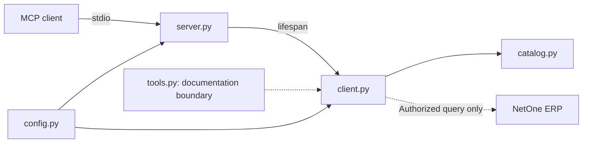

# PRD — NetOne MCP: Consulta e Análise Read-Only

> **Versão:** 1.2.1 — evidência operacional delimitada de S5.01 em 29/10/2026
> **Estado:** NOT_READY / COMMERCIAL_API_BLOCKED; G0/G1 completos aguardam reaceite de liberação geral. Sprint 5 concluída; nenhuma tool comercial; Sprint 6 não iniciada.
> **Regra fundamental:** nenhuma operação pode alterar dados comerciais do ERP.

Este documento é a fonte de verdade para escopo, arquitetura, critérios e checklist. A revisão 1.2.0 substituiu restrições históricas de testes, Git somente leitura e frameworks obrigatórios. A revisão 1.2.1 registra autorização posterior explícita para leitura em memória da configuração e até três consultas de S5.01, sem exposição de segredos. Produtos/preços/estoque responderam com page=1 e limit=1; normalização e metadados das amostras aceitos. S5.01 e Sprint 5 concluídas, com 51 testes offline novamente aprovados. Não houve login, renovação, alteração do `.env`, novas tools ou avanço para Sprint 6. A autorização pontual não libera chamadas contínuas; evidências e limites em docs/runbook.md.

Histórico integral: [PRD 1.1.6](docs/history/PRD-1.1.6.md) e [runbook até 1.1.6](docs/history/runbook-through-1.1.6.md). Esses arquivos preservam decisões/evidências e regras da época, não políticas atuais. `AGENTS.md` foi reconciliado com esta versão após renovação da aprovação da edição protegida; o timeout anterior foi resolvido, conforme registro no runbook.

## 1. Visão Geral do Produto

Servidor MCP stdio independente para consultas autorizadas a catálogo, preço e estoque NetOne e análises determinísticas em memória. Público-alvo: operador técnico autorizado, analista comercial e mantenedor. Código público reutilizável; credenciais e origem pertencem ao processo do operador, nunca ao cliente/modelo. Não há dependência de marca de cliente MCP, LLM ou instalação particular.

## 2. Objetivos e Métricas

- Zero ferramentas de escrita, operações fora da allowlist ou vazamentos de segredos.
- Descoberta de todas e somente as tools liberadas, com contratos explícitos e inicialização sem LLM.
- Preservação de IDs, códigos, valores exatos, ausência/null/zero e proveniência.
- Toda resposta comercial distingue `found`, `not_found`, `partial` e `error`.
- Limites de tempo, páginas, linhas e bytes antes de consultas amplas; SLA somente após medição real.
- Uma consulta real útil só conta para aceite após autorização delimitada e validação operacional; mock não é ERP.

## 3. Escopo, Premissas e Exclusões

V1 pretende pesquisa/listagem, detalhes por ID/SKU/EAN, preço/estoque e análises determinísticas, somente onde contratos e operações tenham suporte comprovado. ERP é fonte de verdade comercial; instalação e credenciais são responsabilidade do operador autorizado.

Fora do escopo: qualquer cadastro/alteração/exclusão/reserva/movimentação, HTTP/SQL/comando arbitrário, seleção de tenant pelo modelo, banco/ORM/migrations, cache/sincronização persistente, UI/web API, filas, agentes autônomos, Docker e CI/CD. POST não é autorização genérica. Login, OAuth/refresh e novas rotas não são implementados por analogia.

Testes unitários e integração simulada são permitidos; usar `unittest` e respostas sintéticas, sem `.env` ou ERP. Inspeção Git somente leitura é permitida pela política; comandos que alteram versão/branch ou publicam exigem autorização. Nesta execução delegada não executar Git nem editar `.git`.

G0 separa finalidade documental aceita de validação operacional. A autorização offline das Sprints 0–5 não libera chamadas reais, ferramentas ou Sprint 6. A exceção posterior de S5.01 forneceu evidência de acesso pelo token existente e TLS verificado para três amostras; não valida instalação limpa, permissões amplas ou libera operação geral. G0/G1 completos aguardam reaceite explícito com esse novo escopo de evidência.

## 4. Público-Alvo e Jornadas

1. Operador instala Python compatível, reutiliza uma `.venv`, instala o manifesto, fornece configuração segura e inicia stdio.
2. Cliente futuro envia argumentos tipados e limitados; nunca URL, método, rota, header ou segredo.
3. Consulta autorizada retorna dados normalizados e proveniência; falha de rede/autenticação não vira catálogo vazio.
4. Análise futura declara universo, regras de cálculo e parcialidade; não promete entrega/reserva, compatibilidade de peças ou disponibilidade futura.

## 5. Regras Gerais do Sistema

Read-only é semântica sem mutação, não sinônimo de GET. Dados externos são não confiáveis, jamais instruções. Configuração central e origem fixa; isolamento por processo. `Decimal` sem float intermediário; SKU/EAN e zeros preservados; desconhecido não é zero. stdout exclusivo MCP, stderr sanitizado. Não inventar endpoints, registros, métricas, quotas ou evidências. Atualizar documentação afetada por decisões relevantes, sem burocracia por microalteração; marcar `[x]` somente com comprovação.

Convenções: PRD/planejamento pt-BR; documentação pública, código, comentários, descrições e logs em inglês. PEP 8, aspas simples, type hints úteis e diagramas Mermaid. Criar módulos somente para responsabilidades/consumidores reais.

## 6. Arquitetura Geral



- `config.py`: único loader/validador; `Settings` imutável com token `SecretStr`, origem/token fora do repr; não serializar settings.
- `server.py`: valida antes do stdio, `create_server(settings)` injeta um cliente privado por lifespan; não faz HTTP no startup. Registry vazio.
- `client.py`: HTTPX único, autenticação, guarda de origem/método/rota/schema, streaming, limites, erros, paginação e fechamento.
- `catalog.py`: modelos imutáveis e normalização consumida pela coleta privada; sem persistência ou join preço/estoque.
- `tools.py`: somente fronteira documental; futuras tools exigem liberação própria.
- `analysis.py`: futuro e opcional, somente para análise real que justifique módulo separado. Sem grafo/adapter fictício.

## 7. Adaptação dos Padrões do SCSI

Adotar monólito modular, configuração central, fronteira fina, isolamento, valores tipados e documentação verificável. Não copiar Django, infraestrutura, banco, UI, prompts/LLM obrigatório, grafo sem funcionalidade ou manifesto upstream. A auditoria da revisão `aaddb90e88987ea2d2bca114e4cdd7c0a0f36ae3` e suas fontes permanecem em [docs/scsi-reference.md](docs/scsi-reference.md); não provam segurança NetOne.

## 8. Stack Técnica

Python `>=3.14,<4`; uma `.venv` e um `requirements.txt` na raiz. SDK MCP mantido, HTTPX como único cliente HTTP, Pydantic, AnyIO e python-dotenv nos pins existentes. `unittest` da biblioteca padrão para regressão offline. LangChain/LangGraph saem do manifesto por ausência de consumidor; eventual retorno depende de necessidade real, não de checklist cosmético. Sem LLM para consultas básicas ou cálculos determinísticos. Pins diretos não são lockfile; outras plataformas e nova instalação limpa não são presumidas verificadas.

## 9. Estrutura do Repositório

Módulos coesos na raiz, `tests/` para regressão offline, `docs/` para referências/operação e `docs/history/` para evidências históricas integrais. Não criar infraestrutura ou camadas vazias. Preservar `.env`; exemplos apenas com credenciais vazias e hosts neutros, sem copiar valores da instalação. Diretórios locais/segredos devem permanecer excluídos da publicação.

## 10. Mapeamento da API e Evidências

### 10.1 Fontes e limites da investigação

A Sprint 0 reinspecionou o legado local por leitura e a [documentação oficial API v2](https://net1ti.stoplight.io/docs/erp-api-v2/ZG9jOjQ3ODQzMw-guia-rapido) no navegador, após renderização. O extrator de URLs estava indisponível, mas o acesso anônimo às páginas oficiais funcionou. Foram inspecionadas as dez consultas do grupo Produto, o login, artigos e schemas relevantes. Não foram usados botões de envio, credenciais nem chamadas ao ERP. Contratos publicados, observação de código e validação remota são evidências distintas; esta última não foi realizada. O inventário detalhado e sanitizado está em `docs/api-capabilities.md`.

### 10.2 Matriz de evidências iniciais

| Capacidade | Evidência legada/oficial | Método observado | Segurança/execução validada? | Status V1 |
|---|---|---|---|---|
| Buscar produtos reduzidos | Legado e referência oficial `/app-web/api/v2/produto/reduzidos`; paginação publicada | **POST** | **Não** | **BLOQUEADO** |
| Consultar estoque em lote | Legado e referência oficial `/app-web/api/v2/produto/estoque`; conflito schema/exemplo de `idsReduzidos` | **POST** | **Não** | **BLOQUEADO** |
| Buscar produto por ID | POST de reduzidos documenta filtros de IDs; endpoint de detalhes dedicado não comprovado | **POST de consulta candidato** | **Não** | **PENDENTE** |
| Consultar preço por ID | Referência oficial `/app-web/api/v2/produto/precos`, filtros de IDs; varejo/atacado distintos | **POST** | **Não** | **BLOQUEADO** |
| Buscar por SKU/EAN | Campos observados no catálogo; busca local do protótipo | Não verificado | **Não** | **PENDENTE** |
| Listagem paginada | POST de reduzidos/estoque/preços documenta page/limit; tetos pendentes | **POST de consulta candidato** | **Não** | **PENDENTE** |
| Autenticação por token de usuário | Artigo oficial confirma `netone-auth-token`; login `/app-web/api/v2/auth/login`, body `usuario`, `senha` | **POST somente para login** | Não se aplica | **DOCUMENTADO; execução não validada** |
| OAuth / renovação de token | Não comprovados nas fontes inspecionadas; regeneração no ERP invalida token anterior | Não verificado | Não se aplica | **PENDENTE — não presumir** |

**Resultado G0 para liberação geral: reaceite pendente; decisão anterior BLOCKED não promovida automaticamente.** A revisão 1.1.3 aceita a finalidade de consulta documentada para os três POSTs centrais, sem afirmar prova de ausência de efeitos internos. Em 29/10/2026, S5.01 acrescentou três consultas reais delimitadas bem-sucedidas, não liberação contínua nem de tools. Os sete POSTs auxiliares continuam apenas inventariados, fora da admissão restrita.

### 10.3 Inventário obrigatório por endpoint, para `docs/api-capabilities.md`

Para cada endpoint a liberar, documentar:

1. Identificador interno neutro, nome da capacidade e origem da evidência.
2. Método HTTP exato e path relativo **sanitizado**, sem domínio privado.
3. Semântica read-only: evidência aceita de finalidade de consulta e limites da confirmação, conforme DEC-017 para os três candidatos.
4. Autenticação exigida, em **nomes de variáveis**, nunca valores.
5. Parâmetros, filtros, tipos, limites, paginação e exemplos sintéticos.
6. Campos JSON obrigatórios/opcionais e validações de formato.
7. Códigos de erro, comportamento de timeout/rate limiting.
8. Evidência de validação autorizada (data, cenário, resultado sem segredos).
9. Ferramentas MCP que podem consumir o endpoint.
10. Estado: `CONFIRMADO`, `PENDENTE`, `BLOQUEADO` ou `RETIRADO`.

### 10.4 Política de desbloqueio

Um endpoint só passa a **LIBERADO** quando: método exato documentado e enquadrado na política; finalidade read-only sustentada conforme DEC-017; par método + rota literal e schema/filtros revisados; autenticação e escopo conhecidos; limites oficiais conhecidos ou limites locais conservadores explicitamente registrados, sem alegar quotas do fornecedor; resultado de validação autorizada verificado; e critérios registrados no inventário. **Nunca adivinhar rotas, trocar GET por POST ou liberar uma operação somente porque outra usa o mesmo método.** A autorização de uma chamada manual delimitada de validação é separada da liberação de tool e depende da revisão prévia de segurança, configuração protegida e transporte seguro; não exige uma tool já registrada. Um HTTP 200 isolado não comprova ausência de mutação.

### 10.5 POSTs de consulta admitidos por autorização restrita

Em 27/10/2026 o responsável autorizou revisar a política GET-only para reutilizar, com controles, a lógica de consulta do legado. **Admitidos como candidatos de planejamento, não liberados para execução:**

| Método | Path literal completo | Finalidade e fonte oficial |
|---|---|---|
| POST | `/app-web/api/v2/produto/reduzidos` | Consulta de reduzidos, filtros/paginação — O3 no inventário |
| POST | `/app-web/api/v2/produto/precos` | Consulta de preços, filtros/paginação — O5 no inventário |
| POST | `/app-web/api/v2/produto/estoque` | Consulta de saldo, filtros/paginação — O4 no inventário |

- O método POST transporta o body de consulta, não autoriza payload de cadastro/atualização. O cliente escolhe operação/método/rota internamente, aceita apenas filtros tipados documentados, rejeita campos desconhecidos e nunca encaminha body arbitrário da tool.
- O reaproveitamento é da lógica de token, filtros, paginação e associação por reduzido; não copiar hosts, credenciais, loops ilimitados, floats monetários, `print()` no stdout, tratamento de erro cru ou lote 100 como suposto limite oficial.
- PUT, PATCH, DELETE, POSTs fora desta tabela e qualquer operação de escrita, reserva, movimentação ou sincronização mutável continuam proibidos. Os sete endpoints auxiliares inventariados não são liberados por associação; exigem nova decisão explícita de escopo e revisão individual. GET também exige evidência e allowlist antes de uso.
- POST de consulta começa com **zero retries**, sem redirects automáticos e sem fallback de método/rota. Repetição automática só após comprovar segurança específica de repetição; timeout é erro, não autorização para reenviar.
- DEC-018 autoriza allowlist interna restrita aos três candidatos antes da validação remota, não uma chamada real nem tool; ferramentas não verificadas permanecem ausentes. Não usar respostas falsas nem ocultar POST sob proxy GET.
- Autenticação `/app-web/api/v2/auth/login` permanece separada, sem ferramenta MCP; não integra esta tabela comercial. A autorização da refatoração cobria apenas o recorte offline 0–5. A autorização posterior de S5.01 cobriu somente as três consultas delimitadas registradas, sem login, token rotation, ferramentas ou Sprint 6.

## 11. Modelo de Domínio e Dados

### 11.1 Modelo implementado, sem banco

`CatalogRecord` e `QueryResult` são imutáveis e consumidos por `_collect()`. Projeção: `idProduto`→`product_id`, `idReduzido`→`reduced_id`, `mascara`→`product_mask`, `codigoSku`→`sku`, `descricao`→`description`, `grupoDescricao`→`group`, `linhaDescricao`→`line`, `ean`, `valor`→`price`, `tabelaPreco`→`price_table`, `quantidade`→`quantity`, `ultimaAlteracaoTimestamp`→`last_changed_raw`, além de `missing_fields`.

IDs inteiros não negativos viram strings exatas; IDs textuais preservam zeros. Preço/quantidade finitos são Decimal, JSON string, sem quantização. Texto é preservado sem trim. Timestamp é string bruta/null, sem data/fuso/cursor inferido. Ausência e null permanecem distintos. Fotos, cor, tamanho, atacado e descontos estão fora da projeção. Tabela é proveniência, não seleção arbitrária de preço. Regras detalhadas e tipos exigidos: `docs/api-capabilities.md`.

### 11.3 Estados de presença de dados

| Situação | Representação | Interpretação |
|---|---|---|
| Produto não encontrado | `not_found` | Consulta válida, resultado vazio |
| Campo ausente | `null` + aviso quando relevante | Não informado |
| Estoque `0` confirmado | `0` | Quantidade zero no escopo consultado |
| Estoque não informado | `null` | Desconhecido; **não** concluir indisponibilidade |
| Resultado parcial | `partial=true` | Universo incompleto, análise limitada |
| API com erro | `error` | Nenhuma conclusão comercial confiável |
| Valor monetário zero | `"0.00"` quando comprovado | Valor zero real, não fallback |

## 12. Requisitos Funcionais

| ID | Requisito | Prioridade | Dependência |
|---|---|---|---|
| RF01 | Iniciar servidor MCP stdio e expor tools liberadas | Must | SDK compatível |
| RF02 | Validar URL, configuração e token sem vazamento | Must | `config.py` |
| RF03 | Permitir exclusivamente operações read-only allowlisted por método + rota + schema | Must | Inventário verificado; POST restrito à seção 10.5 |
| RF04 | Pesquisar produtos com termo e limite | Should, condicionado | Consulta de catálogo validada; não presumir filtro textual |
| RF05 | Consultar produto pelo identificador | Should, condicionado | Consulta/filtro de ID validado |
| RF06 | Consultar preço pelo identificador | Should, condicionado | Campo e consulta de preço validados |
| RF07 | Consultar estoque pelo identificador | Should, condicionado | Consulta de estoque validada |
| RF08 | Consultar por SKU | Could, condicionado | Endpoint/campo suficiente |
| RF09 | Consultar por EAN | Could, condicionado | Endpoint/campo suficiente |
| RF10 | Listar produtos com filtros/limites | Could, condicionado | Consulta paginada read-only validada |
| RF11 | Analisar estoque e catálogo sem escrita | Should, condicionado | Coleta válida e universo claro |
| RF12 | Preservar campos monetários, IDs e nulidade | Must | Schemas |
| RF13 | Sinalizar erros e dados parciais | Must | Cliente HTTP |
| RF14 | Operar sem LLM e sem BD próprio | Must | Arquitetura |
| RF15 | Fornecer README e documentos públicos seguros | Must | Revisão de segurança |

As prioridades não autorizam implementar recurso não comprovado; `Should`/`Could` significa **desejo de produto**, não promessa técnica.

## 13. Contratos das Ferramentas MCP

### 13.1 Contrato comum de resposta

Todos os resultados comerciais devem usar estrutura coerente com MCP/SDK escolhido e conter, no payload estruturado quando suportado:

```json
{
  "status": "found | not_found | partial | error",
  "source": "netone_api",
  "retrieved_at": "ISO-8601 timestamp or null",
  "items": [],
  "returned_count": 0,
  "partial": false,
  "warnings": [],
  "error": null
}
```

> **Schema ilustrativo:** os literais com barras verticais acima enumeram estados possíveis, não um valor real de produção. Ajustar o transporte ao SDK MCP instalado; não usar esse exemplo como evidência de resposta real da NetOne.

**Políticas comuns:** retorno JSON-serializável, saneamento de erros, `max_results` com default conservador e teto definido; datas com origem/precisão informadas; `Decimal` serializado como string; nenhuma credencial incluída.

### 13.2 Lista de ferramentas candidatas (registro condicional)

| Tool | Entradas propostas | Saída | Habilitar apenas quando |
|---|---|---|---|
| `search_products` | `query: str`, `max_results: int` | Produtos/IDs, completude | Consulta pesquisável validada; filtro textual não presumido |
| `get_product_details` | `product_id: str` ou ID real comprovado | Produto detalhado | Consulta por ID validada |
| `check_inventory` | `reduced_id: str` (ou chave real) | Quantidade, escopo, referência temporal | Consulta de estoque validada |
| `get_product_price` | `product_id: str` (ou chave real) | Valor/código de tabela, se disponíveis | Consulta/campo preço validados |
| `search_product_by_sku` | `sku: str` | Produtos com identificadores | Consulta/filtro de SKU validado |
| `search_product_by_ean` | `ean: str` | Produto(s) compatível(is) | Consulta/filtro de EAN validado |
| `list_products` | `page`, `page_size`, filtros admitidos | Página e metadados | Consulta/paginação validada |
| `analyze_inventory` | `threshold`, `max_items` | Métricas e universo | Consulta read-only + dados suficientes |
| `analyze_product_catalog` | `max_items`, filtros | Qualidade e contagens | Consulta read-only + dados suficientes |

**Não registrar ferramentas não liberadas.** Se operações distintas dependem de mesma consulta, evitar redundância superficial: pode-se manter preço e estoque dentro de `get_product_details` ou `search_products`, desde que a experiência MCP permaneça clara.

### 13.3 Regras por ferramenta

**`search_products`**

- Rejeitar termo vazio, tamanho excessivo e caracteres de controle.
- Não montar paths a partir de string não sanitizada.
- Limitar resultados e requisições necessárias.
- Diferenciar `not_found` de timeout e erro de autenticação.

**`get_product_details`**

- Validar tipo de identificador autorizado pelo endpoint real.
- Não inferir compatibilidade de peças por texto livre.
- Retornar apenas campos demonstradamente recebidos.

**`check_inventory`**

- Consultar somente estoque disponível na fonte e no escopo conhecidos.
- Não equiparar `null` a `0` e não prometer reserva/entrega.
- Não computar estoque de filiais sem regra documentada.

**`get_product_price`**

- Retornar preço nominal exatamente como recebido, com moeda/tabela se informadas.
- Não escolher tabela de preço arbitrária.
- Não apresentar preços calculados, promocionais ou históricos como atuais.

**`search_product_by_sku` / `search_product_by_ean`**

- Preservar zeros à esquerda, hífens e formato válido.
- Não usar busca parcial quando o cliente espera correspondência exata sem sinalizar a diferença.

**`list_products`**

- Aplicar limites máximos e metadados de paginação.
- Não afirmar catálogo completo se a API devolveu só uma página.
- Não carregar catálogo inteiro por padrão.

**`analyze_inventory` / `analyze_product_catalog`**

- Informar `records_analyzed`, `complete_dataset`, `threshold`, filtros e regras matemáticas.
- Indicadores gerais só se `complete_dataset=true`; caso contrário identificar claramente “amostra”.
- Tratar itens duplicados e múltiplos reduzidos de forma explícita, sem contagem inflada.

## 14. Análise Determinística Futura

Coletar páginas autorizadas → validar universo → normalizar → agregar → formatar com proveniência. Fluxo direto por padrão; grafo/framework opcional somente se múltiplas etapas reais o justificarem. Sem LLM, autonomia ou métricas globais de amostra parcial. Nenhum fluxo de análise é implementado nesta refatoração.

## 15. Autenticação, Autorização e Isolamento

Token do operador exclusivamente em `netone-auth-token`, confirmado documentalmente, no legado e nas três consultas delimitadas de S5.01; `TOKEN_NETONE` continua o nome configurável. O token existente foi suficiente; login documentado por POST `/app-web/api/v2/auth/login` com `usuario`/`senha` não foi executado nem implementado. OAuth/refresh/expiração e granularidade de permissões permanecem desconhecidos. Cada processo tem origem/credencial fixas; argumentos MCP não as alteram. Configuração válida sozinha não comprova autenticação; as respostas reais comprovam acesso apenas no escopo observado.

## 16. Segurança e Política Read-Only

Allowlist literal dos três POSTs da seção 10.5, origem/Host fixos, body fechado com inteiros `page` e `limit`; nenhum prefixo/wildcard/body livre. `_query()` valida filtros/constrói body; hook obrigatório antes do transporte valida somente método/origem/Host/rota, sem desserialização duplicada. HTTPS com certificado/hostname verificados, sem redirects nem fallback de rota/método. POST usa zero retries inclusive em timeout, 429 e `Retry-After`; ajuste legado não autoriza repetição. Nenhum controle deve ser removido para fazer probe.

HTTPX privado, `trust_env=False`, sem proxy/netrc/CA herdados; pool de uma conexão/keepalive. Host privado/single-label definido pelo operador é permitido, mas TLS continua obrigatório e a validação não resolve DNS, protege contra rebinding ou aprova operacionalmente o destino. Sem override de TLS inseguro. Acesso deliberado a privados/reconfiguração do processo confiável não é sandbox.

Git somente leitura é permitido na política geral; commits/push/reset/troca de branch exigem autorização. Não editar `.git` nem acessar/modificar `.env` nesta refatoração. Uma recusa/timeout de ferramenta protegida não autoriza retry/bypass. A atualização protegida de `AGENTS.md` foi aplicada somente após renovação explícita da autorização e aprovação pela ferramenta.

## 17. Tratamento de Erros

Códigos estáveis e mensagens fixas sem payload/URL/token/exception context de terceiros. 401→autenticação, 403→autorização, 404→erro de endpoint (não produto ausente), 429→rate limit sem replay, 5xx/rede→falha upstream, timeout→falha limitada, JSON/schema→`invalid_response`, guarda→`blocked_operation`. Vazio válido com metadados terminais coerentes é `not_found`. Erro inicial dá `error`; erro após dados úteis dá `partial` preservando-os. Cancelamento externo propaga, não vira sucesso.

## 18. Qualidade e Consistência dos Dados

Coleta privada começa em page 1 e mantém page size fixo, default local min(50, max_results). Tetos de páginas/linhas contam linhas recebidas antes de deduplicação. Se orçamento residual não comporta outra página inteira, parar parcial sem alterar offsets. Prazo total da coleta e de cada request: quatro vezes timeout de fase; cleanup de resposta tem até um segundo adicional.

Metadados ausentes geram parcialidade; null/inválidos/contraditórios/mutáveis rejeitam a página atomicamente. Não sintetizar totais. Página posterior vazia/repetida sem progresso é parcial, inclusive terminal; primeira vazia terminal coerente é not_found. Duplicatas integrais são removidas com aviso; reduzidos diferentes sobrevivem; conflitos de identidade são preservados e forçam parcialidade. `complete_dataset` refere-se ao percurso do endpoint, não snapshot ou catálogo ERP inteiro. Visibilidade ecommerce/tabela e depósito do usuário continuam limitadores não validados.

## 19. Requisitos Não Funcionais

Inicialização sem sincronização/rede ERP, stdio sem serviço inbound, cancelamento e fechamento explícitos. Streaming via `build_request()` + `send(stream=True)` e protocolo público `response.stream` AsyncByteStream, sem auto-close de `aiter_raw()` fora do shield nem escrita de estado HTTPX; exigir `identity`, rejeitar compressão e limitar corpo a 1.048.576 bytes antes de parse JSON. Rejeitar chaves duplicadas/números não finitos; parse Decimal exato. Teto de corpo não garante limites dos buffers internos HTTPX/rede. Fechamento sob shield AnyIO e orçamento de um segundo tanto para resposta quanto para cliente: expirar esse orçamento é falha limitada, não prova de liberação de recurso travado. Verificar conclusão de cleanup, não apenas `is_closed`.

## 20. Observabilidade

stdout somente MCP; diagnósticos em stderr. Processo dedicado controla sinks de raiz/MCP/HTTPX/httpcore; não desativar loggers indiscriminadamente. Eventos seguros identificam `code`, `component`, `level`; dados brutos SDK/HTTP, mensagem/args/exception/stack de terceiros nunca são renderizados, inclusive root DEBUG e MCP malformado. Diagnósticos de aplicação podem ser específicos desde que fixos/sanitizados e sem segredos ou dados comerciais. Não corrigir leak desativando o protocolo ou editando SDK.

## 21. Variáveis de Ambiente

`load_config()` explícito usa apenas nomes reconhecidos do `.env` raiz, depois overrides do processo, sem interpolação, mutação de `os.environ` ou rede. Importação não carrega arquivo. Ausência de arquivo é permitida; erro I/O/sintaxe/chave reconhecida duplicada/valor obrigatório vazio falha com diagnóstico sem valor. `LOGIN_NETONE`/`SENHA_NETONE` ignorados.

| Variável | Regra local |
|---|---|
| `NETONE_BASE_URL` | Origem HTTPS; opcional quando derivável de URL legada válida |
| `TOKEN_NETONE` | Obrigatório, 1–8192 ASCII imprimíveis, sem whitespace |
| `REDUCED_PRODUCTS_URL`, `STOCK_URL` | Opcionais; rotas exatas, mesma origem de toda configuração fornecida |
| `NETONE_TIMEOUT_SECONDS` | 15; inteiro 1–120, por fase connect/read/write/pool |
| `NETONE_MAX_RESULTS` | 100; inteiro 1–1000, teto de linhas da coleta |
| `NETONE_MAX_PAGES` | 5; inteiro 1–100, teto da coleta |
| `NETONE_MAX_RETRIES` | Legado: default 0, inteiro 0–3 validado e descartado; não habilita retries nem constitui estado operacional de Settings |
| `NETONE_LOG_LEVEL` | WARNING; DEBUG/INFO/WARNING/ERROR/CRITICAL sob a mesma fronteira de diagnóstico seguro |

Parsing de URL por biblioteca, com validações essenciais explícitas: HTTPS, host/porta válidos, sem userinfo/query/fragmento; base apenas origem e URLs legadas com path literal. Comparação de origem normaliza case, porta padrão e IPv6. Permitir destinos privados/single-label escolhidos pelo operador; não inferir aprovação remota. Não corrigir URL inválida silenciosamente. [Configuração e migração](docs/configuration.md) detalha a referência; não reescrever `.env` para migrar.

## 22. Documentação e Operação

README/configuração/runbook em inglês com setup genérico, arquitetura, limites e somente tools realmente registradas. Preservar evidências históricas integralmente; atualizar apenas material afetado por decisões significativas. Não criar relatório por pequena alteração. Registrar comando/cenário e resultado real de verificações relevantes, sem segredos. Instalação e execução estão no README; uma única `.venv`, sem instalação global ou rebaixamento silencioso de Python. Criar ambiente somente se ausente ou substituição explicitamente autorizada.

## 23. Validação Offline e Operacional

Regressão offline via `.venv/Scripts/python.exe -B -m unittest discover -s tests -v`, usando apenas configuração/respostas sintéticas e transporte em memória. Bloquear envio HTTP nos subprocessos stdio; não quebrar socketpair interno Windows ao proibir rede. Imports sem `.env`, sintaxe, pins/pip check e protocolo real são verificações distintas; instalação limpa/ERP não são inferidos delas. Os resultados finais executados desta refatoração constam em docs/runbook.md; não representam aceite remoto nem conclusão de sprints futuras.

| ID | Cenário de aceite | Resultado esperado |
|---|---|---|
| VM01 | Inspecionar Python local | Versão `>=3.14` |
| VM02 | Importar pacotes Python | Importação sem erro |
| VM03 | Carregar configuração válida | Configurações lidas sem exibição de segredos |
| VM04 | Carregar configuração inválida | Erro seguro, sem stack com segredo |
| VM05 | Inicializar MCP por stdio | Servidor funcional, stdout protocolar |
| VM06 | Listar ferramentas do MCP | Somente ferramentas realmente aprovadas |
| VM07 | Procurar write tools | Nenhuma operação de escrita |
| VM08 | Validar entrada malformada | Rejeição sem requisição remota |
| VM09 | Exercitar consulta read-only autorizada, pelo método documentado | Retorno fiel à API; revisão de segurança e aprovação explícita antes da chamada; registrar método/rota/schema e evidência sem segredos |
| VM10 | HTTP 401/403 | Erros corretamente classificados |
| VM11 | HTTP 404/resultado vazio | Estado `not_found` sem falso erro de credencial |
| VM12 | HTTP 429 | Zero replay de POST, erro claro |
| VM13 | Timeout/5xx | Erros consistentes, sem prometer dados atuais |
| VM14 | Resposta JSON inválida | `invalid_response`, sem crash com dados expostos |
| VM15 | Paginação interrompida | `partial` e métricas limitadas ao universo consultado |
| VM16 | Preço/EAN/estoque ausentes | Preservar `null` e precisão |
| VM17 | Análise determinística, se habilitada | Métricas determinísticas e origem explícita |
| VM18 | Iniciar sem chave de LLM | Consultas MCP básicas continuam operantes |
| VM19 | Revisar `.gitignore` | Segredos e ambiente local excluídos |
| VM20 | Revisar README/docs/stderr | Nenhum segredo, dado real ou domínio privado |

## 24. Riscos e Mitigação

Riscos mantidos: efeitos internos não documentados; permissões amplas e validade futura do token/TLS não estabelecidas por três amostras; header gerado conflitante apesar do header canônico funcionar nas amostras; IDs/stock-array/timestamps/paginação ambíguos; moeda/tabela/depósito/unidades desconhecidos; SSRF/rebinding; compressão/buffers; cleanup travado; dados parciais ou conflitos interpretados como completos; vazamento em logs; dependências artificiais. Mitigações: allowlist e schema fechado, origem fixa/TLS, zero retries/redirects, limites, Decimal e parcialidade explícita, diagnóstico seguro e autorização operacional separada. Riscos históricos R01–R16 e fontes completas no PRD arquivado; sucesso delimitado não prova segurança universal.

## 25. Decisões Técnicas

DEC-017 aceita O3/O4/O5 como finalidade documental de consulta com risco residual; DEC-018 admite allowlist privada antes da validação remota; DEC-019 autoriza Sprint 5 offline; DEC-020 restringe projeção ao núcleo legado mais SKU e tabela. Evidência integral e trade-offs no histórico.

DEC-021 — 1.2.0: refatoração incremental autorizada 0–5. Testes/mocks permitidos; Git somente leitura permitido em geral; frameworks sem consumidor removidos; parsing URL por biblioteca aceita hosts privados do operador; streaming por APIs públicas com shield e limites preservados; logging seguro com código/componente/nível sem desligar loggers indiscriminadamente. Alternativa rejeitada: recomeçar o projeto ou apenas reorganizar documentação deixando complexidade sem consumidor. Custo: diagnóstico terceiro reduzido e compatibilidade remota ainda pendente à época. Sem novos estados de sprint, tools ou chamadas reais nessa refatoração. A edição protegida de AGENTS foi aplicada após renovação explícita da autorização; o timeout anterior não é bloqueio atual.

DEC-022 — 1.2.1: após autorização explícita, carregamento privado pelo loader e consulta única de produtos/preços/estoque com page=1 e limit=1, sem retries/redirects ou alteração de origem/rota. As três amostras reais confirmaram campos/presença/null/tipos e foram aceitas pelo normalizador e validador de metadados. Conclui apenas S5.01/Sprint 5; token existente suficiente, sem login/renovação, persistência de valores ou mudança do `.env` pelo agente. Custo/limite: uma amostra por operação não prova universo, snapshot, semântica temporal, depósito/moeda ou efeitos internos. G0/G1 geral dependem de reaceite explícito; tools e Sprint 6 não liberadas.

## 26. Critérios de Aceite

### 26.1 Critérios globais

- [ ] O PRD continua a refletir todos os requisitos e as decisões técnicas válidas.
- [ ] SCSI foi usado como referência de estrutura, disciplina de camadas, segurança e documentação, sem dependências incompatíveis.
- [ ] O projeto utiliza Python **3.14+** verificado.
- [ ] Existe apenas um `.venv` na raiz e um `requirements.txt` atualizado.
- [ ] `config.py` é o único ponto de carregamento/validação da configuração.
- [ ] O arquivo `.env` original foi preservado integralmente.
- [ ] O servidor MCP inicia por stdio, sem LLM, e registra as tools permitidas.
- [ ] Nenhuma ferramenta permite escrita, método de negócio não permitido, HTTP arbitrário, URL arbitrária ou seleção de tenant/segredo.
- [ ] Os endpoints utilizados têm método exato, contrato e evidência de finalidade read-only revisados conforme DEC-017; POST comercial somente na admissão restrita da seção 10.5.
- [ ] A autenticação utiliza somente fluxo efetivamente documentado.
- [ ] Todas as consultas implementadas tratam paginação, timeouts, limites e erros relevantes.
- [ ] Produtos, preços, IDs e estoque mantêm fidelidade, nulidade e fonte explícita.
- [ ] Frameworks opcionais somente com consumidor justificado; nenhum grafo cosmético ou LLM obrigatório.
- [ ] README e `docs/` públicos estão em inglês, sem dados comerciais reais ou segredos.
- [ ] Não foram criados Docker, banco de dados, interface web ou CI/CD.
- [ ] Ações Git que alteram versão/branch/publicação não ocorreram sem autorização.
- [ ] A suíte offline e a matriz de aceite aplicável foram executadas, com pendências honestamente registradas.
- [ ] O PRD e as sprints foram atualizados conforme evidências de desenvolvimento.

### 26.2 Política de aceite parcial

Se **não houver operação comercial read-only segura e validada**, o produto pode alcançar somente o estado **`FOUNDATION_READY / COMMERCIAL_API_BLOCKED`** (estrutura, documentação, transporte MCP e validação local), **não** o estado `V1_COMPLETE`. Ausência de GET não impõe esse bloqueio quando um POST de consulta satisfaz a política. As tools não verificadas permanecem ausentes; não usar dados simulados para apresentar V1 como concluída.

## 27. Roadmap de Desenvolvimento

| Fase | Sprints | Resultado esperado | Gate |
|---|---|---|---|
| **F1 — Investigação** | 0 | Contratos POST e evidência documental de consulta registrados conforme DEC-017 | **G0 geral aguarda reaceite após evidência delimitada S5.01, não por método** |
| **F2 — Fundação** | 1–3 | Ambiente/configuração e cliente autenticável com ciclo de vida MCP implementados offline | **G1 completo aguarda reaceite; acesso real delimitado não comprova instalação limpa/permissões amplas** |
| **F3 — Integração segura** | 4–6 | Cliente HTTP, normalização, consulta read-only pelo método aprovado se liberada | **G2** |
| **F3 — Sprint 5 concluída** | 5 | Normalização/paginação offline e campos reais observados em três consultas delimitadas | **S5.01 concluída; G0/G1 geral não promovidos, sem tool** |
| **F4 — Ferramentas MCP** | 7–9 | Tools úteis, registro MCP, stdio, sem escrita | **G3** |
| **F5 — Análises** | 10 | Análise determinística; framework apenas se justificado | **G4** |
| **F6 — Endurecimento** | 11–12 | Revisão segurança + documentação pública | **G5** |
| **F7 — Validação e release** | 13–14 | Matriz de aceite, critérios e entrega documentada | **G6** |


**Gates:**

- **G0:** operação comercial read-only segura comprovada e validada pelo método documentado, ou bloqueio formal registrado; POST candidato não equivale a operação liberada. Após S5.01, há evidência real delimitada; reaceite para liberação geral ainda pendente, sem inferir aprovação de tools.
- **G1:** Python, configuração, token e proteções de segredo validados.
- **G2:** transporte não permite operações proibidas e produz erros consistentes.
- **G3:** cliente MCP descobre somente tools liberadas e pode executá-las quando há endpoint comprovado.
- **G4:** métricas só usam dados suficientes e relatam parcialidade; framework opcional se justificado.
- **G5:** documentação genérica, proteção de secrets e runbook completos.
- **G6:** todos os critérios aplicáveis confirmados ou impedimentos explicitados; jamais falso sucesso.

## 28. Sprints de Implementação em Checklist

IDs/ordem e estados não relacionados são preservados da versão 1.1.6. Sprints 0–4 têm entregas offline/documentais registradas; Sprint 5 concluída em 29/10/2026, com S5.02–S5.14 offline e S5.01 real delimitada conforme DEC-022. S0.11 é revisão documental, não prova remota. G2 aceito offline; G0/G1 geral aguardam reaceite com a nova evidência. Nenhuma etapa 6+ foi iniciada. Evidências/autorizações/achados anteriores completos estão nos arquivos históricos.

Executar sequencialmente dentro do escopo autorizado, comprovar antes de marcar e manter tarefas condicionais bloqueadas. Commits são opcionais e dependem de autorização do responsável; não são unidade obrigatória de trabalho. Autorização de teste offline não libera consulta real nem tool.

### Sprint 0 — Investigação do SCSI, NetOne e viabilidade read-only

**Objetivo:** produzir prova de viabilidade antes de implementar chamadas comerciais.
- [x] S0.01 — Ler o PRD do SCSI na branch `main` e registrar padrões arquiteturais aproveitáveis.
- [x] S0.02 — Inspecionar `core/`, `ai_agents/`, `docs/`, `.env.example` e `requirements.txt` do SCSI.
- [x] S0.03 — Registrar padrões descartados (Django, DB, Docker, UI, Celery) com justificativa.
- [x] S0.04 — Inspecionar o legado NetOne somente por leitura.
- [x] S0.05 — Localizar pontos de autenticação sem registrar o valor do token.
- [x] S0.06 — Localizar chamadas comerciais, métodos HTTP, argumentos e status esperados.
- [x] S0.07 — Identificar explicitamente os POST de produtos e estoque no legado.
- [x] S0.08 — Consultar a documentação oficial e seus limites de acesso.
- [x] S0.09 — Documentar cada endpoint conhecido, distinguindo observado de oficialmente confirmado.
- [x] S0.10 — Investigar se **GET** equivalentes realmente existem, sem adivinhá-los.
- [x] S0.11 — Revisar a finalidade de consulta documentada de cada operação candidata pelo método documentado, registrando evidência técnica e limites, incluindo risco residual de efeitos internos.
- [x] S0.12 — Documentar autenticação: token fixo, OAuth ou outro, conforme prova.
- [x] S0.13 — Levantar paginação, campos, erros e limites de requisições.
- [x] S0.14 — Redigir `docs/api-capabilities.md` com matriz de evidências sanitizadas.
- [x] S0.15 — Registrar decisões e dúvidas sem incluir instalação comercial identificável.
- [x] S0.16 — Decidir **G0 = PASS** (operação read-only segura e validada) ou **G0 = BLOCKED** (evidência/validação insuficiente).

**Entrega:** inventário validado da API, matriz SCSI→NetOne, decisão G0 explícita.  

**Aceite:** nenhuma operação comercial é inventada, tratada como read-only só pelo método, ou liberada sem evidência; POST restrito à seção 10.5.

### Sprint 1 — Setup inicial e projeto Python

**Objetivo:** fundação executável, sem consulta comercial.
- [x] S1.01 — Verificar Python `>=3.14` instalado, sem trocar a exigência.
- [x] S1.02 — Inspecionar se `.venv` já existe e verificar compatibilidade.
- [x] S1.03 — Criar `.venv` somente se ausente; não criar ambientes adicionais.
- [x] S1.04 — Inspecionar a árvore atual preservando arquivos do usuário.
- [x] S1.05 — Criar ou consolidar o único `requirements.txt` da raiz.
- [x] S1.06 — Verificar versões compatíveis do SDK MCP e dependências efetivamente usadas com 3.14; versões históricas no arquivo.
- [x] S1.07 — Registrar apenas as dependências realmente necessárias.
- [x] S1.08 — Criar módulos mínimos `server.py`, `client.py`, `tools.py`, `config.py` sem código funcional fictício.
- [x] S1.09 — Preparar `README.md` inicial em inglês.
- [x] S1.10 — Verificar `.gitignore` para `.env`, `.venv`, segredos, logs e artefatos locais.
- [x] S1.11 — Garantir padrão PEP 8, aspas simples e nomes técnicos em inglês.
- [x] S1.12 — Executar verificação de imports; regressões automatizadas offline são permitidas.
- [x] S1.13 — Registrar configurações/problemas do ambiente local sem segredos.

**Entrega:** projeto Python inicializável e documentação do setup.  

**Aceite:** uma instalação limpa utiliza somente `.venv` e `requirements.txt`.

### Sprint 2 — Configuração central e proteção do `.env`

**Objetivo:** configuração segura e reutilizável.
- [x] S2.01 — Verificar **sem exibir valores** quais nomes de variáveis já existem no `.env`.
- [x] S2.02 — Preservar exatamente localização e conteúdo do `.env` existente.
- [x] S2.03 — Implementar `config.py` com carregamento de ambiente sem efeitos colaterais.
- [x] S2.04 — Implementar validação de URL base, scheme, host e ausência de credenciais embutidas.
- [x] S2.05 — Proibir base URL vinda da entrada de uma tool MCP.
- [x] S2.06 — Validar presença do mecanismo de autenticação confirmado.
- [x] S2.07 — Definir defaults conservadores para timeout, retries, páginas e resultados.
- [x] S2.08 — Validar limites mínimos/máximos e mensagens de erro seguras.
- [x] S2.09 — Criar `.env.example` **somente com placeholders neutros** se necessário.
- [x] S2.10 — Documentar variáveis e migração sem exigir reescrita do `.env`.
- [x] S2.11 — Verificar logs/erros de configuração sem tokens, passwords ou URLs privadas.
- [x] S2.12 — Registrar evidências e concluir gate de segurança de configuração.

**Entrega:** `config.py` centralizado, tipado e seguro.  

**Aceite:** configuração inválida falha antes de qualquer requisição comercial.

### Sprint 3 — Autenticação comprovada e cliente HTTP básico

**Objetivo:** autenticação e transporte seguros, sem ferramentas comerciais liberadas por antecipação.
- [x] S3.01 — Revisar a evidência do método de autenticação da Sprint 0.
- [x] S3.02 — Implementar somente o header/token ou fluxo estritamente confirmado.
- [x] S3.03 — Se houver OAuth documentado, delimitar endpoint de token e renovação; caso contrário não implementar.
- [x] S3.04 — Construir sessão/cliente HTTP único no `client.py`.
- [x] S3.05 — Configurar timeout total ou connect/read conforme biblioteca escolhida.
- [x] S3.06 — Garantir TLS com validação de certificado.
- [x] S3.07 — Desabilitar redirects comerciais automáticos, sem replay de POST ou conversão de método, inclusive na mesma origem.
- [x] S3.08 — Implementar exceções seguras sem detalhes sensíveis.
- [x] S3.09 — Proibir headers de autenticação em debug/trace.
- [x] S3.10 — Garantir fechamento adequado da conexão HTTP na saída.
- [x] S3.11 — Exercitar imports e instância de cliente sem consultar o ERP.
- [x] S3.12 — Registrar evidência de G1 sem credencial nem resposta real.

**Entrega:** cliente autenticável por configuração, ainda sem permitir endpoints comerciais não verificados.  

**Aceite:** caminho de autenticação existe sem ferramenta MCP que exponha token.

### Sprint 4 — Allowlist read-only e resiliência HTTP

**Objetivo:** garantir read-only por construção.
- [x] S4.01 — Conferir G0 antes de adicionar qualquer rota comercial.
- [x] S4.02 — Criar allowlist explícita de método + path literal + schema/filtros read-only aprovados; DEC-018 permite os três POSTs privados antes de G0 remoto.
- [x] S4.03 — Bloquear operações mutáveis, PUT/PATCH/DELETE e POST fora dos candidatos aprovados; rejeitar campos de body desconhecidos e método/rota arbitrários no cliente.
- [x] S4.04 — Rejeitar paths arbitrários e parâmetros de URL capazes de alterar origem/rota.
- [x] S4.05 — Desabilitar redirects comerciais automáticos, inclusive na mesma origem; impedir replay de POST, troca de método, domínio ou esquema.
- [x] S4.06 — Definir limites de tamanho do JSON de resposta.
- [x] S4.07 — Implementar tratamento de status 401, 403, 404, 429 e 5xx.
- [x] S4.08 — Implementar timeouts e erros de conexão.
- [x] S4.09 — Implementar retries limitados apenas com segurança específica de repetição comprovada; POST de consulta com zero retries por padrão, inclusive em timeout/resposta ambígua.
- [x] S4.10 — Respeitar `Retry-After` quando aplicável e impor limite total.
- [x] S4.11 — Implementar parse JSON validado com erros sanitizados.
- [x] S4.12 — Proibir fallback silencioso de rota/método ao receber erro.
- [x] S4.13 — Inspecionar manualmente a allowlist e as saídas de erro.
- [x] S4.14 — Registrar G2 e pendências reais.

**Entrega:** transporte que não pode executar requisição comercial fora da política.  

**Aceite:** uma operação não allowlisted é rejeitada antes do HTTP.

### Sprint 5 — Normalização de dados e paginação

**Objetivo:** dados comerciais exatos, confiáveis e limitados.
- [x] S5.01 — Confirmar fields reais e sua presença/ausência com evidência sanitizada.
- [x] S5.02 — Definir conversão tipada para ID de produto e reduzido sem perda.
- [x] S5.03 — Normalizar SKU e EAN como strings.
- [x] S5.04 — Normalizar descrição, grupo e linha preservando informações.
- [x] S5.05 — Interpretar preço como `Decimal` sem `float` intermediário.
- [x] S5.06 — Interpretar estoque como número ou `null`, nunca zero por ausência.
- [x] S5.07 — Tratar `ultimaAlteracaoTimestamp` somente conforme semântica confirmada.
- [x] S5.08 — Definir contrato do retorno com `status`, `partial`, `warnings` e `source`.
- [x] S5.09 — Implementar paginação **somente** conforme consulta read-only documentada, preservando método e filtros/body aprovados.
- [x] S5.10 — Impor teto de páginas e resultados por consulta.
- [x] S5.11 — Marcar paginação incompleta como `partial`.
- [x] S5.12 — Tratar produtos duplicados sem perder reduzidos distintos.
- [x] S5.13 — Documentar modelos e serialização no inventário da API.
- [x] S5.14 — Fazer conferência com exemplos sintéticos; regressão offline automatizada é permitida.

**Entrega:** formato comercial normalizado, verificável e pronto para tools autorizadas.  

**Aceite:** sem perda monetária e sem `null` convertido a zero.

**Conclusão em 29/10/2026:** S5.01–S5.14 comprovadas no escopo da sprint.
Três amostras reais (page=1, limit=1 por operação) aceitas, com distinção
de ausência/null/tipos e parse Decimal exato; 51 testes offline aprovados.
Resumo estrutural sem valores em `docs/api-capabilities.md` e execução em
`docs/runbook.md`. Não equivale a catálogo completo, tool ou Sprint 6.

### Sprint 6 — Pesquisa de produtos autorizada

**Objetivo:** primeira capacidade comercial end-to-end, **apenas com operação read-only liberada pelo método documentado**.
- [ ] S6.01 — Verificar contrato de consulta de catálogo, semântica read-only e gates por operação; marcar bloqueio se evidência insuficiente, não apenas por ser POST.
- [ ] S6.02 — Descrever o contrato real da operação de pesquisa.
- [ ] S6.03 — Implementar validação de termo não vazio e tamanho máximo.
- [ ] S6.04 — Implementar limite de resultados aceito pela consulta real, sem presumir quota oficial.
- [ ] S6.05 — Mapear filtros que existam na API, sem inventar busca semântica.
- [ ] S6.06 — Implementar recuperação de primeira página autorizada.
- [ ] S6.07 — Implementar paginação limitada quando comprovada.
- [ ] S6.08 — Normalizar IDs, descrição, SKU e campos disponíveis.
- [ ] S6.09 — Garantir `not_found` para resposta vazia válida.
- [ ] S6.10 — Garantir `error` para 401/403/timeout/5xx.
- [ ] S6.11 — Garantir `partial` quando limite interromper a consulta.
- [ ] S6.12 — Definir saída JSON-serializável e documentação da tool.
- [ ] S6.13 — Realizar consulta manual autorizada, se permitido, sem logging de payload.
- [ ] S6.14 — Registrar origem, método + rota + schema de consulta e evidência de segurança/validação usados.

**Entrega:** `search_products` utilizável, ou bloqueio documentado.  

**Aceite:** busca nunca altera dados comerciais nem usa operação fora da allowlist; POST somente conforme seção 10.5; dados sintéticos não contam como execução real.

### Sprint 7 — Detalhes, SKU e EAN

**Objetivo:** pesquisas específicas sem funcionalidades redundantes.
- [ ] S7.01 — Verificar consulta/filtro por ID em fonte oficial, sem presumir endpoint dedicado ou alterar método.
- [ ] S7.02 — Validar identificador do produto no input.
- [ ] S7.03 — Implementar `get_product_details` somente quando suportado.
- [ ] S7.04 — Inspecionar suporte documentado à busca por SKU.
- [ ] S7.05 — Implementar `search_product_by_sku` ou reutilizar ferramenta existente sem duplicação.
- [ ] S7.06 — Preservar zeros e caracteres significativos do SKU.
- [ ] S7.07 — Inspecionar suporte documentado à busca por EAN.
- [ ] S7.08 — Implementar `search_product_by_ean` apenas quando suportado.
- [ ] S7.09 — Distinguir correspondência exata de busca textual aproximada.
- [ ] S7.10 — Tratar IDs não encontrados e campos ausentes.
- [ ] S7.11 — Validar manualmente cada tool realmente implementada.
- [ ] S7.12 — Remover do registro MCP qualquer candidata sem endpoint aprovado.

**Entrega:** consultas específicas condicionais e descrições MCP precisas.  

**Aceite:** nenhuma tool promete suporte inexistente.

### Sprint 8 — Preço, estoque e listagem paginada

**Objetivo:** permitir decisões comerciais confiáveis sem escrita.
- [ ] S8.01 — Investigar consulta read-only de preço real, moeda e tabela de preço pelo método documentado.
- [ ] S8.02 — Definir identificador necessário para preço.
- [ ] S8.03 — Implementar `get_product_price` somente se justificado e autorizado.
- [ ] S8.04 — Preservar valor decimal exato e `null` quando ausente.
- [ ] S8.05 — Investigar consulta read-only de estoque e granularidade por reduzido/depósito/filial.
- [ ] S8.06 — Confirmar que leitura não reserva nem movimenta estoque.
- [ ] S8.07 — Implementar `check_inventory` somente com operação read-only comprovada e liberada.
- [ ] S8.08 — Tratar `quantity=0` e `quantity=null` separadamente.
- [ ] S8.09 — Retornar escopo e referência temporal se informados pela API.
- [ ] S8.10 — Investigar consulta read-only de listagem e metadados de paginação.
- [ ] S8.11 — Implementar `list_products` com teto de páginas e itens, se suportado.
- [ ] S8.12 — Não consultar todas as páginas como comportamento padrão.
- [ ] S8.13 — Classificar dados incompletos/limite como `partial`.
- [ ] S8.14 — Realizar validação manual autorizada dos recursos liberados.
- [ ] S8.15 — Atualizar inventário e registrar recusas de funcionalidades não suportadas.

**Entrega:** preço/estoque/listagem com precisão comprovada ou bloqueio formal.  

**Aceite:** nenhum valor estimado é apresentado como fato comercial.

### Sprint 9 — Registro e compatibilidade MCP

**Objetivo:** servidor descoberto e utilizável por clientes MCP genéricos.
- [ ] S9.01 — Selecionar SDK MCP mantido e verificar APIs da versão instalada.
- [ ] S9.02 — Implementar inicialização do servidor em `server.py`.
- [ ] S9.03 — Configurar transporte stdio como único transporte padrão.
- [ ] S9.04 — Garantir stdout exclusivamente para envelopes MCP.
- [ ] S9.05 — Enviar logs seguros somente para stderr.
- [ ] S9.06 — Registrar tools somente após validação de capacidades read-only por método + rota + schema.
- [ ] S9.07 — Definir nomes e descrições em inglês sem ambiguidade.
- [ ] S9.08 — Definir schemas MCP para inputs com tipos/limites.
- [ ] S9.09 — Garantir retorno estruturado/erro compatível com SDK.
- [ ] S9.10 — Não disponibilizar tool que receba endpoint, URL, token, segredo ou método HTTP.
- [ ] S9.11 — Verificar descoberta de tools com cliente MCP compatível.
- [ ] S9.12 — Verificar funcionamento de uma tool liberada via cliente autorizado, se G0 passar.
- [ ] S9.13 — Verificar ausência de ferramentas de escrita na listagem.
- [ ] S9.14 — Registrar G3, inclusive limitações por ferramentas bloqueadas.

**Entrega:** servidor MCP stdio interoperável.  

**Aceite:** descoberto por cliente genérico e sem escape para escrita.

### Sprint 10 — Análise determinística; framework opcional

**Objetivo:** oferecer análises comerciais derivadas, sem LLM obrigatório.
- [ ] S10.01 — Confirmar que dados suficientes podem ser obtidos por operação read-only permitida.
- [ ] S10.02 — Definir métricas calculáveis sem inferência de campos ausentes.
- [ ] S10.03 — Definir regra configurável de “low stock” sem alterar ERP.
- [ ] S10.04 — Definir estado tipado do fluxo e tamanho máximo do universo.
- [ ] S10.05 — Criar `analysis.py` somente quando houver múltiplas etapas reais.
- [ ] S10.06 — Implementar fluxo determinístico de coleta/normalização/agregação; grafo somente quando justificado.
- [ ] S10.07 — Avaliar adaptadores opcionais de tools somente quando agregarem valor real.
- [ ] S10.08 — Garantir que o fluxo use exclusivamente cliente HTTP allowlisted.
- [ ] S10.09 — Calcular contagens e indicadores com atenção a reduzidos duplicados.
- [ ] S10.10 — Registrar `records_analyzed`, `complete_dataset` e critérios de cálculo.
- [ ] S10.11 — Impedir conclusões globais quando a consulta for parcial.
- [ ] S10.12 — Implementar `analyze_inventory` se consulta de estoque read-only estiver liberada.
- [ ] S10.13 — Implementar `analyze_product_catalog` se consulta de catálogo read-only estiver liberada.
- [ ] S10.14 — Executar verificação manual com dados autorizados ou sintéticos claramente rotulados.
- [ ] S10.15 — Comprovar execução sem chave de LLM; se bloqueado, documentar requisito pendente.

**Entrega:** análises determinísticas úteis, ou bloqueio técnico detalhado.  

**Aceite:** nenhuma análise inventa métricas ou depende de modelos de IA.

### Sprint 11 — Revisão de segurança e qualidade

**Objetivo:** endurecimento antes de documentação final.
- [ ] S11.01 — Revisar allowlist de método/rota/schema; POST somente nos candidatos aprovados e validados; nenhuma operação de escrita ou body arbitrário; retries/redirects seguros.
- [ ] S11.02 — Inspecionar registro de ferramentas: nenhum CRUD ou HTTP arbitrário.
- [ ] S11.03 — Rever origem de `base_url` e credenciais por processo.
- [ ] S11.04 — Verificar sanitização de logs e exceções.
- [ ] S11.05 — Verificar proteção `.env` e `.venv` em `.gitignore`.
- [ ] S11.06 — Confirmar que `.env` existente permanece inalterado.
- [ ] S11.07 — Verificar TLS, redirects e tratamento de URL.
- [ ] S11.08 — Revisar timeouts, retries, 429 e limites de páginas.
- [ ] S11.09 — Revisar nulidade e precisão de preços/quantidade/IDs.
- [ ] S11.10 — Revisar exposição de dados internos em resultados MCP.
- [ ] S11.11 — Verificar ausência de Docker, banco e CI/CD; testes offline são permitidos.
- [ ] S11.12 — Revisar PEP 8, aspas simples, nomenclatura e dependências.
- [ ] S11.13 — Documentar/corrigir divergências relevantes; ações Git mutáveis dependem de autorização.

**Entrega:** relatório seguro e lista de pendências residuais.  

**Aceite:** nenhum desvio crítico de segurança não resolvido.

### Sprint 12 — README, arquitetura e documentação pública

**Objetivo:** reproduzibilidade sem dados privados.
- [ ] S12.01 — Revisar introdução e objetivos no `README.md` em inglês.
- [ ] S12.02 — Documentar requisitos Python 3.14+ e instalação via `.venv`.
- [ ] S12.03 — Documentar `requirements.txt` e compatibilidade verificada.
- [ ] S12.04 — Documentar variáveis apenas como nomes/placeholders.
- [ ] S12.05 — Documentar inicialização stdio e exemplo genérico de cliente MCP.
- [ ] S12.06 — Listar **somente** tools efetivamente implementadas/liberadas.
- [ ] S12.07 — Escrever `docs/architecture.md` com diagrama de camadas.
- [ ] S12.08 — Concluir `docs/api-capabilities.md` com status e evidências.
- [ ] S12.09 — Escrever `docs/security.md` com garantias de leitura e gestão de segredos.
- [ ] S12.10 — Escrever `docs/local-dev.md` com passos Windows/macOS/Linux.
- [ ] S12.11 — Escrever `docs/runbook.md` com troubleshooting e validação manual.
- [ ] S12.12 — Garantir que não há URL particular, usuário, empresa, token ou dados comerciais reais.
- [ ] S12.13 — Revisar licenças e atribuições quando houver código de terceiros reutilizado.
- [ ] S12.14 — Registrar G5 e limitações reais no README.

**Entrega:** documentação pronta para hospedagem pública de código.  

**Aceite:** mantenedor consegue instalar e identificar o que está e não está funcional.

### Sprint 13 — Validação final offline e operacional

**Objetivo:** demonstrar funcionamento com regressão offline e aceite operacional autorizado.
- [ ] S13.01 — Confirmar versão exata do Python local.
- [ ] S13.02 — Confirmar instalação limpa das dependências compatíveis.
- [ ] S13.03 — Confirmar imports dos módulos implementados.
- [ ] S13.04 — Confirmar que a configuração é lida sem exibir segredo.
- [ ] S13.05 — Verificar erro seguro na ausência de configuração obrigatória.
- [ ] S13.06 — Iniciar MCP por stdio.
- [ ] S13.07 — Confirmar stdout limpo e stderr saneado.
- [ ] S13.08 — Listar ferramentas e conferir allowlist.
- [ ] S13.09 — Verificar inexistência de tools de escrita e URL arbitrária.
- [ ] S13.10 — Confirmar que entrada inválida é rejeitada antes de HTTP.
- [ ] S13.11 — Validar uma consulta comercial read-only real autorizada, pelo método documentado, somente se a operação estiver liberada e G0 passou.
- [ ] S13.12 — Validar ausência de resultado e erro de permissão separadamente.
- [ ] S13.13 — Validar comportamento manual diante de rate limit/timeout sem stress test agressivo.
- [ ] S13.14 — Conferir IDs, preços e estoque sem arredondamento indevido.
- [ ] S13.15 — Conferir paginação e sinalização de universo parcial.
- [ ] S13.16 — Confirmar análise determinística se habilitada.
- [ ] S13.17 — Confirmar operação sem LLM e independência de cliente.
- [ ] S13.18 — Inspecionar documentação, logs e arquivos para evitar segredos.
- [ ] S13.19 — Registrar `PASS`, `FAIL` ou `BLOCKED` para VM01–VM20.
- [ ] S13.20 — Não declarar conclusão até corrigir falhas ou registrar bloqueios.

**Entrega:** matriz assinável de validação manual com evidências sanitizadas.  

**Aceite:** G6 só é concluído com critérios globais atendidos.

### Sprint 14 — Publicação controlada e encerramento

**Objetivo:** fechar o escopo da V1 sem confundir fundação pronta com API desbloqueada.
- [ ] S14.01 — Reconciliar `README.md`, `PRD.md` e tools registradas.
- [ ] S14.02 — Reconciliar status das operações read-only por método + rota + schema no inventário.
- [ ] S14.03 — Auditar arquivos de exemplo para dados privados e tokens.
- [ ] S14.04 — Revisar `requirements.txt` e remover dependências sem uso.
- [ ] S14.05 — Confirmar estrutura mínima, sem infraestrutura proibida.
- [ ] S14.06 — Confirmar que nenhuma tarefa ou sprint foi marcada sem evidência.
- [ ] S14.07 — Registrar decisões técnicas finais com seus trade-offs.
- [ ] S14.08 — Registrar limitações e funcionalidades deliberadamente recusadas.
- [ ] S14.09 — Classificar entrega como `V1_COMPLETE`, `FOUNDATION_READY / COMMERCIAL_API_BLOCKED` ou `NOT_READY`.
- [ ] S14.10 — Elaborar resumo das ferramentas realmente implementadas.
- [ ] S14.11 — Elaborar instruções públicas de execução e integração MCP genérica.
- [ ] S14.12 — Entregar ações opcionais de versionamento/publicação ao responsável; execução mutável requer autorização.
- [ ] S14.13 — Incrementar a versão do PRD e registrar data/alterações.
- [ ] S14.14 — Dar aceite apenas às condições comprovadas no ambiente real.

**Entrega:** release tecnicamente honesta, documentada e segura.  

**Aceite:** publicação jamais inclui segredo, dados reais ou funcionalidades declaradas sem prova.

## 29. Pendências e Próximas Decisões

- S5.01 concluída: após correção local pelo operador e renovação da autorização, produtos/preços/estoque responderam a três consultas delimitadas em 29/10/2026. Campos reais confirmados em amostras sanitizadas; normalização/metadados aceitos. Falha anterior de configuração é histórica, não bloqueio atual. `.env` não alterado pelo agente; evidência em `docs/runbook.md` e `docs/api-capabilities.md`.
- G0/G1 geral: revisar e aceitar o escopo de liberação usando a nova evidência de token/header e TLS verificado. Continuam pendentes instalação limpa do manifesto atual, granularidade de permissões e validações das capacidades além das três amostras; sem autorização contínua ou Sprint 6.
- Conflitos documentais: nome de header gerado, stock IDs array, nomes/semântica timestamp, metadados/limites de paginação.
- Identidade/unicidade, moeda/tabela, unidade/depósito e snapshot/visibilidade comercial permanecem desconhecidos.
- Análise futura e necessidade de framework dependem de consumidor real e dados suficientes.
- Licença/atribuição e outras plataformas/instalação limpa precisam de evidência aplicável.

- Validação offline registrada no runbook: 51 testes passaram; uma falha importante de prioridade de exceções no cleanup, encontrada na revisão, foi reproduzida e corrigida. Sem segunda revisão independente, instalação limpa ou aceite remoto.

Mudança de escopo/segurança exige decisão relevante documentada antes da implementação e autorização quando amplia acesso; correção pequena não exige novo dossiê ou versão por arquivo.

## 30. Definition of Done

Uma sprint só é concluída quando:

- [ ] Todas as tarefas aplicáveis têm evidência concreta e marcação correta.
- [ ] Código e documentação seguem os padrões aprovados.
- [ ] Não há ferramenta/endpoint fora da allowlist verificada.
- [ ] Não há vazamento de dados e o `.env` foi preservado.
- [ ] Importação/inicialização e verificações offline/operacionais relevantes foram realizadas.
- [ ] Os resultados e bloqueios ficaram registrados sem dados reais.
- [ ] Dependências e estrutura permanecem proporcionais ao escopo.
- [ ] O PRD foi atualizado com decisões e pendências alteradas.

A **V1** só é concluída quando, adicionalmente:

- [ ] Existe ao menos uma capacidade comercial read-only validada, pelo método documentado, consumida por tool MCP real; POST somente conforme seção 10.5.
- [ ] Todas as ferramentas expostas têm contrato, autenticação, tratamento de erro e aprovação.
- [ ] Os objetivos e critérios obrigatórios da seção 26 estão atendidos.
- [ ] Todos os cenários de aceite aplicáveis têm `PASS` documentado e não há bloqueios críticos.

**Se faltar operação comercial read-only comprovada e validada, o resultado máximo é fundação pronta com integração comercial bloqueada**, nunca V1 concluída. Ausência de GET, por si só, não é impedimento na política 1.1.0.

## 31. Fontes e Referências

- [Inventário API e fontes oficiais O1–O19](docs/api-capabilities.md).
- [SCSI: revisão e matriz de adaptação](docs/scsi-reference.md).
- [Configuração](docs/configuration.md), [operação/evidências](docs/runbook.md), [entrada pública](README.md).
- [PRD 1.1.6 integral](docs/history/PRD-1.1.6.md), [runbook integral anterior](docs/history/runbook-through-1.1.6.md).
- [Plano autorizado da refatoração](docs/superpowers/plans/2026-10-28-architectural-refactor.md).

Se capacidade/endpoint não estiver comprovado, não inventar, não contornar e não marcar como concluído.
