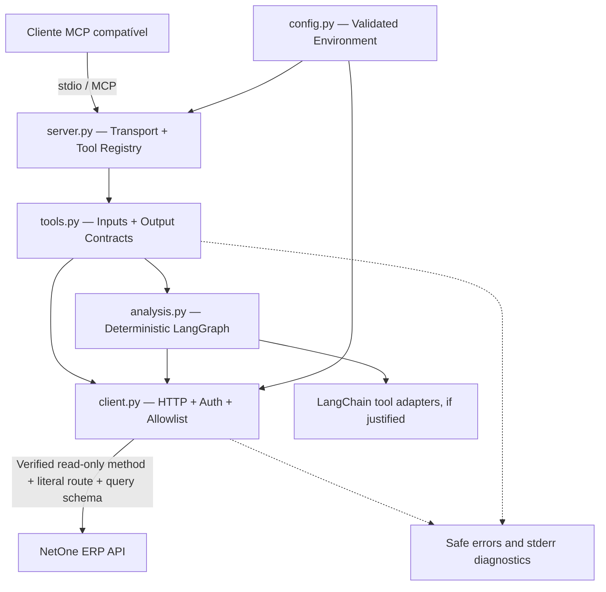
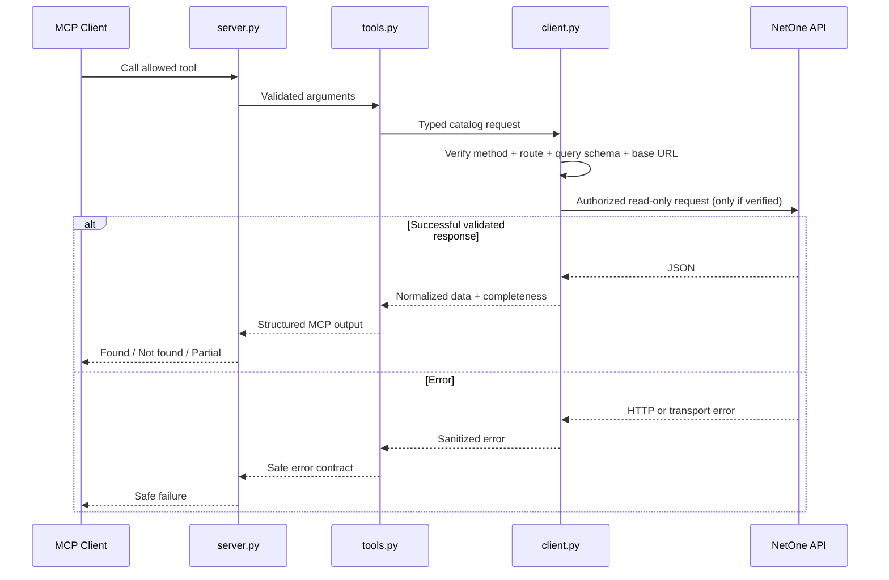
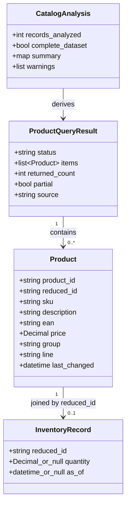
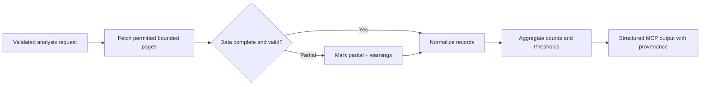

# PRD — NetOne MCP: Servidor de Consulta e Análise Read-Only

> **Versão:** 1.1.0 — revisão autorizada: POST de consulta com allowlist e sem mutação comercial  
> **Data:** 27/10/2026  
> **Status:** NOT_READY — POSTs de consulta candidatos aprovados no planejamento; G0 = BLOCKED por validação de segurança/execução pendente, não pelo método HTTP; nenhuma operação comercial liberada  
> **Produto:** `netone-mcp`  
> **Distribuição prevista:** repositório público, instalação por operador autorizado  
> **Stack central:** Python **3.14+** · SDK MCP mantido · LangChain **1.x+** · LangGraph · cliente HTTP · Pydantic · `.venv` · `requirements.txt`  
> **Referência de organização:** [SCSI — pycodebr/scsi, branch `main`](https://github.com/pycodebr/scsi/tree/main)  
> **Regra fundamental:** nenhuma ferramenta ou fluxo pode alterar dados comerciais do ERP.

---

## Sobre este documento

Este `PRD.md` é a **fonte única de verdade para planejamento e implementação do NetOne MCP**. Deve ser consultado a cada sprint, antes de mudanças arquiteturais e na revisão dos critérios de aceite. Seu formato acompanha os aspectos relevantes do [PRD do SCSI](https://github.com/pycodebr/scsi/blob/main/PRD.md): visão de produto, escopo, jornadas, regras transversais, arquitetura, stack, estrutura de projeto, contratos funcionais, segurança, decisões técnicas, critérios de aceite, roadmap e sprints detalhadas.

**Convenções:**

- Explicações e planejamento neste PRD: **português brasileiro**. Nomes de pacotes, arquivos, funções, classes, ferramentas MCP, variáveis, logs padronizados e documentação pública (`README.md`, `docs/`) devem estar em **inglês**.
- Tarefas são checklists Markdown no formato **`- [ ]`**, alterados para **`- [x]`** somente após verificação efetiva.
- Diagramas são escritos em **Mermaid**; representam decisões de projeto, não funcionalidades já implementadas.
- **`CONFIRMADO`** = observado em código-fonte/documentação verificável; **`PENDENTE`** = depende de evidência adicional; **`BLOQUEADO`** = proibição ou dependência crítica não satisfeita; **`PROPOSTO`** = decisão deste PRD, ainda não implementada.
- A especificação distingue **requisitos**, **evidências externas**, **hipóteses** e **entregas futuras**. Nenhum exemplo de JSON, endpoint ou fluxo proposto comprova suporte real da API.
- Qualquer alteração de escopo deve atualizar a versão do PRD, o registro de decisões, os riscos, o roadmap e as sprints afetadas; nunca marcar tarefas retroativamente sem evidência.

> **Política vigente — autorização explícita do responsável em 27/10/2026:** read-only significa **ausência de mutação comercial**, não obrigatoriedade de GET. A versão 1.1.0 substitui a proibição geral de POST comercial pela admissão restrita dos POSTs documentados de consulta de reduzidos, preços e estoque, identificados literalmente na seção 10.5. Isso permite planejar/adaptar a lógica legada; não autoriza copiar código inseguro, iniciar outras sprints, executar chamadas reais, liberar tools ou presumir segurança só pelo método HTTP. Cadastro, alteração, exclusão, reserva, movimentação e sincronização com escrita permanecem proibidos. S0.11 e G0 continuam bloqueados pela evidência de segurança e validação ainda pendentes. A antiga política GET-only é histórica e não rege novas implementações.

## Índice

1. [Visão geral](#1-visão-geral-do-produto)
2. [Objetivos e métricas](#2-objetivos-e-métricas)
3. [Escopo, premissas e exclusões](#3-escopo-premissas-e-exclusões)
4. [Público-alvo e jornadas](#4-público-alvo-e-jornadas)
5. [Regras gerais](#5-regras-gerais-do-sistema)
6. [Arquitetura geral](#6-arquitetura-geral)
7. [Adaptação fiel dos padrões SCSI](#7-adaptação-dos-padrões-do-scsi)
8. [Stack técnica](#8-stack-técnica)
9. [Estrutura do repositório](#9-estrutura-do-repositório)
10. [Mapeamento da API e evidências](#10-mapeamento-da-api-e-evidências)
11. [Modelo de domínio e dados](#11-modelo-de-domínio-e-dados)
12. [Requisitos funcionais](#12-requisitos-funcionais)
13. [Contratos das ferramentas MCP](#13-contratos-das-ferramentas-mcp)
14. [Fluxos LangChain e LangGraph](#14-fluxos-langchain-e-langgraph)
15. [Autenticação, autorização e isolamento](#15-autenticação-autorização-e-isolamento)
16. [Segurança e política read-only](#16-segurança-e-política-read-only)
17. [Tratamento de erros](#17-tratamento-de-erros)
18. [Qualidade e consistência dos dados](#18-qualidade-e-consistência-dos-dados)
19. [Requisitos não funcionais](#19-requisitos-não-funcionais)
20. [Observabilidade](#20-observabilidade)
21. [Variáveis de ambiente](#21-variáveis-de-ambiente)
22. [Documentação e operação](#22-documentação-e-operação)
23. [Validação manual](#23-validação-manual)
24. [Riscos e mitigação](#24-riscos-e-mitigação)
25. [Decisões técnicas](#25-decisões-técnicas)
26. [Critérios de aceite](#26-critérios-de-aceite)
27. [Roadmap](#27-roadmap-de-desenvolvimento)
28. [Sprints de implementação](#28-sprints-de-implementação-em-checklist)
29. [Registro de pendências](#29-registro-de-pendências-e-decisões)
30. [Definition of Done](#30-definition-of-done)
31. [Fontes e referências](#31-fontes-e-referências)

---

## 1. Visão Geral do Produto

### 1.1 Descrição

O **NetOne MCP** é um servidor independente que expõe, através do **Model Context Protocol (MCP)**, consultas autorizadas a dados comerciais disponibilizados pela API NetOne. Os clientes MCP poderão pesquisar produtos e, se suportado por endpoints comprovadamente seguros, consultar preço, estoque, SKU, EAN e realizar análises determinísticas de catálogo, **sem realizar escrita no ERP**.

A instalação deve funcionar com credenciais fornecidas pelo próprio operador autorizado e URL base configurável; nenhum usuário, empresa, domínio específico, agente de IA ou provedor de LLM deve ser necessário para executar o servidor.

### 1.2 Problema

Integrar sistemas assistidos por IA a ERPs frequentemente exige código específico, cria risco de expor credenciais ou concede ferramentas capazes de modificar registros. Informações retornadas também podem ser mal interpretadas como estoque e preços atuais, mesmo quando incompletas. O produto oferece uma interface controlada, de finalidade restrita e rastreável.

### 1.3 Proposta de valor

1. **Segurança por construção:** catálogo estritamente allowlist de operações de leitura autorizadas.
2. **Fidelidade dos dados:** nunca inventar produto, estoque, preço ou disponibilidade.
3. **Interoperabilidade:** ferramentas MCP padronizadas e independentes de cliente.
4. **Reutilização:** configuração por instalação, sem dependência de informações particulares.
5. **Manutenibilidade:** projeto Python pequeno, modular e documentado, seguindo os princípios aplicáveis do SCSI.

### 1.4 Status de evidência

- **CONFIRMADO em código legado, reinspecionado na Sprint 0:** cabeçalho `netone-auth-token`; paginação com chaves `page`, `limit`, `totalPages`, `result`; requisições **POST** de produtos e estoque; lotes com `idsReduzidos`. Nenhum código legado foi executado.
- **CONFIRMADO na documentação oficial em 27/10/2026:** as dez consultas do grupo Produto inspecionadas usam **POST**; autenticação por token de usuário no header, recuperável no ERP ou por **POST de autenticação** `/app-web/api/v2/auth/login`. Estoque é físico menos reservas, no depósito informado ou parametrizado do usuário; `valor` é descrito como varejo, distinto de atacado. Evidências e conflitos: `docs/api-capabilities.md`.
- **NÃO CONFIRMADO:** ausência de efeitos colaterais comerciais dos candidatos de consulta, limites reais, validade/renovação do token, eventual OAuth, permissões e contratos executados na instalação. GET equivalente não é mais pré-requisito; nenhum método, isoladamente, comprova segurança. Nenhuma chamada autenticada foi realizada.
- **PROPOSTO:** servidor stdio, validação tipada, normalização de respostas, limites conservadores, documentação pública e análise sem LLM obrigatório.

---

## 2. Objetivos e Métricas

### 2.1 Objetivos de produto

- Disponibilizar consultas comerciais úteis por meio de ferramentas MCP descobertas corretamente.
- Tornar impossível alcançar endpoints de escrita por parâmetros MCP ou por configuração não autorizada.
- Facilitar instalação em computador local, com credenciais seguras e configuração externa.
- Permitir reutilização pública do **código**, sem publicação de dados comerciais ou segredos.
- Informar claramente dados ausentes, informações parciais, falhas de API e limitações.

### 2.2 Objetivos técnicos

- Compatibilidade com Python **3.14+** e versões verificadas do SDK MCP, LangChain e LangGraph.
- Nenhuma dependência obrigatória de banco de dados, Docker, servidor web, LLM ou sistema de filas.
- Um único `requirements.txt` na raiz; um `.venv` na raiz; `config.py` como ponto central de configuração.
- Comunicação HTTP encapsulada em um único cliente, com autenticação, timeouts, paginação, throttling e erros consistentes.
- Tools MCP com contratos estáveis e descrições claras para seleção por clientes de IA.

### 2.3 Metas mensuráveis de aceite (objetivos, não resultados já medidos)

| Indicador | Meta para V1 | Como comprovar |
|---|---|---|
| Ferramentas de escrita | **0** | Inspecionar registry e código de todas as tools |
| Operações comerciais HTTP não allowlisted | **0** | Revisar transporte central e rotas permitidas |
| Vazamento de segredos em documentação e logs | **0** | Inspeção manual de arquivos e saída stderr |
| Inicialização sem LLM | **Obrigatória** | Executar servidor sem API key de IA |
| Descoberta de tools MCP | **100% das tools liberadas** | Inspeção manual com cliente MCP |
| Respostas com origem/estado dos dados | **100% das tools comerciais** | Verificar contratos de retorno |
| Fluxos com dados parciais | **Indicação explícita** | Simular limitação com dados sanitizados e revisar resposta |
| Consulta real de produtos | **Somente por operação read-only aprovada** | Contrato documentado + revisão de ausência de mutação + validação autorizada |

**Tempo de resposta:** estabelecer baseline durante a validação; não declarar SLA numérico sem dados reais da API. Definir limites de tamanho, tempo e número de requisições antes de qualquer consulta ampla.

---

## 3. Escopo, Premissas e Exclusões

### 3.1 No escopo V1, condicionado a operação read-only comprovada

- Conexão com uma instância NetOne configurada por ambiente.
- Autenticação estritamente necessária às leituras comprovadas.
- Pesquisa/listagem de produtos, consulta por identificador, SKU ou EAN, preço e estoque — **somente quando cada operação for comprovada e autorizada**.
- Análise determinística de dados retornados: contagem, agrupamento, produtos sem estoque, baixo estoque e qualidade do catálogo, se campos suficientes existirem.
- Exposição via MCP stdio para qualquer cliente compatível.
- Tratamento de erros, paginação, limites, normalização, documentação e validação manual.

### 3.2 Fora do escopo V1 — proibições

- Criar, editar, atualizar, excluir, reservar ou movimentar qualquer registro comercial.
- Alterar preços, estoque, vendas, pedidos, clientes, fornecedores, regras ou cadastros.
- Endpoint HTTP arbitrário, proxy genérico, execução de comandos ou SQL arbitrário.
- Operações comerciais mutáveis por **qualquer método**, incluindo GET; PUT, PATCH, DELETE e POST fora dos candidatos de consulta aprovados na seção 10.5. POST não é permitido genericamente: método, rota e schema de consulta precisam de revisão individual, validação e allowlist literal.
- Ferramentas MCP de autenticação administrativa ou divulgação de tokens.
- Banco de dados próprio, sincronização persistente, migrations, cache persistente.
- Testes unitários, de integração automatizados ou arquivos de testes.
- Docker, Compose, Kubernetes, CI/CD, workflows de publicação automatizados.
- Interface web, dashboard, APIs HTTP públicas, filas, Celery, agentes autônomos ou multiagentes, memória persistente.
- Hospedagem, implantação ou integração específicas para aplicativos, marcas de clientes MCP e provedores LLM.
- Operações Git automatizadas, inclusive clone, pull, checkout, commit, push e alteração de branches.

### 3.3 Premissas

- O operador tem acesso autorizado à API e configura seus segredos localmente.
- A base URL é fornecida via ambiente, sem domínio particular codificado no software.
- O arquivo `.env` original do ambiente de desenvolvimento, quando presente, deve ser **preservado integralmente**.
- O ERP é a fonte de verdade para atributos comerciais; análises derivadas devem indicar sua natureza calculada.
- O protocolo MCP pode ser usado por qualquer cliente compatível; o servidor não autentica ou administra usuários do cliente.

### 3.4 Gate de viabilidade obrigatório

**G0 — Condição para liberar as Sprints 4 a 10 com operações reais:**

1. Obter documentação e evidências dos métodos, rotas e formatos dos recursos pretendidos.
2. Comprovar pelo menos uma operação comercial de consulta efetivamente sem mutação de negócio, pelo método exato documentado; POST só nos candidatos da seção 10.5. Descrever evidência, limites e como efeitos colaterais foram descartados; uma resposta 200 ou o nome «Busca» não bastam.
3. Comprovar autenticação autorizada e ausência de exposição de segredos.
4. Registrar o catálogo de endpoints e suas evidências no inventário de capacidades.
5. Se nenhuma operação satisfizer contrato, revisão de segurança e validação autorizada, classificar o núcleo comercial como **BLOQUEADO**. A inexistência de GET não bloqueia por si só. Fundação offline pode ser preparada em outra sprint expressamente autorizada, sem contornar a política READ-ONLY.

**Situação atual:** os três POSTs centrais são candidatos documentados e aceitos para planejamento, não rotas liberadas. A autorização desta revisão cobre documentos; não cobre login, chamadas reais ou início da Sprint 1. G0 = BLOCKED enquanto S0.11 e validação operacional segura não tiverem evidência. Implementar um cliente seguro para posterior validação em sprint autorizada não exige fingir G0 = PASS; chamadas comerciais continuam bloqueadas até aprovação específica.

---

## 4. Público-Alvo e Jornadas

### 4.1 Personas

**Operador técnico autorizado:** instala o MCP, informa URL e credenciais, acompanha erros e atualiza versões. Não precisa modificar o sistema ERP.

**Analista comercial:** faz perguntas sobre catálogo e estoque por meio de um cliente MCP com permissão prévia. Precisa de fontes confiáveis, limites e erros claros.

**Mantenedor open source:** lê README e o PRD, verifica a política read-only, mantém adaptadores permitidos sem adicionar complexidade indevida.

### 4.2 Jornada J01 — instalação

1. O operador instala Python 3.14+ e cria `.venv` na raiz.
2. Instala o único `requirements.txt`.
3. Configura variáveis, sem modificar `.env` já existente de outro operador.
4. Inicia `server.py` por stdio e conecta seu cliente MCP.
5. Confirma a descoberta das tools liberadas e a ausência de ferramentas de escrita.

### 4.3 Jornada J02 — pesquisa de produto

1. Cliente MCP envia termo com tamanho válido.
2. Tool valida o termo, escopo e limite máximo.
3. Cliente HTTP realiza apenas operações read-only comprovadas, por método e rota literais allowlisted e body de consulta validado.
4. O servidor normaliza e limita os resultados.
5. A resposta diferencia `found`, `not_found`, `partial` e `error` sem inventar dados.

### 4.4 Jornada J03 — estoque/preço

1. Cliente consulta por identificador comercial aceito e validado.
2. O servidor consulta exclusivamente o recurso permitido.
3. Valor e quantidade preservam a fonte, a unidade e eventual ausência.
4. Resultado traz observação de temporalidade da consulta; não garante disponibilidade futura.

### 4.5 Jornada J04 — análise do catálogo

1. Cliente solicita resumo limitado a dados comprovadamente coletáveis.
2. Um fluxo determinístico agrega resultados, trata paginação e calcula indicadores.
3. A resposta especifica o universo analisado, a regra de cálculo e os campos faltantes.
4. Nenhuma análise dispara mutações ou depende de modelo de linguagem.

### 4.6 Jornada J05 — falha segura

1. Credenciais inválidas, erro 429, indisponibilidade, timeout ou formato inesperado.
2. A tool retorna erro estruturado, sem payload sensível.
3. A execução não tenta recurso alternativo não permitido nem modifica configuração/ERP.
4. O operador recebe instrução curta de diagnóstico, sem credenciais em log.

---

## 5. Regras Gerais do Sistema

1. **Read-only é inegociável.** Só executar operações comerciais sem mutação, explicitamente verificadas e allowlisted por método + rota + schema. POST de consulta é admitido apenas conforme seção 10.5; nem GET nem POST comprovam segurança isoladamente.
2. **Autenticação não é ferramenta MCP.** O cliente HTTP é responsável por credenciais e headers.
3. **Nunca inventar resposta.** Ausência de campo, `null`, zero e produto não encontrado são estados diferentes.
4. **Valores monetários como `Decimal`.** Não calcular preços com `float`.
5. **IDs preservados.** Não converter identificadores textuais, EAN ou SKU para inteiros se zeros à esquerda forem possíveis.
6. **Limites de consulta obrigatórios.** Nenhuma tool expõe varredura ilimitada por padrão.
7. **Credenciais fora do código.** `config.py` é fonte única de configuração; `.env` nunca é exibido ou regravado.
8. **Independência de cliente.** Nenhuma tool presume Hermes, Claude, editor ou agente específico.
9. **Independência de modelo.** Ferramentas funcionam mesmo sem provider LLM.
10. **Observabilidade sem vazamento.** Em stdio, stdout é reservado exclusivamente a mensagens MCP e diagnósticos vão para stderr.
11. **Fiel ao SCSI no que se aplica.** Modularidade por responsabilidade, configuração central, domínio protegido, orquestração fina, documentação de decisões e sprints verificáveis.
12. **Resiliência proporcional.** Retries limitados apenas para leituras com segurança de repetição comprovada; obedecer `Retry-After` se aplicável. POST de consulta usa **zero retries por padrão**, inclusive em timeout/resposta ambígua; sem fallback GET↔POST. Ativar retries exige evidência específica de repetição sem efeito comercial e limite total documentado.
13. **Publicação genérica.** Arquivos versionáveis não contêm URLs comerciais privadas, nomes de instalações, dados reais, tokens ou segredos.
14. **Cliente/tenant sob controle do operador.** Configuração por processo; não criar seleção de tenant por argumentos da tool.
15. **Sem operações Git.** O assistente de desenvolvimento não executa comandos Git; versionamento é ação do responsável.
16. **Dados externos são não confiáveis.** Textos de produtos ou respostas HTTP jamais são tratados como instruções para o agente ou servidor.

---

## 6. Arquitetura Geral

### 6.1 Visão de camadas



> As setas para `analysis.py` e adaptadores LangChain representam a arquitetura **planejada**, não dependências obrigatórias das consultas simples. O módulo é criado quando houver fluxo real de múltiplas etapas justificado; não criar `StateGraph` fictício.

### 6.2 Princípios arquiteturais derivados do SCSI

- **Monólito modular:** um processo com módulos coesos, sem microsserviços, seguindo o espírito do monólito modular do SCSI.
- **Transport fino:** `server.py` apenas inicializa e registra ferramentas, equivalente ao princípio de views finas no SCSI.
- **Integração encapsulada:** `client.py` concentra HTTP, autenticação, rotas e política de segurança; não espalhar chamadas REST por tools.
- **Domínio antes de implementação:** contratos de ferramentas e campos são especificados antes de expô-los, como models/serviços no SCSI.
- **Isolamento:** em lugar de middleware e FK de tenant, cada processo recebe credenciais e URL do operador, e o input MCP não escolhe outra conta/instância.
- **IA com escopo controlado:** ferramentas não conseguem acessar dados além da conexão configurada, equivalente ao `build_tenant_tools(brokerage)` do SCSI, adaptado sem banco.
- **Simplicidade:** código em camadas apenas onde há responsabilidade real, sem repository/factory/service artificial.

### 6.3 Sequência de consulta



### 6.4 Fronteiras de confiança

- **Cliente MCP → servidor:** argumentos não confiáveis; validar schema, limites e escopo.
- **Servidor → ERP:** somente domínio aprovado, HTTPS, método + rota literais aprovados, body/filtros de consulta tipados e autenticação protegida. Não seguir redirects comerciais automaticamente, inclusive 301/302/303/307/308, nem reescrever método ou repetir POST por redirecionamento.
- **ERP → servidor:** JSON não confiável; validar forma/tipos, tamanho e conteúdo, sem execução de instruções.
- **Servidor → logs:** mensagens resumidas, sem headers de autenticação, corpo bruto sensível, URL com query secreta ou produto comercial completo por padrão.

---

## 7. Adaptação dos Padrões do SCSI

**Referência inspecionada:** [`pycodebr/scsi`, branch `main`](https://github.com/pycodebr/scsi/tree/main), incluindo `PRD.md`, `docs/architecture.md`, `docs/ai-agents.md`, `docs/local-dev.md`, `docs/env-vars.md`, `core/settings.py`, `ai_agents/tools.py`, `ai_agents/agents.py`, `requirements.txt` e a árvore de arquivos do repositório.

**Reinspeção da Sprint 0:** revisão `aaddb90e88987ea2d2bca114e4cdd7c0a0f36ae3`, obtida por HTTP da branch `main`; árvore não truncada, 34 arquivos recuperados nos caminhos solicitados. Matriz com fontes por arquivo/linha em `docs/scsi-reference.md`. O código inspecionado não sustenta copiar o grafo de resumo como fluxo funcional: há nós que apenas retornam estado e o caminho `run_summary_agent` chama LLM diretamente; também existem divergências entre tools documentadas e retornadas. Aproveitar princípios, não scaffolds, infraestrutura ou promessas não executadas do upstream.

| Padrão do SCSI | Decisão no NetOne MCP | Motivo |
|---|---|---|
| PRD abrangente como fonte de verdade | **Adotar** | Roadmap e critérios tornam a execução verificável |
| Monólito modular com responsabilidades coesas | **Adotar/adaptar** | Módulos pequenos no mesmo processo |
| `core/settings.py` centralizado | **Adaptar para `config.py`** | Requisito explícito do projeto; evita importar Django |
| Apps separadas por domínio | **Adotar na medida necessária** | Hoje um domínio: catálogo de produtos; não criar dezenas de diretórios vazios |
| Thin views + lógica fora da borda | **Adotar** | Registry MCP fino; lógica no cliente/analisador |
| Isolamento tenant em cada query | **Adaptar** | Isolamento por configuração de processo e credenciais; sem modelo de tenants/DB |
| Tools de IA com acesso restrito | **Adotar** | Não deixar o modelo escolher URL, credencial ou recurso |
| LangChain + `StateGraph` LangGraph | **Adotar quando houver fluxo real** | Agregações determinísticas sem API key LLM |
| Segurança, documentação em `docs/` e runbook | **Adotar** | Operação pública sustentável |
| Campos monetários `Decimal` e dados tipados | **Adotar** | Preservação de valores comerciais |
| PostgreSQL, Django ORM e migrations | **Não replicar** | Não existe persistência própria nem aplicação web |
| UI, templates, Bootstrap/Design System | **Não replicar** | MCP não tem interface gráfica |
| Celery, RabbitMQ, Redis, agendamentos | **Não replicar** | Sem jobs assíncronos permanentes |
| Docker, Swarm, Traefik e deployment | **Não replicar** | Proibição expressa no escopo NetOne |
| Testes automatizados e CI/CD | **Não replicar** | Proibição expressa; substituir por plano manual |

**Regra de precedência:** (1) segurança e proteção dos dados; (2) restrições explícitas do prompt NetOne; (3) evidência real da API; (4) padrões arquiteturais aplicáveis do SCSI; (5) preferência por simplicidade. A frase “replicar o SCSI fielmente” significa reproduzir **princípios, organização documental e disciplina de arquitetura**, não copiar componentes incompatíveis com o problema e com as proibições expressas.

---

## 8. Stack Técnica

| Camada | Tecnologia | Requisito / política | Justificativa |
|---|---|---|---|
| Linguagem | Python | **`>=3.14` e `<4` (enquanto compatível)** | `>3.13` significa 3.14+, sem rebaixamento silencioso |
| Ambiente | `venv` | **`.venv` na raiz** | Sem ambientes adicionais |
| Dependências | `requirements.txt` | **Único arquivo na raiz** | Facilidade de operação |
| MCP | SDK Python oficial MCP ou SDK mantido compatível | Fixar versão compatível após verificação | Tools e stdio interoperáveis |
| HTTP | `httpx` **ou** `requests` | Escolher **um** cliente | Sem duplicação de responsabilidades |
| Schemas | Pydantic 2.x | Dependência quando justificada | Inputs/outputs tipados |
| Configuração | `python-dotenv` ou padrão já compatível | Não modificar `.env` existente | Carregamento seguro |
| IA tools | `langchain>=1.0` | Mandatório; uso funcional justificado | Abstrações de ferramentas quando úteis |
| Fluxos | `langgraph` | Mandatório; `StateGraph` quando houver análise multietapas | Orquestração determinística |
| Logging | `logging` da stdlib | Sem biblioteca extra por padrão | Saída stderr filtrada |
| Valores comerciais | `decimal.Decimal` | Padrão | Evita erro binário de `float` |

**Política de versões:** não inventar compatibilidades; verificar no momento da implementação as versões concretas que suportam Python 3.14, o SDK MCP e a composição LangChain/LangGraph. Registrar versões compatíveis no `requirements.txt` e instalações/atualizações efetivamente verificadas. Não importar dependências herdadas do SCSI que não participem do produto.

**LangChain e LangGraph:** exigidos no projeto, mas **não** no caminho crítico de uma busca simples. Consultas básicas continuam possíveis sem chamar LLM ou criar graph. Se as verificações demonstrarem que nenhuma operação real comporta orquestração multietapas, registrar o requisito funcional pendente; não simular uso apenas para satisfazer o checklist.

---

## 9. Estrutura do Repositório

### 9.1 Estrutura mínima desejada da V1

```text
netone-mcp/
├── .venv/                  # Local; never commit
├── .env                    # Existing local secrets; never overwrite or commit
├── .env.example            # Placeholder keys only; when safe to create
├── .gitignore              # Must exclude .env, .venv and local secrets
├── PRD.md                  # Canonical requirements and sprint checklist
├── README.md               # Public English entry point
├── requirements.txt        # Single dependency manifest
├── config.py               # Centralized validated environment
├── client.py               # Authentication + HTTP + endpoint allowlist
├── tools.py                # MCP-facing typed read-only tools
├── server.py               # MCP registration and stdio entry point
├── analysis.py             # Optional: real deterministic LangGraph flow
└── docs/
    ├── architecture.md     # SCSI-inspired architecture and boundaries
    ├── api-capabilities.md # Verified endpoint evidence matrix
    ├── security.md         # Read-only and secret handling
    ├── local-dev.md        # Setup and launch
    └── runbook.md          # Manual troubleshooting and validation
```

### 9.2 Regras de expansão de estrutura

- Criar somente arquivos que tenham implementação, responsabilidade e consumidores reais.
- `analysis.py` só entra quando o fluxo de múltiplas etapas tiver fontes e critérios comprovados.
- Se o catálogo de ferramentas crescer significativamente, **pode-se** extrair `products/` como módulo coeso na raiz, à maneira das apps irmãs do SCSI, preservando `server.py`, `config.py` e interfaces públicas.
- `docs/` usa Markdown puro por padrão; adicionar MkDocs apenas mediante necessidade explícita, evitando dependências e build desnecessários.
- Não criar `tests/`, `db/`, `models/` com ORM, `migrations/`, `templates/`, `static/`, `Dockerfile`, `docker-compose.yml`, scripts de CI ou módulos sem consumidores.
- Ninguém deve reformatar, remover, sobrescrever ou revelar um `.env` já existente.

### 9.3 Responsabilidade de cada módulo

**`config.py`**: resolve diretório-raiz, lê ambiente de modo não destrutivo, valida base URL e parâmetros seguros; fornece configurações tipadas sem mostrar valores.

**`client.py`**: sessão HTTP, headers, autenticação comprovada, allowlist de métodos/rotas, paginação, tempo limite, limite de payload, retries seguros e erros sanitizados.

**`tools.py`**: expõe operações MCP permitidas, define descrições e entradas tipadas, orquestra consultas simples, normaliza retornos de acordo com a seção 13.

**`server.py`**: inicializa servidor stdio, instancia dependências, registra apenas ferramentas aprovadas, mantém stdout limpo.

**`analysis.py`**: se existir, encapsula `StateGraph` determinístico, cálculos, validação de universo e sinalização de parcialidade; sem agente autônomo.

---

## 10. Mapeamento da API e Evidências

### 10.1 Fontes e limites da investigação

A Sprint 0 reinspecionou o legado local por leitura e a [documentação oficial API v2](https://net1ti.stoplight.io/docs/erp-api-v2/ZG9jOjQ3ODQzMw-guia-rapido) no navegador, após renderização. O extrator de URLs estava indisponível, mas o acesso anônimo às páginas oficiais funcionou. Foram inspecionadas as dez consultas do grupo Produto, o login, artigos e schemas relevantes. Não foram usados botões de envio, credenciais nem chamadas ao ERP. Contratos publicados, observação de código e validação remota são evidências distintas; esta última não foi realizada. O inventário detalhado e sanitizado está em `docs/api-capabilities.md`.

### 10.2 Matriz de evidências iniciais

| Capacidade | Evidência legada/oficial | Método observado | Segurança/execução validada? | Status V1 |
|---|---|---|---|---|
| Buscar produtos reduzidos | Legado e referência oficial `/app-web/api/v2/produto/reduzidos`; paginação publicada | **POST** | **Não** | **BLOQUEADO** |
| Consultar estoque em lote | Legado e referência oficial `/app-web/api/v2/produto/estoque`; conflito schema/exemplo de `idsReduzidos` | **POST** | **Não** | **BLOQUEADO** |
| Buscar produto por ID | POST de reduzidos documenta filtros de IDs; endpoint de detalhes dedicado não comprovado | **POST de consulta candidato** | **Não** | **PENDENTE** |
| Consultar preço por ID | Referência oficial `/app-web/api/v2/produto/precos`, filtros de IDs; varejo/atacado distintos | **POST** | **Não** | **BLOQUEADO** |
| Buscar por SKU/EAN | Campos observados no catálogo; busca local do protótipo | Não verificado | **Não** | **PENDENTE** |
| Listagem paginada | POST de reduzidos/estoque/preços documenta page/limit; tetos pendentes | **POST de consulta candidato** | **Não** | **PENDENTE** |
| Autenticação por token de usuário | Artigo oficial confirma `netone-auth-token`; login `/app-web/api/v2/auth/login`, body `usuario`, `senha` | **POST somente para login** | Não se aplica | **DOCUMENTADO; execução não validada** |
| OAuth / renovação de token | Não comprovados nas fontes inspecionadas; regeneração no ERP invalida token anterior | Não verificado | Não se aplica | **PENDENTE — não presumir** |

**Resultado G0 vigente em 27/10/2026: BLOCKED — validação de segurança/execução pendente.** A revisão 1.1.0 admite os três POSTs centrais como candidatos de consulta; não exige GET equivalente nem libera requisições reais. Os sete POSTs auxiliares continuam apenas inventariados, fora da admissão restrita desta revisão. Nenhuma rota comercial está liberada. S0.11 permanece pendente, agora avaliando ausência de mutação comercial independentemente de GET ou POST.

### 10.3 Inventário obrigatório por endpoint, para `docs/api-capabilities.md`

Para cada endpoint a liberar, documentar:

1. Identificador interno neutro, nome da capacidade e origem da evidência.
2. Método HTTP exato e path relativo **sanitizado**, sem domínio privado.
3. Semântica read-only: confirmação de que não altera dados comerciais.
4. Autenticação exigida, em **nomes de variáveis**, nunca valores.
5. Parâmetros, filtros, tipos, limites, paginação e exemplos sintéticos.
6. Campos JSON obrigatórios/opcionais e validações de formato.
7. Códigos de erro, comportamento de timeout/rate limiting.
8. Evidência de validação autorizada (data, cenário, resultado sem segredos).
9. Ferramentas MCP que podem consumir o endpoint.
10. Estado: `CONFIRMADO`, `PENDENTE`, `BLOQUEADO` ou `RETIRADO`.

### 10.4 Política de desbloqueio

Um endpoint só passa a **LIBERADO** quando: método exato documentado e enquadrado na política; ausência de mutação comercial tecnicamente sustentada; par método + rota literal e schema/filtros revisados; autenticação e escopo conhecidos; limites oficiais conhecidos ou limites locais conservadores explicitamente registrados, sem alegar quotas do fornecedor; resultado de validação autorizada verificado; e critérios registrados no inventário. **Nunca adivinhar rotas, trocar GET por POST ou liberar uma operação somente porque outra usa o mesmo método.** A autorização de uma chamada manual delimitada de validação é separada da liberação de tool e depende da revisão prévia de segurança, configuração protegida e transporte seguro; não exige uma tool já registrada. Um HTTP 200 isolado não comprova ausência de mutação.

### 10.5 POSTs de consulta admitidos por autorização restrita

Em 27/10/2026 o responsável autorizou revisar a política GET-only para reutilizar, com controles, a lógica de consulta do legado. **Admitidos como candidatos de planejamento, não liberados para execução:**

| Método | Path literal completo | Finalidade e fonte oficial |
|---|---|---|
| POST | `/app-web/api/v2/produto/reduzidos` | Consulta de reduzidos, filtros/paginação — O3 no inventário |
| POST | `/app-web/api/v2/produto/precos` | Consulta de preços, filtros/paginação — O5 no inventário |
| POST | `/app-web/api/v2/produto/estoque` | Consulta de saldo, filtros/paginação — O4 no inventário |

- O método POST transporta o body de consulta, não autoriza payload de cadastro/atualização. O futuro cliente escolhe operação/método/rota internamente, aceita apenas filtros tipados documentados, rejeita campos desconhecidos e nunca encaminha body arbitrário da tool.
- O reaproveitamento é da lógica de token, filtros, paginação e associação por reduzido; não copiar hosts, credenciais, loops ilimitados, floats monetários, `print()` no stdout, tratamento de erro cru ou lote 100 como suposto limite oficial.
- PUT, PATCH, DELETE, POSTs fora desta tabela e qualquer operação de escrita, reserva, movimentação ou sincronização mutável continuam proibidos. Os sete endpoints auxiliares inventariados não são liberados por associação; exigem nova decisão explícita de escopo e revisão individual. GET também exige evidência e allowlist antes de uso.
- POST de consulta começa com **zero retries**, sem redirects automáticos e sem fallback de método/rota. Repetição automática só após comprovar segurança específica de repetição; timeout é erro, não autorização para reenviar.
- A futura allowlist operacional fica vazia até revisão/validação por operação; ferramentas não verificadas permanecem ausentes. Não usar respostas falsas nem ocultar POST sob proxy GET.
- Autenticação `/app-web/api/v2/auth/login` permanece separada, sem ferramenta MCP; não integra esta tabela comercial. A autorização atual não permite login, token rotation, chamadas reais ou início de outra sprint.

---

## 11. Modelo de Domínio e Dados

### 11.1 Modelos lógicos, sem banco de dados



> O diagrama expressa um modelo **conceitual proposto** para validação interna. Os tipos e cardinalidades finais dependem de evidência da API; não gerar tabelas ou ORM.

### 11.2 Mapeamento preliminar de campos observados no código legado

| Campo NetOne observado | Campo normalizado proposto | Regra |
|---|---|---|
| `idProduto` | `product_id` | Preservar identidade e tipo original compatível; serializar de modo consistente |
| `idReduzido` | `reduced_id` | Chave de união com estoque; preservar sem perda |
| `mascara` | `product_mask` (proposta revisada na Sprint 0) | Código textual do produto; não confundir com `codigoSku`; preservar zeros |
| `codigoSku` | `sku` (proposto, a validar) | Código textual do reduzido, oficialmente pode ser `null`; preservar identidade separada da máscara |
| `descricao` | `description` | Preservar texto; normalizar espaços apenas onde seguro |
| `grupoDescricao` | `group` | Opcional conforme resposta real |
| `linhaDescricao` | `line` | Opcional conforme resposta real |
| `ean` | `ean` | String, nunca coerção numérica destrutiva |
| `valor` | `price` | `Decimal` ou `null`; não presumir moeda/tabela sem comprovação |
| `quantidade` | `quantity` | Numérico ou `null`; não presumir filial/depósito |
| `ultimaAlteracaoTimestamp` | `last_changed` | Parse seguro; timezone somente se comprovado |

**Observação:** a documentação descreve IDs inteiros, `valor` de varejo e `valorAtacado` de atacado; estoque físico menos reservas, por depósito informado ou parametrizado. Isso não comprova unicidade, moeda, unidade, nulidade completa, depósito efetivo ou permissões da instalação. `mascara` e `codigoSku` são distintos; o modelo conceitual ainda depende de validação antes de implementação.

### 11.3 Estados de presença de dados

| Situação | Representação | Interpretação |
|---|---|---|
| Produto não encontrado | `not_found` | Consulta válida, resultado vazio |
| Campo ausente | `null` + aviso quando relevante | Não informado |
| Estoque `0` confirmado | `0` | Quantidade zero no escopo consultado |
| Estoque não informado | `null` | Desconhecido; **não** concluir indisponibilidade |
| Resultado parcial | `partial=true` | Universo incompleto, análise limitada |
| API com erro | `error` | Nenhuma conclusão comercial confiável |
| Valor monetário zero | `"0.00"` quando comprovado | Valor zero real, não fallback |

---

## 12. Requisitos Funcionais

| ID | Requisito | Prioridade | Dependência |
|---|---|---|---|
| RF01 | Iniciar servidor MCP stdio e expor tools liberadas | Must | SDK compatível |
| RF02 | Validar URL, configuração e token sem vazamento | Must | `config.py` |
| RF03 | Permitir exclusivamente operações read-only allowlisted por método + rota + schema | Must | Inventário verificado; POST restrito à seção 10.5 |
| RF04 | Pesquisar produtos com termo e limite | Should, condicionado | Consulta de catálogo validada; não presumir filtro textual |
| RF05 | Consultar produto pelo identificador | Should, condicionado | Consulta/filtro de ID validado |
| RF06 | Consultar preço pelo identificador | Should, condicionado | Campo e consulta de preço validados |
| RF07 | Consultar estoque pelo identificador | Should, condicionado | Consulta de estoque validada |
| RF08 | Consultar por SKU | Could, condicionado | Endpoint/campo suficiente |
| RF09 | Consultar por EAN | Could, condicionado | Endpoint/campo suficiente |
| RF10 | Listar produtos com filtros/limites | Could, condicionado | Consulta paginada read-only validada |
| RF11 | Analisar estoque e catálogo sem escrita | Should, condicionado | Coleta válida e universo claro |
| RF12 | Preservar campos monetários, IDs e nulidade | Must | Schemas |
| RF13 | Sinalizar erros e dados parciais | Must | Cliente HTTP |
| RF14 | Operar sem LLM e sem BD próprio | Must | Arquitetura |
| RF15 | Fornecer README e documentos públicos seguros | Must | Revisão de segurança |

As prioridades não autorizam implementar recurso não comprovado; `Should`/`Could` significa **desejo de produto**, não promessa técnica.

---

## 13. Contratos das Ferramentas MCP

### 13.1 Contrato comum de resposta

Todos os resultados comerciais devem usar estrutura coerente com MCP/SDK escolhido e conter, no payload estruturado quando suportado:

```json
{
  "status": "found | not_found | partial | error",
  "source": "netone_api",
  "retrieved_at": "ISO-8601 timestamp or null",
  "items": [],
  "returned_count": 0,
  "partial": false,
  "warnings": [],
  "error": null
}
```

> **Schema ilustrativo:** os literais com barras verticais acima enumeram estados possíveis, não um valor real de produção. Ajustar o transporte ao SDK MCP instalado; não usar esse exemplo como evidência de resposta real da NetOne.

**Políticas comuns:** retorno JSON-serializável, saneamento de erros, `max_results` com default conservador e teto definido; datas com origem/precisão informadas; `Decimal` serializado como string; nenhuma credencial incluída.

### 13.2 Lista de ferramentas candidatas (registro condicional)

| Tool | Entradas propostas | Saída | Habilitar apenas quando |
|---|---|---|---|
| `search_products` | `query: str`, `max_results: int` | Produtos/IDs, completude | Consulta pesquisável validada; filtro textual não presumido |
| `get_product_details` | `product_id: str` ou ID real comprovado | Produto detalhado | Consulta por ID validada |
| `check_inventory` | `reduced_id: str` (ou chave real) | Quantidade, escopo, referência temporal | Consulta de estoque validada |
| `get_product_price` | `product_id: str` (ou chave real) | Valor/código de tabela, se disponíveis | Consulta/campo preço validados |
| `search_product_by_sku` | `sku: str` | Produtos com identificadores | Consulta/filtro de SKU validado |
| `search_product_by_ean` | `ean: str` | Produto(s) compatível(is) | Consulta/filtro de EAN validado |
| `list_products` | `page`, `page_size`, filtros admitidos | Página e metadados | Consulta/paginação validada |
| `analyze_inventory` | `threshold`, `max_items` | Métricas e universo | Consulta read-only + dados suficientes |
| `analyze_product_catalog` | `max_items`, filtros | Qualidade e contagens | Consulta read-only + dados suficientes |

**Não registrar ferramentas não liberadas.** Se operações distintas dependem de mesma consulta, evitar redundância superficial: pode-se manter preço e estoque dentro de `get_product_details` ou `search_products`, desde que a experiência MCP permaneça clara.

### 13.3 Regras por ferramenta

**`search_products`**

- Rejeitar termo vazio, tamanho excessivo e caracteres de controle.
- Não montar paths a partir de string não sanitizada.
- Limitar resultados e requisições necessárias.
- Diferenciar `not_found` de timeout e erro de autenticação.

**`get_product_details`**

- Validar tipo de identificador autorizado pelo endpoint real.
- Não inferir compatibilidade de peças por texto livre.
- Retornar apenas campos demonstradamente recebidos.

**`check_inventory`**

- Consultar somente estoque disponível na fonte e no escopo conhecidos.
- Não equiparar `null` a `0` e não prometer reserva/entrega.
- Não computar estoque de filiais sem regra documentada.

**`get_product_price`**

- Retornar preço nominal exatamente como recebido, com moeda/tabela se informadas.
- Não escolher tabela de preço arbitrária.
- Não apresentar preços calculados, promocionais ou históricos como atuais.

**`search_product_by_sku` / `search_product_by_ean`**

- Preservar zeros à esquerda, hífens e formato válido.
- Não usar busca parcial quando o cliente espera correspondência exata sem sinalizar a diferença.

**`list_products`**

- Aplicar limites máximos e metadados de paginação.
- Não afirmar catálogo completo se a API devolveu só uma página.
- Não carregar catálogo inteiro por padrão.

**`analyze_inventory` / `analyze_product_catalog`**

- Informar `records_analyzed`, `complete_dataset`, `threshold`, filtros e regras matemáticas.
- Indicadores gerais só se `complete_dataset=true`; caso contrário identificar claramente “amostra”.
- Tratar itens duplicados e múltiplos reduzidos de forma explícita, sem contagem inflada.

---

## 14. Fluxos LangChain e LangGraph

### 14.1 Princípio

O MCP **não** incorpora um agente conversacional. LangChain serve para contratos/adapters de tool quando necessário; LangGraph é reservado a um fluxo determinístico de coleta e análise cujo valor exceda uma função simples.

### 14.2 Fluxo proposto, condicionado a capacidade liberada



**StateGraph proposto:** estado tipado com `query_scope`, `page_cursor`, `items`, `warnings`, `complete`, `metrics`, `error`; nós `fetch`, `normalize`, `aggregate`, `format`; limite máximo de páginas e guardas de erro/cancelamento; sem loops ilimitados, sem inferência de dados faltantes e sem chamadas LLM.

**Regra:** caso o requisito de análise não exija grafo de verdade, a implementação permanece direta até haver justificativa verificável; registrar pendência de uso funcional do LangGraph sem criar pipeline cosmético.

### 14.3 Segurança das ferramentas LangChain

- Se houver `@tool`, nenhuma tool LangChain é automaticamente exposta como MCP sem revisão.
- Receber objeto de cliente NetOne **já configurado pelo processo**, nunca base URL ou credenciais fornecidas pelo modelo.
- Tools e graphs não possuem operações de escrita, nem endpoints HTTP genéricos.
- Prompts, descrições e payloads vindos da API são dados não confiáveis.

---

## 15. Autenticação, Autorização e Isolamento

### 15.1 Autenticação observada versus hipótese

**Observado no legado e confirmado pelo artigo oficial na Sprint 0:** token de usuário enviado em `netone-auth-token`, carregado no legado de `TOKEN_NETONE`. A documentação permite obtê-lo no cadastro de integração do ERP ou por **POST** `/app-web/api/v2/auth/login`, com strings obrigatórias `usuario` e `senha`; sucesso documentado retorna `token`, `mensagem`, `status`, com respostas 200/400/401. Regenerar o token invalida o anterior. **OAuth, refresh token, prazo de validade e execução autenticada não foram comprovados.** Exemplos gerados de algumas operações rotulam o header como `Token de Autenticação`, em conflito com o artigo e o legado; o inventário registra a divergência. Preferir token fornecido pelo operador na futura fundação; não implementar login nem acionar regeneração nesta sprint.

### 15.2 Política

- Segredos são recebidos exclusivamente de ambiente/`.env` existente, via `config.py`.
- Nunca incluir URL com credenciais, senha, token ou Authorization em logs.
- Não passar tokens como argumentos de ferramenta MCP.
- Usar TLS, validar certificados e rejeitar URL de API configurada com esquema inseguro, salvo decisão excepcional documentada para ambiente local controlado (sem relaxar em builds públicos).
- `base_url` é fixa por instância: nenhum parâmetro de tool escolhe domínio, tenant, credencial ou HTTP path.
- O isolamento entre operadores decorre de processos/configurações segregados, **não** de um sistema multi-tenant com banco.
- Caso haja múltiplas empresas/instâncias, o operador inicia processos separados. Não implementar ferramenta para alternar entre contas.

### 15.3 Exceção de autenticação POST

Se a API **comprovadamente** exigir POST para obtenção ou renovação de token, o cliente HTTP poderá usá-lo para esse protocolo em rota de autenticação específica e sem payload comercial. A permissão de autenticação **não** libera operações comerciais: os POSTs de consulta dependem separadamente da seção 10.5 e dos gates por operação. Renovação/OAuth não comprovados não serão implementados por analogia.

---

## 16. Segurança e Política Read-Only

### 16.1 Controles mandatórios

1. Allowlist explícita de **método + path literal + schema/filtros** autorizados, preenchida apenas após verificação por operação. Não usar prefixo amplo, wildcard, método livre ou body arbitrário.
2. Bloqueio arquitetural de operações mutáveis por qualquer método; bloquear `PUT`, `PATCH`, `DELETE` e `POST` fora da seção 10.5. A presença de um POST aprovado não autoriza outros POSTs.
3. Sem ferramenta HTTP genérica, sem proxy arbitrário, sem `eval` ou execução de comandos externos.
4. Validar parâmetros, limites, paginação, tamanho máximo de resposta e estruturas JSON.
5. Proteger contra SSRF: validar URL base de instalação; rejeitar URL construída pelo input e não seguir redirects comerciais automaticamente, mesmo na mesma origem; não converter nem repetir métodos por redirecionamento.
6. Usar timeouts de conexão/leitura; retries limitados com backoff e respeito a `Retry-After` somente quando a segurança de repetição estiver comprovada. POST de consulta: zero retries por padrão; timeout/resposta ambígua não dispara reenvio.
7. `429` deve resultar em erro claro com orientação de espera; backoff/reenvio somente se a política de repetição da operação permitir. `Retry-After` ou variável de ambiente não habilitam automaticamente retries de POST.
8. Tratar 401/403 como autenticação/autorização falha, sem inventar “não encontrado”.
9. Filtrar dados sensíveis dos logs, exceções e saída MCP; não imprimir headers e bodies completos.
10. Guardar somente configuração necessária em memória; não registrar tokens em arquivos.
11. `.env` e `.venv` não podem estar versionados; configurar `.gitignore` sem executar operações Git.
12. Arquivos públicos de exemplo contêm apenas placeholders genéricos.

### 16.2 Proibição de efeitos colaterais

- Toda operação, GET ou POST, deve ter evidência de **semântica read-only**. Se dispara atualização, reserva, movimentação, sincronização com escrita ou outra mutação comercial, não permitir sua execução. Documentação de consulta e legado sem escrita explícita são evidências iniciais, não prova completa dos efeitos no servidor.
- No carregamento, o servidor valida os caminhos liberados e **não** cria tools de escrita, nem “ocultas” ou “desativadas”.
- Nunca permitir que tool configure a URL final concatenando path externo fornecido pelo usuário.
- Análise local em memória é permitida; nenhuma gravação comercial no NetOne é permitida.

### 16.3 Política Git do desenvolvimento

Por determinação do projeto, o agente de desenvolvimento **não pode executar comandos Git**, inclusive leitura/alteração por `git clone`, `git status`, `git pull`, `git add`, `git commit`, `git push`, troca de branch ou edição de `.git`. Para inspecionar repositórios externos, usar consultas HTTP de leitura e arquivos disponíveis. O responsável faz versionamento manualmente.

---

## 17. Tratamento de Erros

| Categoria | Cenário | Comportamento obrigatório |
|---|---|---|
| `configuration_error` | URL, token ou parâmetro inválido | Falha segura na inicialização ou erro explícito sem mostrar valor |
| `authentication_error` | Token ausente/inválido; HTTP 401 | Não tentar consulta desprotegida |
| `authorization_error` | HTTP 403 | Informar falta de permissão sem expor detalhes |
| `not_found` | HTTP 404 ou resultado vazio conforme API | Diferenciar ausência de produto de erro remoto |
| `validation_error` | Query muito longa, ID malformado, limite inválido | Sem chamada HTTP |
| `rate_limited` | HTTP 429 | Backoff limitado ou erro com possibilidade de tentativa posterior |
| `timeout` | Tempo de conexão/leitura esgotado | Erro recuperável, sem sucesso falso |
| `upstream_error` | HTTP 5xx ou erro de rede | Resultado de falha, nunca catálogo vazio |
| `invalid_response` | JSON malformado, shape incompatível | Erro sanitarizado; registrar schema esperado |
| `partial_data` | Uma ou mais páginas indisponíveis | Retorno explicitamente parcial, sem KPIs globais |
| `blocked_operation` | Método/path não allowlisted | Bloquear antes do envio HTTP |

**Formato recomendado:** código estável de erro, mensagem em inglês com orientação curta, `retryable` apenas quando justificável e `details` sem valores sensíveis. Não expor stack traces ao cliente MCP.

---

## 18. Qualidade e Consistência dos Dados

1. O ERP é fonte de verdade; o servidor pode enriquecer apenas com **cálculos rotulados**.
2. `price` é string decimal exata quando serializado; não inferir impostos, descontos, moeda ou tabela.
3. SKU/EAN como string, preservar zeros à esquerda e comprimento original.
4. `quantity=null` é desconhecido; `quantity=0` só quando explicitamente retornado ou regra verificada.
5. Não deduzir disponibilidade imediata, reserva de estoque, compatibilidade de peça ou prazo de entrega.
6. Se a API devolver múltiplas linhas por produto/reduzido, preservar e documentar granularidade.
7. Aplicar normalização explícita de campos opcionais, espaços e datas sem eliminar informações.
8. Agregação deve informar filtros, quantidade de páginas, total informado pela API e qualidade da amostra.
9. Paginação interrompida por erro gera resultado `partial`; nunca preencher páginas com registros fictícios.
10. Respostas externas podem incluir instruções maliciosas em descrições; tratá-las como texto de catálogo, não como comandos.

---

## 19. Requisitos Não Funcionais

### 19.1 Segurança

- Sem segredo no repositório público, no stdout de MCP, no stderr ou em retorno JSON.
- Falha fechada (`fail-closed`) quando houver dúvida sobre segurança de endpoint ou autorização.
- SSL/TLS validado; redirecionamentos não devem burlar o controle de origem.

### 19.2 Desempenho

- Paginação, número de páginas, quantidade máxima de itens e concorrência configurados com limites conservadores.
- Inicialização sem sincronizar catálogo inteiro e sem fazer requisições comerciais automaticamente.
- Reduzir consultas redundantes no mesmo fluxo, sem implementar cache persistente.
- Registrar tempos medidos durante validação, sem afirmar SLA não comprovado.

### 19.3 Confiabilidade

- Validar formas de JSON e campos obrigatórios por capacidade.
- Respeitar limites oficiais da API quando documentados.
- Cancelar/encerrar sem deixar tarefas órfãs ou reexecutar chamadas em loop.

### 19.4 Portabilidade

- Compatível com Python 3.14+ após verificar pacotes usados.
- Instruções para Windows PowerShell, macOS e Linux, sem exigência de Docker.
- Transporte stdio por padrão, sem rede inbound ou serviço web.

### 19.5 Manutenibilidade

- PEP 8; nomes e comentários técnicos em inglês; aspas simples em Python.
- Pequenas funções, type hints relevantes, dependências justificadas, responsabilidades claras.
- Contratos estáveis do MCP e de cliente HTTP; minimizar alterações entre sprints.

---

## 20. Observabilidade

**Logs permitidos (stderr):** inicialização, código da tool, identificador de requisição local não sensível, duração, status HTTP, páginas consultadas, tipo de erro, truncamento/partialidade. 

**Logs proibidos:** token, `.env`, URLs de autenticação, corpos completos de resposta com dados comerciais, dados pessoais, headers sensíveis, valores de credenciais, chaves de API, stack trace de terceiros potencialmente sensível.

**Regras:** usar `logging` da stdlib, nível padrão `WARNING` ou `INFO` seguro, `DEBUG` somente com redaction confirmado; `stdout` reservado ao protocolo MCP; nunca armazenar relatórios persistentes de catálogo automaticamente.

---

## 21. Variáveis de Ambiente

### 21.1 Política de configuração

- `config.py` **deve preservar** nomes existentes no `.env` do ambiente quando razoável.
- O `.env` existente **não será alterado, movido, reescrito ou exibido**.
- Os nomes abaixo são **candidatos para configuração genérica**, a verificar e documentar na Sprint 2. Não os incluir como chaves duplicadas silenciosamente quando a instalação já usar nomes equivalentes.
- O `.env.example` conterá **apenas nomes e placeholders inofensivos**; nenhum dado de empresa, domínio de cliente ou credencial real.

| Variável | Propósito | Status |
|---|---|---|
| `NETONE_BASE_URL` | Base URL configurável, sem host fixo | Proposta — confirmar nome existente |
| `TOKEN_NETONE` | Token API, **observado no legado** | Candidato a preservar |
| `NETONE_TIMEOUT_SECONDS` | Timeout HTTP, default documentado | Proposta |
| `NETONE_MAX_RESULTS` | Teto para tools comerciais | Proposta |
| `NETONE_MAX_PAGES` | Teto de paginação | Proposta |
| `NETONE_MAX_RETRIES` | Retentativas apenas permitidas | Proposta |
| `NETONE_LOG_LEVEL` | Nível de log seguro | Proposta |
| `REDUCED_PRODUCTS_URL` | URL completa usada no legado com **POST de consulta** | Nome legado a preservar quando compatível; validar origem e rota literal; não ativar sem gate |
| `STOCK_URL` | URL completa usada no legado com **POST de consulta** | Nome legado a preservar quando compatível; validar origem e rota literal; não ativar sem gate |

**Não presumir OAuth:** não adicionar variáveis de `CLIENT_ID`/`CLIENT_SECRET`/`REFRESH_TOKEN` antes de confirmação documental.

### 21.2 Regras de validação

- Rejeitar URL vazia, host inválido, credenciais embutidas e esquema inesperado.
- Não aceitar `base_url` ou tokens como parâmetro de tool MCP.
- `NETONE_MAX_RESULTS`, `NETONE_MAX_PAGES` e timeout devem ter mínimo/máximo seguros e erro se inválidos.
- `NETONE_MAX_RETRIES` define apenas um teto global, não concede segurança de repetição por operação; POST de consulta permanece com zero retries sem evidência e aprovação específicas, mesmo se o teto configurado for maior.
- Reutilizar `.venv` existente apenas se compatível; nunca instalar dependências globalmente de forma desnecessária.

---

## 22. Documentação e Operação

### 22.1 `README.md` obrigatório, em inglês

Deve conter: problema resolvido, arquitetura simples, limitações, pré-requisitos, setup, `.venv`, `requirements.txt`, `.env.example`, execução stdio, exemplo **genérico** de configuração de cliente MCP, lista de tools efetivamente liberadas, exemplos fictícios de resultados, política read-only e cuidado com segredos.

### 22.2 `docs/` como no SCSI, adaptado

| Arquivo | Conteúdo |
|---|---|
| `docs/architecture.md` | Camadas, responsabilidades, diagrama Mermaid e ausência de BD/UI |
| `docs/api-capabilities.md` | Inventário de endpoints, métodos, evidências e bloqueios |
| `docs/security.md` | Políticas de URL, token, read-only, logs e publicação |
| `docs/local-dev.md` | Instalação no Windows/macOS/Linux e cliente MCP genérico |
| `docs/runbook.md` | Erros, inspeção de tools e checklist de validação manual |

### 22.3 Setup documentado (exemplos genéricos; não executados)

Windows PowerShell:

```powershell
py -3.14 -m venv .venv
.\.venv\Scripts\python.exe -m pip install -r requirements.txt
.\.venv\Scripts\python.exe server.py
```

macOS/Linux:

```bash
python3.14 -m venv .venv
./.venv/bin/python -m pip install -r requirements.txt
./.venv/bin/python server.py
```

> Estes comandos pressupõem distribuição de Python/SDK compatível e arquivos de projeto implementados; não são prova de funcionamento atual. O operador deve definir configuração por meio seguro antes de iniciar o servidor. Se `.env` existir, não substituí-lo por exemplo.

---

## 23. Validação Manual

**Não criar arquivos de teste automatizado, fixtures de testes, CI/CD nem executar `pytest`.** As verificações abaixo são inspeções manuais e comandos pontuais seguros executados por pessoa autorizada.

### 23.1 Matriz de cenários

| ID | Cenário manual | Resultado esperado |
|---|---|---|
| VM01 | Inspecionar Python local | Versão `>=3.14` |
| VM02 | Importar pacotes Python | Importação sem erro |
| VM03 | Carregar configuração válida | Configurações lidas sem exibição de segredos |
| VM04 | Carregar configuração inválida | Erro seguro, sem stack com segredo |
| VM05 | Inicializar MCP por stdio | Servidor funcional, stdout protocolar |
| VM06 | Listar ferramentas do MCP | Somente ferramentas realmente aprovadas |
| VM07 | Procurar write tools | Nenhuma operação de escrita |
| VM08 | Validar entrada malformada | Rejeição sem requisição remota |
| VM09 | Exercitar consulta read-only autorizada, pelo método documentado | Retorno fiel à API; revisão de segurança e aprovação explícita antes da chamada; registrar método/rota/schema e evidência sem segredos |
| VM10 | HTTP 401/403 | Erros corretamente classificados |
| VM11 | HTTP 404/resultado vazio | Estado `not_found` sem falso erro de credencial |
| VM12 | HTTP 429 | Retry respeita limite, sem avalanche |
| VM13 | Timeout/5xx | Erros consistentes, sem prometer dados atuais |
| VM14 | Resposta JSON inválida | `invalid_response`, sem crash com dados expostos |
| VM15 | Paginação interrompida | `partial` e métricas limitadas ao universo consultado |
| VM16 | Preço/EAN/estoque ausentes | Preservar `null` e precisão |
| VM17 | Ferramenta LangGraph, se habilitada | Métricas determinísticas e origem explícita |
| VM18 | Iniciar sem chave de LLM | Consultas MCP básicas continuam operantes |
| VM19 | Revisar `.gitignore` | Segredos e ambiente local excluídos |
| VM20 | Revisar README/docs/stderr | Nenhum segredo, dado real ou domínio privado |

### 23.2 Evidência e aprovação

Para cada VM executada, registrar em `docs/runbook.md`: data, comando/cenário, resultado `PASS`/`FAIL`/`BLOCKED`, motivo, sem credenciais ou payload real. Não alegar “PASS” sem executar. Validações remotas exigem credencial legítima e preservação da segurança operacional.

---

## 24. Riscos e Mitigação

| ID | Risco | Impacto | Probabilidade | Mitigação / gatilho |
|---|---|---|---|---|
| R01 | Confundir POST de consulta com permissão genérica de escrita | **Crítico** | **POST central documentado; segurança/execução ainda não validadas** | Seção 10.5 restrita a três candidatos; G0 permanece BLOCKED até evidência por operação; nenhum POST arbitrário |
| R02 | Autenticação presumida incorretamente como OAuth | Alto | Indeterminada | Usar somente mecanismo documentado; token no header observado |
| R03 | Dados de preço/estoque incompletos | Alto | Possível | Diferenciar `null` de zero e sinalizar origem |
| R04 | GET ou POST de consulta com efeitos colaterais ocultos | Crítico | Desconhecida | Confirmar ausência de mutação comercial antes de allowlist; 200 isolado não é prova |
| R05 | Exposição de token no repositório/log | Crítico | Controlável | `.gitignore`, `.env` intacto, sanitização, revisão manual |
| R06 | URL arbitrária ou SSRF via tool | Alto | Controlável | Base URL por processo, validação e allowlist |
| R07 | Quebra de SDK no Python 3.14 | Alto | Desconhecida | Prova de instalação e execução, versões verificadas |
| R08 | Paginação massiva/rate limit | Alto | Possível | Tetos, backoff e resposta parcial |
| R09 | LangGraph acrescenta complexidade artificial | Médio | Possível | Usar somente num fluxo determinístico multietapas real |
| R10 | Reutilização insegura do código legado | Alto | Possível | Adaptar só lógica de consulta; não copiar secrets, DB, dados, domínio, loops ilimitados ou logs inseguros; revisar método/rota/schema |
| R11 | Cliente MCP confunde texto de produto com instruções | Alto | Possível | Tratar payloads como dados não confiáveis |
| R12 | Exemplo público expõe nome de instalação real | Alto | Controlável | Placeholders genéricos, revisão final antes da publicação |
| R13 | Contradições na documentação: header, array de IDs, timestamps e paginação | Alto | Observadas na Sprint 0 | Registrar conflitos no inventário; exigir esclarecimento e validação autorizada antes de implementar contratos |
| R14 | Repetir POST de consulta após timeout ou redirect sem segurança comprovada | Crítico | Controlável | Zero retries e redirects automáticos por padrão; sem fallback de método; repetição só com evidência específica e limite total |

---

## 25. Decisões Técnicas

| ID | Decisão | Razão | Trade-off |
|---|---|---|---|
| ADR-01 | MCP stdio como único transporte V1 | Simplicidade, sem porta de rede | Execução local; remoto fora de escopo |
| ADR-02 | Configuração central em `config.py` | Requisito específico e segurança | Não reproduz `core/settings.py` do Django |
| ADR-03 | Cliente HTTP único com allowlist | Segurança e coesão | Toda nova rota exige revisão |
| ADR-04 | Sem BD, cache persistente e sincronização | Sem dados duplicados e sem infraestrutura | Consultas dependem de API disponível |
| ADR-05 | Código modular na raiz | Mantém princípio SCSI sem apps Django | Menos arquivos por enquanto |
| ADR-06 | MCP independente de qualquer LLM | Portabilidade | Resumos de linguagem natural ficam com cliente |
| ADR-07 | LangGraph determinístico somente quando necessário | Uso funcional sem autonomia | Análises condicionadas aos endpoints |
| ADR-08 (substituída por ADR-15) | Política GET-only original, histórica | Foi aplicada até a versão 1.0.1 | Não é a regra vigente; ver seção 10.5 |
| ADR-09 | Validação manual sem automação | Exigência expressa | Menor cobertura automatizada de regressão |
| ADR-10 | Nenhuma execução Git pelo desenvolvedor | Respeita instruções do projeto | Versionamento manual pelo responsável |
| ADR-11 | Docs Markdown em `docs/` sem build obrigatório | Adota disciplina do SCSI | Sem portal navegável MkDocs inicialmente |
| ADR-12 | Erros estruturados, sem expor corpos | Segurança e interoperabilidade | Menos detalhes de diagnóstico público |
| ADR-13 (atualizada) | G0 = BLOCKED por segurança/execução pendente; allowlist comercial operacional vazia | A revisão documental não comprova efeitos nem valida credenciais/respostas | POST não bloqueia por si só; S0.11 e chamadas reais continuam pendentes |
| ADR-14 | Distinguir máscara de produto e SKU do reduzido | Documentação contém `mascara` e `codigoSku` distintos | Contrato normalizado permanece proposto até validar identidade e nulidade |
| ADR-15 | Read-only por semântica; três POSTs centrais admitidos como candidatos | Autorização explícita do responsável em 27/10/2026 e contratos O3/O4/O5 | Não libera endpoints auxiliares, tools ou chamadas; exige revisão por método/rota/schema |
| ADR-16 | POST de consulta sem retries e redirects automáticos por padrão | Evitar reenvio ou conversão de método sem segurança de repetição comprovada | Resiliência automática menor até obter evidência específica |

---

## 26. Critérios de Aceite

### 26.1 Critérios globais

- [ ] O PRD continua a refletir todos os requisitos e as decisões técnicas válidas.
- [ ] SCSI foi usado como referência de estrutura, disciplina de camadas, segurança e documentação, sem dependências incompatíveis.
- [ ] O projeto utiliza Python **3.14+** verificado.
- [ ] Existe apenas um `.venv` na raiz e um `requirements.txt` atualizado.
- [ ] `config.py` é o único ponto de carregamento/validação da configuração.
- [ ] O arquivo `.env` original foi preservado integralmente.
- [ ] O servidor MCP inicia por stdio, sem LLM, e registra as tools permitidas.
- [ ] Nenhuma ferramenta permite escrita, método de negócio não permitido, HTTP arbitrário, URL arbitrária ou seleção de tenant/segredo.
- [ ] Os endpoints utilizados têm método exato, contrato e ausência de mutação comercial comprovados; POST comercial somente na admissão restrita da seção 10.5.
- [ ] A autenticação utiliza somente fluxo efetivamente documentado.
- [ ] Todas as consultas implementadas tratam paginação, timeouts, limites e erros relevantes.
- [ ] Produtos, preços, IDs e estoque mantêm fidelidade, nulidade e fonte explícita.
- [ ] LangChain e LangGraph são usados funcionalmente **quando aplicável e comprovado**; nenhum grafo cosmético ou LLM obrigatório.
- [ ] README e `docs/` públicos estão em inglês, sem dados comerciais reais ou segredos.
- [ ] Não foram criados Docker, banco de dados, interface web, testes automatizados ou CI/CD.
- [ ] Nenhum comando Git foi executado pelo agente de desenvolvimento.
- [ ] A matriz de validação manual foi executada, com pendências honestamente registradas.
- [ ] O PRD e as sprints foram atualizados conforme evidências de desenvolvimento.

### 26.2 Política de aceite parcial

Se **não houver operação comercial read-only segura e validada**, o produto pode alcançar somente o estado **`FOUNDATION_READY / COMMERCIAL_API_BLOCKED`** (estrutura, documentação, transporte MCP e validação local), **não** o estado `V1_COMPLETE`. Ausência de GET não impõe esse bloqueio quando um POST de consulta satisfaz a política. As tools não verificadas permanecem ausentes; não usar dados simulados para apresentar V1 como concluída.

---

## 27. Roadmap de Desenvolvimento

| Fase | Sprints | Resultado esperado | Gate |
|---|---|---|---|
| **F1 — Investigação** | 0 | Contratos POST e revisão autorizada registrados; S0.11 pendente de segurança | **G0 = BLOCKED por validação, não método** |
| **F2 — Fundação** | 1–3 | Ambiente, configuração, autenticação e segurança básica | **G1** |
| **F3 — Integração segura** | 4–6 | Cliente HTTP, normalização, consulta read-only pelo método aprovado se liberada | **G2** |
| **F4 — Ferramentas MCP** | 7–9 | Tools úteis, registro MCP, stdio, sem escrita | **G3** |
| **F5 — Análises** | 10 | Análise determinística e LangGraph justificado | **G4** |
| **F6 — Endurecimento** | 11–12 | Revisão segurança + documentação pública | **G5** |
| **F7 — Validação e release** | 13–14 | Matriz manual, critérios e entrega documentada | **G6** |


**Gates:**

- **G0:** operação comercial read-only segura comprovada e validada pelo método documentado, ou bloqueio formal registrado; POST candidato não equivale a operação liberada. Decisão atual: BLOCKED por validação pendente.
- **G1:** Python, configuração, token e proteções de segredo validados.
- **G2:** transporte não permite operações proibidas e produz erros consistentes.
- **G3:** cliente MCP descobre somente tools liberadas e pode executá-las quando há endpoint comprovado.
- **G4:** métricas só usam dados suficientes e relatam parcialidade; LangGraph real se aplicável.
- **G5:** documentação genérica, proteção de secrets e runbook completos.
- **G6:** todos os critérios aplicáveis confirmados ou impedimentos explicitados; jamais falso sucesso.

---

## 28. Sprints de Implementação em Checklist

> **Como executar:** sprints curtas, sequenciais e verificáveis; uma subtarefa por commit **manual do mantenedor**, se ele desejar (o agente não deve executar Git). Após cada sprint, atualizar evidência em documentação e marcar **somente itens comprovados** com `[x]`. Tarefas condicionais à operação read-only validada permanecem desmarcadas e com nota `BLOCKED`, nunca simuladas. O responsável pode autorizar fundações/cliente offline enquanto G0 permanece pendente, mas chamadas de validação exigem revisão prévia de segurança e autorização explícita delimitada, antes de qualquer liberação de tool. A revisão 1.1.0 não inicia outra sprint.

### Sprint 0 — Investigação do SCSI, NetOne e viabilidade read-only

**Objetivo:** produzir prova de viabilidade antes de implementar chamadas comerciais.

- [x] S0.01 — Ler o PRD do SCSI na branch `main` e registrar padrões arquiteturais aproveitáveis.
- [x] S0.02 — Inspecionar `core/`, `ai_agents/`, `docs/`, `.env.example` e `requirements.txt` do SCSI.
- [x] S0.03 — Registrar padrões descartados (Django, DB, Docker, UI, Celery) com justificativa.
- [x] S0.04 — Inspecionar o legado NetOne somente por leitura, sem executar operações Git.
- [x] S0.05 — Localizar pontos de autenticação sem registrar o valor do token.
- [x] S0.06 — Localizar chamadas comerciais, métodos HTTP, argumentos e status esperados.
- [x] S0.07 — Identificar explicitamente os POST de produtos e estoque no legado.
- [x] S0.08 — Consultar a documentação oficial e seus limites de acesso.
- [x] S0.09 — Documentar cada endpoint conhecido, distinguindo observado de oficialmente confirmado.
- [x] S0.10 — Investigar se **GET** equivalentes realmente existem, sem adivinhá-los.
- [ ] S0.11 — Confirmar ausência de mutação comercial de cada operação candidata, pelo método documentado (incluindo POST de consulta da seção 10.5), registrando evidência técnica e limites da confirmação.
- [x] S0.12 — Documentar autenticação: token fixo, OAuth ou outro, conforme prova.
- [x] S0.13 — Levantar paginação, campos, erros e limites de requisições.
- [x] S0.14 — Redigir `docs/api-capabilities.md` com matriz de evidências sanitizadas.
- [x] S0.15 — Registrar decisões e dúvidas sem incluir instalação comercial identificável.
- [x] S0.16 — Decidir **G0 = PASS** (operação read-only segura e validada) ou **G0 = BLOCKED** (evidência/validação insuficiente).

**Evidências vigentes em 27/10/2026:** `docs/scsi-reference.md`, `docs/api-capabilities.md` e `docs/runbook.md`. **15 tarefas verificadas; S0.11 = BLOCKED** pela confirmação de ausência de mutação comercial ainda pendente, não pela ausência de GET. A S0.10 preserva o levantamento histórico de GET, que não é mais condição de aceite; S0.13 registra contratos e limites desconhecidos, não quotas inventadas. S0.11 e S0.16 foram reformuladas na 1.1.0; o resultado BLOCKED de S0.16 continua válido, sem nova execução remota e sem novo [x]. Autorização de revisão documental não conclui S0.11. Nenhuma outra sprint iniciada/marcada, módulo/manifesto criado ou chamada ao ERP realizada. `.env` e `.venv` não foram abertos nem modificados. Estado: **NOT_READY / COMMERCIAL_API_BLOCKED**.

**Entrega:** inventário validado da API, matriz SCSI→NetOne, decisão G0 explícita.  
**Aceite:** nenhuma operação comercial é inventada, tratada como read-only só pelo método, ou liberada sem evidência; POST restrito à seção 10.5.

### Sprint 1 — Setup inicial e projeto Python

**Objetivo:** fundação executável, sem consulta comercial.

- [ ] S1.01 — Verificar Python `>=3.14` instalado, sem trocar a exigência.
- [ ] S1.02 — Inspecionar se `.venv` já existe e verificar compatibilidade.
- [ ] S1.03 — Criar `.venv` somente se ausente; não criar ambientes adicionais.
- [ ] S1.04 — Inspecionar a árvore atual preservando arquivos do usuário.
- [ ] S1.05 — Criar ou consolidar o único `requirements.txt` da raiz.
- [ ] S1.06 — Verificar versões compatíveis do SDK MCP, LangChain e LangGraph com 3.14.
- [ ] S1.07 — Registrar apenas as dependências realmente necessárias.
- [ ] S1.08 — Criar módulos mínimos `server.py`, `client.py`, `tools.py`, `config.py` sem código funcional fictício.
- [ ] S1.09 — Preparar `README.md` inicial em inglês.
- [ ] S1.10 — Verificar `.gitignore` para `.env`, `.venv`, segredos, logs e artefatos locais; ajustar texto sem executar Git.
- [ ] S1.11 — Garantir padrão PEP 8, aspas simples e nomes técnicos em inglês.
- [ ] S1.12 — Executar apenas verificação pontual de imports, sem framework de testes.
- [ ] S1.13 — Registrar configurações/problemas do ambiente local sem segredos.

**Entrega:** projeto Python inicializável e documentação do setup.  
**Aceite:** uma instalação limpa utiliza somente `.venv` e `requirements.txt`.

### Sprint 2 — Configuração central e proteção do `.env`

**Objetivo:** configuração segura e reutilizável.

- [ ] S2.01 — Verificar **sem exibir valores** quais nomes de variáveis já existem no `.env`.
- [ ] S2.02 — Preservar exatamente localização e conteúdo do `.env` existente.
- [ ] S2.03 — Implementar `config.py` com carregamento de ambiente sem efeitos colaterais.
- [ ] S2.04 — Implementar validação de URL base, scheme, host e ausência de credenciais embutidas.
- [ ] S2.05 — Proibir base URL vinda da entrada de uma tool MCP.
- [ ] S2.06 — Validar presença do mecanismo de autenticação confirmado.
- [ ] S2.07 — Definir defaults conservadores para timeout, retries, páginas e resultados.
- [ ] S2.08 — Validar limites mínimos/máximos e mensagens de erro seguras.
- [ ] S2.09 — Criar `.env.example` **somente com placeholders neutros** se necessário.
- [ ] S2.10 — Documentar variáveis e migração sem exigir reescrita do `.env`.
- [ ] S2.11 — Verificar logs/erros de configuração sem tokens, passwords ou URLs privadas.
- [ ] S2.12 — Registrar evidências e concluir gate de segurança de configuração.

**Entrega:** `config.py` centralizado, tipado e seguro.  
**Aceite:** configuração inválida falha antes de qualquer requisição comercial.

### Sprint 3 — Autenticação comprovada e cliente HTTP básico

**Objetivo:** autenticação e transporte seguros, sem ferramentas comerciais liberadas por antecipação.

- [ ] S3.01 — Revisar a evidência do método de autenticação da Sprint 0.
- [ ] S3.02 — Implementar somente o header/token ou fluxo estritamente confirmado.
- [ ] S3.03 — Se houver OAuth documentado, delimitar endpoint de token e renovação; caso contrário não implementar.
- [ ] S3.04 — Construir sessão/cliente HTTP único no `client.py`.
- [ ] S3.05 — Configurar timeout total ou connect/read conforme biblioteca escolhida.
- [ ] S3.06 — Garantir TLS com validação de certificado.
- [ ] S3.07 — Desabilitar redirects comerciais automáticos, sem replay de POST ou conversão de método, inclusive na mesma origem.
- [ ] S3.08 — Implementar exceções seguras sem detalhes sensíveis.
- [ ] S3.09 — Proibir headers de autenticação em debug/trace.
- [ ] S3.10 — Garantir fechamento adequado da conexão HTTP na saída.
- [ ] S3.11 — Exercitar imports e instância de cliente sem consultar o ERP.
- [ ] S3.12 — Registrar evidência de G1 sem credencial nem resposta real.

**Entrega:** cliente autenticável por configuração, ainda sem permitir endpoints comerciais não verificados.  
**Aceite:** caminho de autenticação existe sem ferramenta MCP que exponha token.

### Sprint 4 — Allowlist read-only e resiliência HTTP

**Objetivo:** garantir read-only por construção.

- [ ] S4.01 — Conferir G0 antes de adicionar qualquer rota comercial.
- [ ] S4.02 — Criar allowlist explícita de método + path literal + schema/filtros read-only aprovados, inicialmente vazia se G0 bloqueado; POST restrito à seção 10.5.
- [ ] S4.03 — Bloquear operações mutáveis, PUT/PATCH/DELETE e POST fora dos candidatos aprovados; rejeitar campos de body desconhecidos e método/rota arbitrários no cliente.
- [ ] S4.04 — Rejeitar paths arbitrários e parâmetros de URL capazes de alterar origem/rota.
- [ ] S4.05 — Desabilitar redirects comerciais automáticos, inclusive na mesma origem; impedir replay de POST, troca de método, domínio ou esquema.
- [ ] S4.06 — Definir limites de tamanho do JSON de resposta.
- [ ] S4.07 — Implementar tratamento de status 401, 403, 404, 429 e 5xx.
- [ ] S4.08 — Implementar timeouts e erros de conexão.
- [ ] S4.09 — Implementar retries limitados apenas com segurança específica de repetição comprovada; POST de consulta com zero retries por padrão, inclusive em timeout/resposta ambígua.
- [ ] S4.10 — Respeitar `Retry-After` quando aplicável e impor limite total.
- [ ] S4.11 — Implementar parse JSON validado com erros sanitizados.
- [ ] S4.12 — Proibir fallback silencioso de rota/método ao receber erro.
- [ ] S4.13 — Inspecionar manualmente a allowlist e as saídas de erro.
- [ ] S4.14 — Registrar G2 e pendências reais.

**Entrega:** transporte que não pode executar requisição comercial fora da política.  
**Aceite:** uma operação não allowlisted é rejeitada antes do HTTP.

### Sprint 5 — Normalização de dados e paginação

**Objetivo:** dados comerciais exatos, confiáveis e limitados.

- [ ] S5.01 — Confirmar fields reais e sua presença/ausência com evidência sanitizada.
- [ ] S5.02 — Definir conversão tipada para ID de produto e reduzido sem perda.
- [ ] S5.03 — Normalizar SKU e EAN como strings.
- [ ] S5.04 — Normalizar descrição, grupo e linha preservando informações.
- [ ] S5.05 — Interpretar preço como `Decimal` sem `float` intermediário.
- [ ] S5.06 — Interpretar estoque como número ou `null`, nunca zero por ausência.
- [ ] S5.07 — Tratar `ultimaAlteracaoTimestamp` somente conforme semântica confirmada.
- [ ] S5.08 — Definir contrato do retorno com `status`, `partial`, `warnings` e `source`.
- [ ] S5.09 — Implementar paginação **somente** conforme consulta read-only documentada, preservando método e filtros/body aprovados.
- [ ] S5.10 — Impor teto de páginas e resultados por consulta.
- [ ] S5.11 — Marcar paginação incompleta como `partial`.
- [ ] S5.12 — Tratar produtos duplicados sem perder reduzidos distintos.
- [ ] S5.13 — Documentar modelos e serialização no inventário da API.
- [ ] S5.14 — Fazer conferência manual com exemplos sintéticos, sem fixtures automatizadas.

**Entrega:** formato comercial normalizado, verificável e pronto para tools autorizadas.  
**Aceite:** sem perda monetária e sem `null` convertido a zero.

### Sprint 6 — Pesquisa de produtos autorizada

**Objetivo:** primeira capacidade comercial end-to-end, **apenas com operação read-only liberada pelo método documentado**.

- [ ] S6.01 — Verificar contrato de consulta de catálogo, semântica read-only e gates por operação; marcar bloqueio se evidência insuficiente, não apenas por ser POST.
- [ ] S6.02 — Descrever o contrato real da operação de pesquisa.
- [ ] S6.03 — Implementar validação de termo não vazio e tamanho máximo.
- [ ] S6.04 — Implementar limite de resultados aceito pela consulta real, sem presumir quota oficial.
- [ ] S6.05 — Mapear filtros que existam na API, sem inventar busca semântica.
- [ ] S6.06 — Implementar recuperação de primeira página autorizada.
- [ ] S6.07 — Implementar paginação limitada quando comprovada.
- [ ] S6.08 — Normalizar IDs, descrição, SKU e campos disponíveis.
- [ ] S6.09 — Garantir `not_found` para resposta vazia válida.
- [ ] S6.10 — Garantir `error` para 401/403/timeout/5xx.
- [ ] S6.11 — Garantir `partial` quando limite interromper a consulta.
- [ ] S6.12 — Definir saída JSON-serializável e documentação da tool.
- [ ] S6.13 — Realizar consulta manual autorizada, se permitido, sem logging de payload.
- [ ] S6.14 — Registrar origem, método + rota + schema de consulta e evidência de segurança/validação usados.

**Entrega:** `search_products` utilizável, ou bloqueio documentado.  
**Aceite:** busca nunca altera dados comerciais nem usa operação fora da allowlist; POST somente conforme seção 10.5; dados sintéticos não contam como execução real.

### Sprint 7 — Detalhes, SKU e EAN

**Objetivo:** pesquisas específicas sem funcionalidades redundantes.

- [ ] S7.01 — Verificar consulta/filtro por ID em fonte oficial, sem presumir endpoint dedicado ou alterar método.
- [ ] S7.02 — Validar identificador do produto no input.
- [ ] S7.03 — Implementar `get_product_details` somente quando suportado.
- [ ] S7.04 — Inspecionar suporte documentado à busca por SKU.
- [ ] S7.05 — Implementar `search_product_by_sku` ou reutilizar ferramenta existente sem duplicação.
- [ ] S7.06 — Preservar zeros e caracteres significativos do SKU.
- [ ] S7.07 — Inspecionar suporte documentado à busca por EAN.
- [ ] S7.08 — Implementar `search_product_by_ean` apenas quando suportado.
- [ ] S7.09 — Distinguir correspondência exata de busca textual aproximada.
- [ ] S7.10 — Tratar IDs não encontrados e campos ausentes.
- [ ] S7.11 — Validar manualmente cada tool realmente implementada.
- [ ] S7.12 — Remover do registro MCP qualquer candidata sem endpoint aprovado.

**Entrega:** consultas específicas condicionais e descrições MCP precisas.  
**Aceite:** nenhuma tool promete suporte inexistente.

### Sprint 8 — Preço, estoque e listagem paginada

**Objetivo:** permitir decisões comerciais confiáveis sem escrita.

- [ ] S8.01 — Investigar consulta read-only de preço real, moeda e tabela de preço pelo método documentado.
- [ ] S8.02 — Definir identificador necessário para preço.
- [ ] S8.03 — Implementar `get_product_price` somente se justificado e autorizado.
- [ ] S8.04 — Preservar valor decimal exato e `null` quando ausente.
- [ ] S8.05 — Investigar consulta read-only de estoque e granularidade por reduzido/depósito/filial.
- [ ] S8.06 — Confirmar que leitura não reserva nem movimenta estoque.
- [ ] S8.07 — Implementar `check_inventory` somente com operação read-only comprovada e liberada.
- [ ] S8.08 — Tratar `quantity=0` e `quantity=null` separadamente.
- [ ] S8.09 — Retornar escopo e referência temporal se informados pela API.
- [ ] S8.10 — Investigar consulta read-only de listagem e metadados de paginação.
- [ ] S8.11 — Implementar `list_products` com teto de páginas e itens, se suportado.
- [ ] S8.12 — Não consultar todas as páginas como comportamento padrão.
- [ ] S8.13 — Classificar dados incompletos/limite como `partial`.
- [ ] S8.14 — Realizar validação manual autorizada dos recursos liberados.
- [ ] S8.15 — Atualizar inventário e registrar recusas de funcionalidades não suportadas.

**Entrega:** preço/estoque/listagem com precisão comprovada ou bloqueio formal.  
**Aceite:** nenhum valor estimado é apresentado como fato comercial.

### Sprint 9 — Registro e compatibilidade MCP

**Objetivo:** servidor descoberto e utilizável por clientes MCP genéricos.

- [ ] S9.01 — Selecionar SDK MCP mantido e verificar APIs da versão instalada.
- [ ] S9.02 — Implementar inicialização do servidor em `server.py`.
- [ ] S9.03 — Configurar transporte stdio como único transporte padrão.
- [ ] S9.04 — Garantir stdout exclusivamente para envelopes MCP.
- [ ] S9.05 — Enviar logs seguros somente para stderr.
- [ ] S9.06 — Registrar tools somente após validação de capacidades read-only por método + rota + schema.
- [ ] S9.07 — Definir nomes e descrições em inglês sem ambiguidade.
- [ ] S9.08 — Definir schemas MCP para inputs com tipos/limites.
- [ ] S9.09 — Garantir retorno estruturado/erro compatível com SDK.
- [ ] S9.10 — Não disponibilizar tool que receba endpoint, URL, token, segredo ou método HTTP.
- [ ] S9.11 — Verificar descoberta de tools com cliente MCP compatível.
- [ ] S9.12 — Verificar funcionamento de uma tool liberada via cliente autorizado, se G0 passar.
- [ ] S9.13 — Verificar ausência de ferramentas de escrita na listagem.
- [ ] S9.14 — Registrar G3, inclusive limitações por ferramentas bloqueadas.

**Entrega:** servidor MCP stdio interoperável.  
**Aceite:** descoberto por cliente genérico e sem escape para escrita.

### Sprint 10 — Análise determinística e LangGraph

**Objetivo:** oferecer análises comerciais derivadas, sem LLM obrigatório.

- [ ] S10.01 — Confirmar que dados suficientes podem ser obtidos por operação read-only permitida.
- [ ] S10.02 — Definir métricas calculáveis sem inferência de campos ausentes.
- [ ] S10.03 — Definir regra configurável de “low stock” sem alterar ERP.
- [ ] S10.04 — Definir estado tipado do fluxo e tamanho máximo do universo.
- [ ] S10.05 — Criar `analysis.py` somente quando houver múltiplas etapas reais.
- [ ] S10.06 — Implementar grafo determinístico de coleta/normalização/agregação, quando justificado.
- [ ] S10.07 — Utilizar LangChain em adaptadores de tools quando agregar valor real.
- [ ] S10.08 — Garantir que o grafo use exclusivamente cliente HTTP allowlisted.
- [ ] S10.09 — Calcular contagens e indicadores com atenção a reduzidos duplicados.
- [ ] S10.10 — Registrar `records_analyzed`, `complete_dataset` e critérios de cálculo.
- [ ] S10.11 — Impedir conclusões globais quando a consulta for parcial.
- [ ] S10.12 — Implementar `analyze_inventory` se consulta de estoque read-only estiver liberada.
- [ ] S10.13 — Implementar `analyze_product_catalog` se consulta de catálogo read-only estiver liberada.
- [ ] S10.14 — Executar verificação manual com dados autorizados ou sintéticos claramente rotulados.
- [ ] S10.15 — Comprovar execução sem chave de LLM; se bloqueado, documentar requisito pendente.

**Entrega:** análises e graph verdadeiramente úteis, ou bloqueio técnico detalhado.  
**Aceite:** nenhuma análise inventa métricas ou depende de modelos de IA.

### Sprint 11 — Revisão de segurança e qualidade

**Objetivo:** endurecimento antes de documentação final.

- [ ] S11.01 — Revisar allowlist de método/rota/schema; POST somente nos candidatos aprovados e validados; nenhuma operação de escrita ou body arbitrário; retries/redirects seguros.
- [ ] S11.02 — Inspecionar registro de ferramentas: nenhum CRUD ou HTTP arbitrário.
- [ ] S11.03 — Rever origem de `base_url` e credenciais por processo.
- [ ] S11.04 — Verificar sanitização de logs e exceções.
- [ ] S11.05 — Verificar proteção `.env` e `.venv` em `.gitignore`.
- [ ] S11.06 — Confirmar que `.env` existente permanece inalterado.
- [ ] S11.07 — Verificar TLS, redirects e tratamento de URL.
- [ ] S11.08 — Revisar timeouts, retries, 429 e limites de páginas.
- [ ] S11.09 — Revisar nulidade e precisão de preços/quantidade/IDs.
- [ ] S11.10 — Revisar exposição de dados internos em resultados MCP.
- [ ] S11.11 — Verificar ausência de Docker, testes, banco e CI/CD.
- [ ] S11.12 — Revisar PEP 8, aspas simples, nomenclatura e dependências.
- [ ] S11.13 — Documentar divergências e corrigi-las sem operação Git.

**Entrega:** relatório seguro e lista de pendências residuais.  
**Aceite:** nenhum desvio crítico de segurança não resolvido.

### Sprint 12 — README, arquitetura e documentação pública

**Objetivo:** reproduzibilidade sem dados privados.

- [ ] S12.01 — Revisar introdução e objetivos no `README.md` em inglês.
- [ ] S12.02 — Documentar requisitos Python 3.14+ e instalação via `.venv`.
- [ ] S12.03 — Documentar `requirements.txt` e compatibilidade verificada.
- [ ] S12.04 — Documentar variáveis apenas como nomes/placeholders.
- [ ] S12.05 — Documentar inicialização stdio e exemplo genérico de cliente MCP.
- [ ] S12.06 — Listar **somente** tools efetivamente implementadas/liberadas.
- [ ] S12.07 — Escrever `docs/architecture.md` com diagrama de camadas.
- [ ] S12.08 — Concluir `docs/api-capabilities.md` com status e evidências.
- [ ] S12.09 — Escrever `docs/security.md` com garantias de leitura e gestão de segredos.
- [ ] S12.10 — Escrever `docs/local-dev.md` com passos Windows/macOS/Linux.
- [ ] S12.11 — Escrever `docs/runbook.md` com troubleshooting e validação manual.
- [ ] S12.12 — Garantir que não há URL particular, usuário, empresa, token ou dados comerciais reais.
- [ ] S12.13 — Revisar licenças e atribuições quando houver código de terceiros reutilizado.
- [ ] S12.14 — Registrar G5 e limitações reais no README.

**Entrega:** documentação pronta para hospedagem pública de código.  
**Aceite:** mantenedor consegue instalar e identificar o que está e não está funcional.

### Sprint 13 — Validação manual final

**Objetivo:** demonstrar funcionamento sem testes automatizados.

- [ ] S13.01 — Confirmar versão exata do Python local.
- [ ] S13.02 — Confirmar instalação limpa das dependências compatíveis.
- [ ] S13.03 — Confirmar imports dos módulos implementados.
- [ ] S13.04 — Confirmar que a configuração é lida sem exibir segredo.
- [ ] S13.05 — Verificar erro seguro na ausência de configuração obrigatória.
- [ ] S13.06 — Iniciar MCP por stdio.
- [ ] S13.07 — Confirmar stdout limpo e stderr saneado.
- [ ] S13.08 — Listar ferramentas e conferir allowlist.
- [ ] S13.09 — Verificar inexistência de tools de escrita e URL arbitrária.
- [ ] S13.10 — Confirmar que entrada inválida é rejeitada antes de HTTP.
- [ ] S13.11 — Validar uma consulta comercial read-only real autorizada, pelo método documentado, somente se a operação estiver liberada e G0 passou.
- [ ] S13.12 — Validar ausência de resultado e erro de permissão separadamente.
- [ ] S13.13 — Validar comportamento manual diante de rate limit/timeout sem stress test agressivo.
- [ ] S13.14 — Conferir IDs, preços e estoque sem arredondamento indevido.
- [ ] S13.15 — Conferir paginação e sinalização de universo parcial.
- [ ] S13.16 — Confirmar análise determinística se habilitada.
- [ ] S13.17 — Confirmar operação sem LLM e independência de cliente.
- [ ] S13.18 — Inspecionar documentação, logs e arquivos para evitar segredos.
- [ ] S13.19 — Registrar `PASS`, `FAIL` ou `BLOCKED` para VM01–VM20.
- [ ] S13.20 — Não declarar conclusão até corrigir falhas ou registrar bloqueios.

**Entrega:** matriz assinável de validação manual com evidências sanitizadas.  
**Aceite:** G6 só é concluído com critérios globais atendidos.

### Sprint 14 — Publicação controlada e encerramento

**Objetivo:** fechar o escopo da V1 sem confundir fundação pronta com API desbloqueada.

- [ ] S14.01 — Reconciliar `README.md`, `PRD.md` e tools registradas.
- [ ] S14.02 — Reconciliar status das operações read-only por método + rota + schema no inventário.
- [ ] S14.03 — Auditar arquivos de exemplo para dados privados e tokens.
- [ ] S14.04 — Revisar `requirements.txt` e remover dependências sem uso.
- [ ] S14.05 — Confirmar estrutura mínima, sem infraestrutura proibida.
- [ ] S14.06 — Confirmar que nenhuma tarefa ou sprint foi marcada sem evidência.
- [ ] S14.07 — Registrar decisões técnicas finais com seus trade-offs.
- [ ] S14.08 — Registrar limitações e funcionalidades deliberadamente recusadas.
- [ ] S14.09 — Classificar entrega como `V1_COMPLETE`, `FOUNDATION_READY / COMMERCIAL_API_BLOCKED` ou `NOT_READY`.
- [ ] S14.10 — Elaborar resumo das ferramentas realmente implementadas.
- [ ] S14.11 — Elaborar instruções públicas de execução e integração MCP genérica.
- [ ] S14.12 — Entregar lista de ações de versionamento/publicação **para execução manual pelo responsável**, sem comandos Git automáticos.
- [ ] S14.13 — Incrementar a versão do PRD e registrar data/alterações.
- [ ] S14.14 — Dar aceite apenas às condições comprovadas no ambiente real.

**Entrega:** release tecnicamente honesta, documentada e segura.  
**Aceite:** publicação jamais inclui segredo, dados reais ou funcionalidades declaradas sem prova.

---

## 29. Registro de Pendências e Decisões

| Código | Questão | Estado vigente | Evidência necessária | Impacto |
|---|---|---|---|---|
| DEC-001 | As consultas comerciais documentadas, inclusive POST da seção 10.5, estão comprovadas sem mutação de negócio? | **BLOQUEADO — segurança/execução pendentes; método não é bloqueio** | Revisão técnica por operação, evidência de ausência de escrita (contrato explícito ou confirmação técnica do fornecedor), configuração segura e validação delimitada autorizada | Impede liberar operações e concluir S0.11; não impede fundação offline autorizada |
| DEC-002 | Qual contrato oficial de autenticação? | **DOCUMENTADO; validação remota pendente** | Token no header e POST login publicados; esclarecer header gerado e permissões | Implementação futura de `client.py`, sem OAuth presumido |
| DEC-003 | Os IDs são inteiros/strings e únicos em qual nível? | **PARCIAL — IDs inteiros publicados; máscara e SKU distintos** | Unicidade, nulidade e schema de `idsReduzidos` | Normalização e busca |
| DEC-004 | `valor` pertence a qual tabela/moeda? | **PARCIAL — varejo/atacado documentados; moeda não** | Moeda e seleção de tabela da instalação | `get_product_price` |
| DEC-005 | `quantidade` representa qual depósito/filial? | **PARCIAL — físico menos reservas; depósito explícito ou do usuário** | Depósito efetivo, unidade, agregação e validação | `check_inventory` |
| DEC-006 | Quais contratos de paginação, limites e filtros das consultas candidatas? | **PARCIAL — POST documenta page/limit; tetos e completude pendentes** | Schema do body por operação, obrigatoriedade dos metadados e limites oficiais ou locais explicitamente distinguidos | Busca e listagem |
| DEC-007 | API possui rate limit, `Retry-After` ou limite de lotes? | **PENDENTE** | Doc/respostas autorizadas | Resiliência e performance |
| DEC-008 | Quais versões MCP/LangChain/LangGraph instalam em Python 3.14? | **PENDENTE** | Instalação e verificação de imports | Fundação |
| DEC-009 | Há fluxo de análise multietapas que justifique LangGraph? | **PENDENTE** | Consultas read-only liberadas e casos de uso reais | `analysis.py` |
| DEC-010 | Existe licença permissiva aplicável a qualquer código reaproveitado? | **PENDENTE** | Revisão da licença na fonte | Publicação pública |

**Protocolo de decisão vigente:** decisões novas usam o próximo código sequencial após DEC-014 e registram data, evidência, alternativa escolhida, justificativa, impacto nas sprints e versão do PRD. Qualquer ampliação dos três POSTs da seção 10.5 ou relaxamento de segurança exige nova autorização explícita e atualização deste documento antes do código. A política GET-only foi substituída na versão 1.1.0; não deve ser reaplicada como requisito atual.

**Registro histórico de 27/10/2026 — versão 1.0.1 (política substituída):** DEC-011 manteve G0 BLOCKED pela regra GET-only então vigente; DEC-012 separou máscara e SKU. A busca de contrato GET era necessária naquela versão, não na atual. Evidências de inspeção permanecem válidas, sem comprovação de execução remota.

**Registro vigente de 27/10/2026 — versão 1.1.0:** DEC-013, autorizado pelo responsável após proposta explícita, admite somente os POSTs de consulta de reduzidos, preços e estoque como candidatos; substitui o bloqueio por método, sem permitir mutação comercial. Alternativas: manter GET-only (rejeitada por incompatibilidade com consultas documentadas) ou liberar POST genericamente (rejeitada por segurança/escopo). Impacto: seções 3, 5–6, 10, 12–13, 15–16, 21, 23–30 e critérios/sprints relacionados passam a usar método/rota/schema e semântica de consulta. ADR-15/16 e riscos R01/R04/R10/R14 registram limites e repetição. DEC-014 mantém G0 BLOCKED e S0.11 aberta: autorização de revisão não é evidência nova de ausência de efeitos nem autorização de chamada. A adaptação futura pode reutilizar filtros/paginação/associação do legado, mas precisa controles de segurança e autorização de sprint. Responsável: mantenedor revisa contrato/semântica e solicita esclarecimentos técnicos ao fornecedor quando faltarem, depois autoriza validação delimitada com cliente seguro. Nenhum módulo, dependência, tool, chamada real ou nova marcação [x] faz parte desta revisão.

---

## 30. Definition of Done

Uma sprint só é concluída quando:

- [ ] Todas as tarefas aplicáveis têm evidência concreta e marcação correta.
- [ ] Código e documentação seguem os padrões aprovados.
- [ ] Não há ferramenta/endpoint fora da allowlist verificada.
- [ ] Não há vazamento de dados e o `.env` foi preservado.
- [ ] Importação/inicialização e verificações manuais relevantes foram realizadas.
- [ ] Os resultados e bloqueios ficaram registrados sem dados reais.
- [ ] Dependências e estrutura permanecem proporcionais ao escopo.
- [ ] O PRD foi atualizado com decisões e pendências alteradas.

A **V1** só é concluída quando, adicionalmente:

- [ ] Existe ao menos uma capacidade comercial read-only validada, pelo método documentado, consumida por tool MCP real; POST somente conforme seção 10.5.
- [ ] Todas as ferramentas expostas têm contrato, autenticação, tratamento de erro e aprovação.
- [ ] Os objetivos e critérios obrigatórios da seção 26 estão atendidos.
- [ ] Todos os cenários manuais aplicáveis têm `PASS` documentado e não há bloqueios críticos.

**Se faltar operação comercial read-only comprovada e validada, o resultado máximo é fundação pronta com integração comercial bloqueada**, nunca V1 concluída. Ausência de GET, por si só, não é impedimento na política 1.1.0.

---

## 31. Fontes e Referências

### 31.1 SCSI — modelo documental e arquitetural

- [Repositório SCSI — branch `main`](https://github.com/pycodebr/scsi/tree/main).
- [PRD do SCSI](https://github.com/pycodebr/scsi/blob/main/PRD.md).
- [Documentação de arquitetura](https://github.com/pycodebr/scsi/blob/main/docs/architecture.md).
- [Documentação de agentes de IA](https://github.com/pycodebr/scsi/blob/main/docs/ai-agents.md).
- [Documentação de desenvolvimento local](https://github.com/pycodebr/scsi/blob/main/docs/local-dev.md).
- [Documentação de ambiente](https://github.com/pycodebr/scsi/blob/main/docs/env-vars.md).
- [Ferramentas LangChain do SCSI](https://github.com/pycodebr/scsi/blob/main/ai_agents/tools.py).
- [Grafo/agentes do SCSI](https://github.com/pycodebr/scsi/blob/main/ai_agents/agents.py).

### 31.2 NetOne — fontes a investigar

- [Guia rápido público da API NetOne v2](https://net1ti.stoplight.io/docs/erp-api-v2/ZG9jOjQ3ODQzMw-guia-rapido).
- [Busca de reduzidos — referência de documentação](https://net1ti.stoplight.io/docs/erp-api-v2/1eefaa8cb7cc6-busca-reduzidos).
- Código legado de integração fornecido para análise: observações resumidas e sanitizadas nas seções 10–11. **O link específico do repositório legado e a URL da instalação empresarial foram intencionalmente omitidos** deste documento público para preservar a neutralidade.

### 31.3 Limitações desta análise

Na elaboração inicial, a documentação interativa Stoplight não havia permitido verificar contratos completos. **Atualização da Sprint 0 em 27/10/2026:** a renderização permitiu ler contratos de Produto, autenticação e schemas; POST confirmado, sem validação de efeitos/execução no ERP. O legado foi reinspecionado somente como texto. **Revisão autorizada 1.1.0:** GET deixou de ser pré-requisito; três POSTs de consulta são candidatos de planejamento, ainda não liberados. Não há comprovação nova de ausência de mutação ou execução autenticada. Nenhuma credencial privada foi utilizada nem chamada ao ERP realizada. Evidências, conflitos e limites estão em `docs/api-capabilities.md`; pendências na seção 29. Não há módulos de aplicação ou manifesto de dependências, nem MCP funcional para validar.

---

**Diretriz final:** implementar de forma incremental, preservando as exigências de segurança e o `.env`; usar o SCSI como disciplina de projeto, não como justificativa para adicionar Django, Docker, banco ou outros componentes fora do escopo. **Se um endpoint ou capacidade não estiver comprovado, não inventar, não contornar e não marcar como concluído.**
