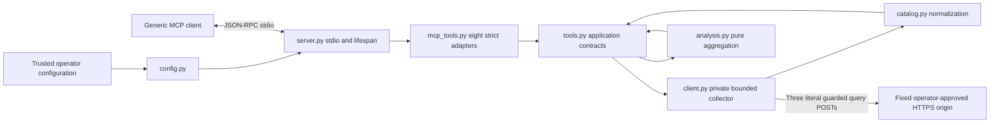

# Architecture

## Scope and module ownership

NetOne MCP is one process serving MCP over stdio. It has no inbound HTTP
server, database, persistent cache, background synchronization or LLM.
The implementation deliberately uses a direct deterministic pipeline rather
than a framework or graph without a consumer.

The diagram's analysis path is application-only, not an MCP registration.
The authoritative current [tool list](../README.md#sprint-9-mcp-interface)
and [method/route/body matrix](api-capabilities.md#current-implementation-matrix)
are separate from future candidates and historical observations.

| Module | Responsibility | Must not own |
|---|---|---|
| config.py | Explicit root dotenv/process loading, immutable Settings, safe validation | Import-time file I/O, network, tool-selected configuration |
| server.py | Startup validation, safe stderr logging, stdio and lifespan | Commercial matching, startup ERP query |
| mcp_tools.py | Closed eight-entry registry, strict schemas, fixed protocol errors, structured/text equivalence | Generic dispatch outside registry, credentials, new HTTP filters |
| tools.py | Input validation, bounded searches/exact selection/listing, analytical consumers | Arbitrary HTTP, persistence, inferred commercial facts |
| client.py | Token header, literal destination guard, request construction, streaming, pagination and cleanup | Login, mutation, arbitrary URLs/headers/bodies |
| catalog.py | Immutable normalized records, exact Decimal JSON, collection evidence | Price/stock joins, timezone or missing-value inference |
| analysis.py | Typed identity universe and pure metrics | I/O, LLM, unit/deposit sums or global claims from samples |

## Lifecycle and request flow

1. Importing application modules performs no configuration I/O. `main()`
   explicitly calls `load_config()` before starting stdio. The root dotenv
   location is beside config.py, not the MCP client's working directory.
2. `create_server(settings)` binds one private NetOneClient to each lifespan.
   Construction, initialize and tools/list do not query the ERP.
3. tools/call resolves an explicit registry entry. Pydantic rejects coercion
   and extra fields; application validation adds blank/Unicode/effective-cap
   checks. Tool arguments cannot select configuration or transport.
4. One bounded collection constructs its internally selected query body.
   The mandatory request hook checks method, origin, Host and literal path.
   Products may use one admitted ID or commercial-mask filter. Canonical numeric
   price/stock IDs use closed singleton filters (idsProdutos/idsReduzidos).
   Legacy noncanonical text stays exact/local with explicit lookup_strategy;
   no input normalization or fallback after failure. Stock array selection is
   provisional under DEC-038; supplier schema disagreement is not resolved.
5. Each page is streamed under byte/time limits, parsed without float
   intermediates and normalized atomically. Contradictory metadata or another
   identity in an ID-filtered page rejects that page. Prior valid data survives
   later failures as partial.
6. Application matching preserves errors and provenance. Analytical consumers
   additionally prepare exact reduced identities, excluding entire conflicting
   groups from metrics while preserving source items.
7. MCP returns structuredContent and equivalent compact JSON text. Application
   status error sets isError=true; partial/not_found remain valid results.
8. Cancellation propagates. Response/client cleanup is shielded and bounded
   independently to one second. A timed-out close is not proof of resource
   release; a closed flag is not completion evidence.

## Collection and result invariants

- Fixed-size pages begin at one by default; DEC-037 listings accept a strict
  start_page for stateless blocks. Consumers reconcile metadata and identities
  across calls; local block completion/terminal suffix is not full traversal.
  Row budgets count received rows before
  deduplication, including nonmatches. No shrinking the next page to fit a
  residual budget or stopping at the first match.
- Search inspection and output caps are distinct. Output cuts preserve
  collection_complete but set partial and clear complete_dataset.
- Exact identifiers retain zeros, spaces, punctuation and case. Commercial
  mascara, technical codigoSku, product ID, reduced ID and EAN are distinct.
- Decimal values serialize as exact strings. Missing/null/blank/zero/false
  are not interchangeable. missing_fields records absent projected source keys.
- Stock conflict groups use reduced_id alone; optional/missing product_id
  cannot hide inconsistent balances behind separate identities. Conflicting
  source rows remain partial without summation. Products/prices retain their
  (product_id,reduced_id) grouping.
- Provider-visible traversal completeness does not prove ERP-wide coverage,
  stable snapshot, stock freshness, deposit identity or semantic coverage.
- Analytics distinguish collection completeness, analytical completeness and
  metric sufficiency. The default low-stock threshold3 is a local rule.

## Boundaries and evidence

[Security](security.md) describes controls and their limits. [Configuration](configuration.md)
describes process ownership and defensive ceilings; none are provider quotas.
[Runbook](runbook.md) separates synthetic regression, historical bounded ERP
observations and future operational acceptance. Eight MCP tools are implemented;
technical SKU, expanded lexical search and two analyses remain application-only.
No architecture diagram or successful mock grants permission for a real query.
